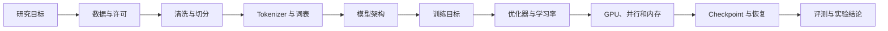

# 序章：为什么要从零训练一个基模

## 这一章要解决什么问题

在开始写数据清洗代码之前，我们先回答一个更大的问题：为什么要训练一个 base model，以及训练一个 base model 到底需要哪些部分。

本书的目标不是把一个 Transformer 类写出来，而是建立一条完整、可解释、可复现的训练链路：从原始数据开始，经过 tokenizer、模型、训练目标、优化器、GPU 运行时和评测，最后得到可以继续做 SFT、推理和架构研究的基模。

## 为什么训练基模

基模通过大规模 next-token prediction 学习语言、代码或其他序列数据中的统计规律。它是后续能力的起点：

```text
预训练基模
    ↓
监督微调（SFT）
    ↓
偏好优化 / RL / Agent 训练
    ↓
部署与应用
```

从零训练基模有四个研究价值：

1. **控制数据**：可以明确知道模型学到了什么，检查数据许可、污染和分布；
2. **控制 tokenizer 和架构**：可以研究词表、注意力、TTT、MoE 和 Loop 的影响；
3. **建立可复现基线**：后续改动有明确的控制组，而不是只比较别人已经训练好的权重；
4. **理解系统成本**：知道参数、tokens、显存、通信和吞吐之间的关系。

训练基模的代价也很高。正式规模需要大量数据、GPU、存储、监控和长时间稳定运行。因此本书先用 tiny 和小规模配置建立证据，再进入 125M、760M、MoE 和更大规模实验。

## 一个训练系统由什么组成

本章的主图由 `figures/ttt_training_overview.tex` 绘制。它用数据、Tokenizer、基模、TTT-E2E 和证据五个阶段概括整本书的实验主线；图内的虚线表示外循环和内循环分别更新不同状态。



| 部分 | 要回答的问题 | 本书对应内容 |
|---|---|---|
| 研究目标 | 想比较什么，成功标准是什么 | 序章、实验协议 |
| 数据 | 模型从什么分布中学习 | 数据清洗、数据契约 |
| Tokenizer | 文本如何变成 token ID | 词表和特殊 token |
| 模型 | token 如何变成隐藏状态和 logits | Transformer、TTT、MoE |
| 训练目标 | 什么叫预测正确 | next-token loss、mask |
| 算法 | 参数如何更新 | 内循环、外循环、AdamW |
| 算力 | 如何把计算放到设备上 | JAX、mesh、专家并行 |
| 工程 | 中断后如何继续 | checkpoint、数据指纹、环境摘要 |
| 评测 | 结果是否支持研究结论 | loss、长上下文、消融、scaling |

这些部分是相互耦合的。词表大小会改变 embedding 和分类头，序列长度会改变显存和注意力成本，MoE 会改变专家通信，内循环会改变反向传播和检查点需求。因此后面的章节会按照依赖关系推进。

## 本书的运行示例

全书使用一条逐步扩展的实验线：

```text
tiny dense baseline
    ↓
标准 Causal LM
    ↓
TTT 内循环
    ↓
MLP′ 与注意力变体
    ↓
MoE 与专家并行
    ↓
消融、Scaling 和长上下文
```

每次只改变少量因素，并保存：

- Git commit；
- 完整配置；
- 数据 manifest 和 SHA256；
- tokenizer 和特殊 token；
- Python、JAX、驱动和 GPU 信息；
- 训练日志和检查点；
- 验证报告和失败原因。

## 主线和前沿线

稳定主线从数据开始，依次建立 baseline、TTT-E2E、MoE、消融和 Scaling。当前热点放在 [Frontier Lab](../frontier/index.md)：TTT 与线性注意力的关系、TTT-E2E 长上下文、Looped Transformer 和 TTT × Loop。

前沿专题可以快速更新，但必须使用主线已经固定的数据、训练和评测协议。这样热点实验有控制组，也不会把未经验证的论文主张直接写成最终结论。

## 这一章的结果

读完序章后，应该能够画出一个从原始文本到实验结论的训练系统图，并知道后面的章节分别填补哪一块。

下一章从数据契约开始：先规定样本格式、许可信息、清洗统计和数据版本，然后再写清洗代码。
