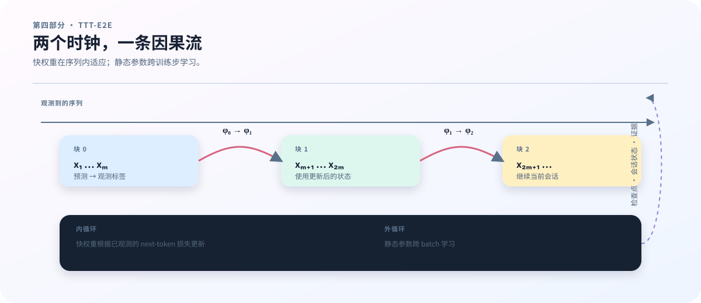

# 16　前向顺序：一个 token 如何穿过 TTT-E2E

## 先不要从 kernel 读模型

TTT-E2E 看起来包含很多新名词：prefix、suffix、fast weights、inner loss、MLP′、KV cache。最稳妥的读法不是先看 JAX scan 或 grouped GEMM，而是拿一个 token，沿着残差流走一遍。

模型首先把 token ID 查成 embedding。随后每一层将隐藏状态送进 attention 或 gated delta，再送入 MLP。后段层可能多一条 fast MLP′。最后的 hidden state 经过归一化和词表投影得到 logits。

~~~text
token ids
   ↓
embedding
   ↓
attention / gated delta + residual
   ↓
fast MLP′ + residual     （选择的后段层）
   ↓
static MLP or MoE + residual
   ↓
final norm → lm_head → logits
~~~

每个箭头都是形状、mask、cache 和梯度的接口。将 MLP′ 放在普通 MLP 前后，得到的算法并不相同；将更新发生在 token 内、chunk 末尾或下一个 chunk，状态语义也不同。

<figure class="book-figure">
  
  <figcaption><strong>图 3　TTT 的两个时间尺度。</strong> 每个 chunk 先用当前快权重预测，再用已观测标签更新 \(\phi\)；\(\theta\) 则跨 batch 由外循环更新。</figcaption>
</figure>

## 当前代码的前向顺序

`TTTE2EForCausalLM._block` 先执行 attention branch。若层类型是 full_attention 或 sliding_attention，则调用 attention；若是 gated_delta，则调用递归状态更新。输出加回 hidden，形成 attention residual。

若参数中包含 fast_mlp，代码取当前 fast weight 初始化的 MLP′，对 hidden 做 norm、SwiGLU 和可选 post norm，再加回 residual。之后才执行普通 MLP 或 MoE 分支。

这意味着当前实现的概念顺序是：

~~~text
Attention / Delta
→ Fast MLP′
→ Static MLP or MoE
~~~

这与“用 MLP′ 替换原 FFN”不同。普通 FFN 仍然存在，MLP′ 是附加的适应路径。若 fast weights 不存在，配置和参数树也不会凭空生成一条快路径。

## Prefix 与 suffix 的作用

配置将层分成 prefix 和 suffix。prefix 一次性运行静态层，产生每个位置的 hidden；suffix 使用这些 hidden 和可更新快权重继续计算。

这种划分减少了内循环需要重复的计算，但也带来一个约束：prefix 的 cache 和 hidden 必须与 suffix 的位置、mask 对齐。后缀不是一段独立文本，它接收的是同一序列中对应位置的表示。

`sequence_loss` 先补齐输入，并运行 <code>model.prefix</code> 得到隐藏表示，再将表示按 <code>ttt_chunk_size</code> 分块。suffix 在 scan 中逐块处理。快权重从 <code>initial_fast_weights(params)</code> 开始；完整块完成后，下一块使用它的更新结果。尾块不足完整长度时仍对真实目标评分，但整块不提交快权重更新，真实尾部目标也不例外；这与流式路径等待完整块的规则一致。

## 为什么快权重不是普通参数

普通参数由外循环 AdamW 更新，跨 batch、跨训练 step 保存。快权重在一个序列内由 inner loss 更新，可以在下一个 chunk 变化；是否跨 request 保留，则由 runtime session 决定。

可以用两个时间索引区分：

$$
\theta_{k+1}=\mathrm{AdamW}(\theta_k,\nabla_\theta \mathcal{L}_{\mathrm{outer}}),
$$

$$
\phi_{c+1}=\phi_c-\eta_{\mathrm{inner}}
\nabla_\phi \mathcal{L}_{\mathrm{inner}}(\theta,\phi_c;X_c,Y_c,M_c).
$$

\(k\) 计数外循环训练步，\(c\) 计数序列内的完整更新块；\(X_c,Y_c,M_c\) 是该块的输入、目标和 mask。这里先写普通梯度下降形式，实际更新还有梯度裁剪，下一章展开。静态参数 \(\theta\) 包含 MLP′ 的可学习初值，<code>initial_fast_weights(params)</code> 从中取出 \(\phi_0\)。这个初值参与外循环训练；随后产生的 \(\phi_1,\phi_2,\ldots\) 是序列或会话状态，不写回全局 AdamW 参数。不能把“初值参与训练”和“会话中的适应值属于优化器”混为一谈。

## 梯度边界和因果性

一个安全的内循环顺序是：

~~~text
使用当前 fast state 预测一个块的目标
→ 等待该块全部目标可观测，计算 inner loss
→ 提交新的 fast state
→ 下一块使用新状态
~~~

如果当前预测的标签已经被用于修改产生该预测的状态，模型就得到了未来信息。因果性测试应修改较晚位置的 token，再比较它之前所有位置的 logits；较早预测不能因为未来标签改变。这里“较早/较晚”指时间位置，与前面按层划分的 prefix/suffix 是两个不同的轴。

当前 <code>inner_step</code> 对 fast weights 使用 <code>jax.value_and_grad</code>，再调用 <code>sgd_update</code>；外循环继续对 <code>sequence_loss</code> 求导，计算图可穿过内更新，产生二阶导数项。<code>jax.checkpoint</code> 通过重算节省内存，不会自动截断这条梯度。若要做一阶近似，需要显式指定哪些导数路径被截断，不能把重计算误称为一阶算法。

## 一个手算的 chunk 例子

设 sequence length 为 8，chunk size 为 4。下面的 0–7 是代码数组索引；按全书记号，数学位置对应 \(1\)–\(8\)。代码中的输入索引 0–7 被分成两块：

~~~text
chunk 0: positions 0,1,2,3
chunk 1: positions 4,5,6,7
~~~

chunk 0 使用 $\phi_0$ 产生 $\mathcal{L}_0$，并更新成 $\phi_1$。chunk 1 使用 $\phi_1$ 产生 $\mathcal{L}_1$。另设序列只有 6 个目标位置：最后一块有 2 个真实目标和 2 个 padding。两个真实目标仍计入 loss；padding 的 mask 为 0。由于该块未满，当前实现保留整个旧快权重 \(\phi_1\)，不提交这两个真实目标产生的更新。

这个例子解释了为什么 chunk size 不是单纯的 batch 参数。它改变了快权重观察上下文的频率，也改变了内循环反向传播和 cache 的边界。

## 如何验证前向不是“形状正确但语义错误”

至少做四种检查：

1. 分别核对无 fast MLP 的 dense 模型和保留模块但关闭更新的 C；二者结构不同，不要求 logits 相等；
2. 修改某个较晚 token 后，它之前所有位置的 logits 不变；
3. 完整序列前向与 prefill/decode 的输出在容忍范围内一致；
4. 把 chunk size 改变时，明确记录这是算法变量还是仅实现变量。

这些检查是验证目标，不全由一条脚本覆盖。下面列出当前 GPU 脚本真正执行和记录的内容；其他对照应有独立证据。

## 一个 token 的 shape walk

用 tiny 配置的 \(d=16\)、\(V=259\)、batch \(B=1\) 和位置数 \(L=4\) 走一遍：

| 阶段 | 教学对象 | 批量形状 | 读者要检查的事实 |
|---|---|---|---|
| 输入 | <code>input_ids</code> | \([1,4]\) | 每个整数在 \([0,259)\) |
| embedding | hidden | \([1,4,16]\) | token ID 变成残差向量 |
| attention/delta | residual | \([1,4,16]\) | 只读取允许的历史位置 |
| MLP′ | fast branch | \([1,4,16]\) | 中间宽度可变，输出回到 16 |
| 输出 | logits | \([1,4,259]\) | 每个位置有 259 个候选分数 |

这张表描述批量计算的概念布局。当前模型 <code>forward</code> 处理单序列 <code>input_ids</code>，输入形状为 \([L]\)，内部 hidden 为 \([L,d]\)，logits 为 \([L,V]\)；训练代码在外层用 <code>jax.vmap</code> 加上 batch 轴。表中的 \([B,L]\) 不能直接传入这个单序列接口。

## 一个可计算的因果性断言

对一个包含 4 个输入位置的序列，用同一初始参数和 mask 跑两次，只把输入索引 3 的 token 从 18 改为 19。索引 0、1、2 都在改变位置之前，因此三者的 logits 都必须不变。以单序列输出 <code>[L,V]</code> 为例，概念上的断言是：

~~~text
max_abs_diff(logits_a[0:3, :], logits_b[0:3, :]) <= tolerance
max_abs_diff(logits_a[3:, :], logits_b[3:, :]) may be > 0
~~~

这里 <code>max_abs_diff</code> 是“取逐元素差的绝对值再取最大值”的说明性记法，不是仓库 API。第一行失败意味着未来信息影响了较早预测；只有从索引 3 开始才允许变化。容差应与 dtype 及比较方式一起声明，不能为通过测试而任意放宽。

## 本章最小验证

在远端 GPU 节点运行 <code>bash scripts/validate_gpu.sh outputs/gpu-validation.json</code>。它执行 <code>ttt/validate.py</code> 中内置的 tiny 用例，不会读取上一章的 C/F 配置文件。每个用例检查 loss/梯度有限性，对比 <code>sequence_loss</code> 与 <code>TTTSession.observe</code>，并通过断言检查未来 token 扰动的因果性。

成功报告的顶层是 <code>environment</code>、<code>passed</code>、<code>cases</code>。每个 case 有 <code>name</code>、<code>tokens</code>、<code>loss</code>、<code>finite_gradients</code>、<code>logits_max_error</code>、<code>compilation_seconds</code>、<code>training_seconds</code>、<code>state_bytes</code> 和 <code>inner_updates</code>。其中 <code>logits_max_error</code> 是序列/流式差异，不是单独的因果误差字段。失败报告包含 <code>passed=false</code>、异常类型、消息和环境信息。

脚本不输出完整配置、mask、初始参数、state shape 或恢复比较；用例设定与随机 seed 在源码中，必须保存源码版本才能追溯。它要求至少一个可用 GPU，并不验证特定 GPU 型号或多卡数量。恢复实验见第 3 章。一次 tiny 验证只覆盖实际列出的组合；下一章将进一步解释内循环与外循环的梯度如何连接。

## 本章小结

- 前向顺序决定每条残差路径看到的输入和状态；
- fast weights 的初值参与外循环训练，适应后的值属于序列/会话状态；
- prefix/suffix、chunk 和 mask 必须使用同一位置坐标；
- 因果性要通过修改未来 token 的数值断言验证；
- 下一章把这里的状态转移展开为 inner 与 outer 两条梯度路径。
