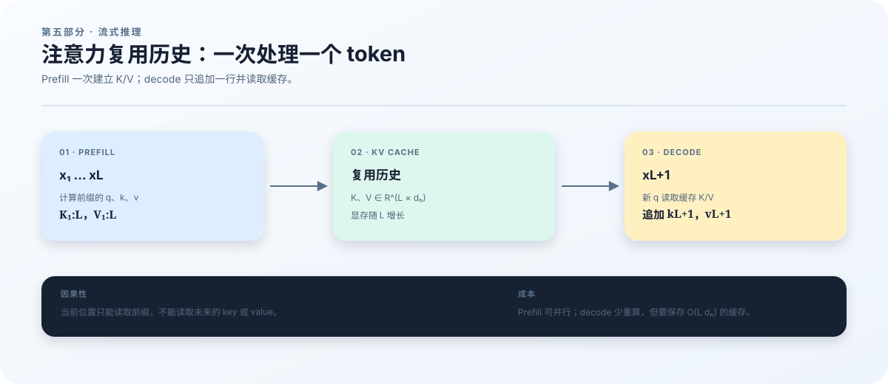

# 18　Attention、Cache 与流式推理

## 为什么生成一句话需要保存状态

上一章已经回答了快权重何时更新。现在把运行方式从“一次处理整段文本”换成“逐个接收 token”。假设模型已读到“今天的天气”，正在预测下一个词；得到新 token 后，它需要结合整个已知前缀继续预测。如果每来一个 token 都从头计算，历史词语的 key 和 value 会被反复计算。KV cache 把这些中间结果保存下来，换取较少的重复计算。

本章继续使用隐藏宽度 \(d=16\)、TTT chunk 长度 \(C=4\) 的 tiny 案例。我们先用更小的二维向量手算 attention，再追踪一个 session 从 \(x_1\) 到 \(x_6\) 的变化。读者需要知道矩阵乘法和 softmax；下面会把它们在 attention 中的作用连起来。目标不是记住“prefill 快、decode 慢”，而是能够说明每一步读哪些历史、写哪些状态、为什么不能读取未来。

<figure class="book-figure">
  
  <figcaption><strong>图 4　从整段计算到逐 token 计算。</strong> 沿着新 token 的箭头追踪查询，再沿历史箭头找它可读取的 key/value。图展示缓存的用途；真实 TTT session 还必须保存快权重、位置和未完成的 chunk。</figcaption>
</figure>

## 从“找相关内容”到两个位置的手算

Attention 可以理解为一次带权检索。当前位置先生成一个 query，表示“我需要什么”；历史位置生成 key，表示“这里有什么”；value 是检索后真正传递的信息。三者都由可学习的线性变换得到，而不是人为填写的语义标签：

$$
Q=HW_Q,\qquad K=HW_K,\qquad V=HW_V.
$$

这里 \(H\in\mathbb R^{L\times d}\) 是一条序列的 hidden states，\(L\) 是长度；在一个 attention head 中，\(Q,K\in\mathbb R^{L\times d_h}\)。内积 \(q_t^\top k_s\) 衡量查询与候选 key 在当前表示空间中的匹配程度。除以 \(\sqrt{d_h}\) 是为了控制内积随维度增长的尺度：若各分量独立、零均值且方差为 1，则内积方差为 \(d_h\)，除后方差为 1。这是尺度分析，不是训练后的 query/key 必然服从该分布的承诺。

取 \(L=d_h=2\)，并给出已经投影好的矩阵：

$$
Q=\begin{bmatrix}1&0\\1&0\end{bmatrix},\quad
K=\begin{bmatrix}1&0\\0&1\end{bmatrix},\quad
V=\begin{bmatrix}10&0\\0&10\end{bmatrix}.
$$

尚未加 mask 的分数是

$$
S=\frac{QK^\top}{\sqrt2}
=\begin{bmatrix}0.7071&0\\0.7071&0\end{bmatrix}.
$$

语言模型中的位置 1 不能读取位置 2。否则模型在预测下一个 token 时，可能直接从未来输入中看到答案。因果 mask 是加在分数上的矩阵；对合法位置加 0，对不合法位置加负无穷：

| 查询位置 \ 历史位置 | \(s=1\) | \(s=2\) |
|---|---:|---:|
| \(t=1\) | \(0\)：可读取 | \(-\infty\)：未来 |
| \(t=2\) | \(0\)：可读取 | \(0\)：可读取 |

用 \(\mathcal M\) 表示这里的 attention 加性 mask，以区别数据章节的 loss mask。逐行做 softmax，得到权重 \(A\) 和输出 \(O\)：

$$
\mathcal M=\begin{bmatrix}0&-\infty\\0&0\end{bmatrix},\qquad
A=\operatorname{softmax}_{\rm row}(S+\mathcal M)
=\begin{bmatrix}1&0\\0.6698&0.3302\end{bmatrix},
$$

$$
O=AV=\begin{bmatrix}10&0\\6.698&3.302\end{bmatrix}.
$$

位置 1 的输出完全来自第一个 value；位置 2 混合了两个 value。这里保留对角线是正确的：输入位置 \(t\) 的表示包含 \(x_t\)，用于预测 \(x_{t+1}\)。不能把“看见当前位置”误认为“看见预测标签”。这一缩放点积与因果 mask 形式来自 [Transformer 的原始定义](https://arxiv.org/abs/1706.03762)。

## KV cache 保存什么，又没有保存什么

在普通 causal attention 中，生成新 token 时只需要计算它自己的 \(q,k,v\)，并把新的 \(k,v\) 追加到缓存。历史 key/value 保留，新的 query 与当前可见的历史 key 比较。KV cache 不保存新的可学习参数，也不能替代模型权重。

为便于估算，批量推理常用概念布局 \([B,n_{\rm kv},L,d_h]\)，其中 \(B\) 是 session 数，\(n_{\rm kv}\) 是 KV head 数。但本仓库的 <code>KVCache</code> 面向单个 session，实际 key/value 布局是 \([\text{capacity},n_{\rm kv},d_h]\)，另有长度为 capacity 的 positions 数组。把概念布局直接写进断言会把正确代码误判为错误。

若 key/value 每元素占 \(b\) 字节，所有层长度与 head 配置相同，仅 KV 数据的估算为

$$
M_{\rm KV}=2B\,n_{\rm layers}\,n_{\rm kv}\,L\,d_h\,b.
$$

例如 \(B=1\)、\(n_{\rm kv}=2\)、\(L=4096\)、\(d_h=64\)、\(b=2\)，每层为 \(2{,}097{,}152\) 字节，即 \(2\) MiB；12 层合计 \(24\) MiB。这不包括权重、快权重、激活、临时 workspace、positions 与分配器开销。若使用 grouped-query attention，多个 query head 共享较少的 KV heads，公式应代入 KV head 数，不能代入 query head 数。

还要区分三个长度：已观察 token 数、已分配 cache capacity、当前 attention 可见窗口。它们可能不同。<code>TTTSession</code> 会增长缓存容量，sliding attention 则通过位置与 mask 限制可见历史。窗口限制不能直接证明分配器只占用“窗口长度乘每 token 字节数”的显存；具体内存应查看实际数组与设备统计。

## Prefill 和 decode 必须遵守同一条时间线

Prefill 表示处理一个已经给定的前缀，decode 表示处理随后到来的单个 token；它们描述的是调用方式，不是两套因果规则。本仓库 <code>prefill</code> 与 <code>decode</code> 最终都走 <code>observe</code>。对同一 token 序列，分几次提交不应改变其预测和更新语义。

继续上一章 \(C=4\) 的例子。四个输入 \(x_1,x_2,x_3,x_4\) 的预测标签是 \(x_2,x_3,x_4,x_5\)。因此读完 \(x_4\) 时，最后一个标签仍未到达。下面假设启用内循环并且存在快权重；缓存栏说的是有效历史，具体分配容量可能更大。

| 调用完成后 | position | pending_count | 待更新标签 | fast weights | updates | 有效缓存 |
|---|---:|---:|---|---|---:|---|
| reset | 0 | 0 | 无 | \(\phi_0\) | 0 | 无 |
| prefill \(x_1,\ldots,x_4\) | 4 | 4 | \(x_2,x_3,x_4\) | \(\phi_0\) | 0 | \(x_1,\ldots,x_4\) |
| decode \(x_5\) | 5 | 1 | 无 | \(\phi_1\) | 1 | \(x_1,\ldots,x_5\) |
| decode \(x_6\) | 6 | 2 | \(x_6\) | \(\phi_1\) | 1 | \(x_1,\ldots,x_6\) |

收到 \(x_5\) 时，程序先用它补齐前一 chunk 的标签并完成更新，然后用 \(\phi_1\) 处理 \(x_5\)，预测 \(x_6\)。这没有让 \(x_5\) 泄漏进对 \(x_5\) 的预测：那个预测已经在处理 \(x_4\) 时完成。第 3 行中的“无”只表示新 chunk 尚无已知目标，并不是模型没有看到 \(x_5\)。

历史 suffix cache 可能由较早的快权重产生。本实现保留这些结果，不在每次更新后重新编码整个历史。因此，“拿最新 \(\phi\) 从头运行整段文本”不必与 session 相等。应比较的是遵守相同 chunk 边界和历史缓存规则的 <code>sequence_loss</code> 与 <code>TTTSession</code>。两者一致才说明批处理路径和流式路径实现了同一个算法。

## 一个 session 是一组共同演化的状态

仅保存 KV cache 不足以恢复 TTT 推理。下面这些字段共同决定下一次调用的结果：

| 状态 | 为什么需要 |
|---|---|
| fast_weights | 决定当前适应后的计算 |
| cache、position | 决定可见历史、位置编码与写入位置 |
| pending_features、pending_targets、pending_count | 重建尚未完成的内循环训练样本 |
| chunk_cache、chunk_start | 保留当前 chunk 开始时的 suffix 历史 |
| last_logits | 继续使用最近一次 next-token 分布 |
| updates、rng_key | 保持更新计数与随机过程一致 |

<code>ttt/session_store.py</code> 把数组和元数据一起保存。加载时检查模型版本、模型配置、内循环设置、数组形状与 dtype、token 范围、位置和 chunk 边界。其格式版本为 2，并且恢复到本机第一张设备。这是具体实现约束，不是一个支持任意模型版本或任意分片拓扑的通用格式。

若要检查恢复正确性，应该在 chunk 中间保存，再把同一后缀分别交给原 session 和恢复后的 session，比较 logits、快权重、更新次数和位置；还应覆盖恰好等满 chunk 但最后标签未到达的状态。仓库已有 <code>tests/test_session_store.py</code> 和 <code>tests/test_runtime_consistency.py</code>。单卡验证脚本不调用前者，不能用它的通过状态代替 session 恢复测试。

## 从实现位置走到可检查的证据

| 问题 | 代码位置 |
|---|---|
| key/value 的布局、RoPE、因果与窗口 mask | <code>ttt/models/ttt_e2e/attention.py</code> |
| prefill/decode、标签到达与 chunk 完成 | <code>ttt/runtime.py</code> |
| 按 chunk 计算的训练参照路径 | <code>ttt/inner_loop.py</code> |
| session 保存及加载检查 | <code>ttt/session_store.py</code> |
| GPU 上的因果性与流式一致性检查 | <code>ttt/validate.py</code> |

完成环境章节的安装后，在远程 GPU 机器的仓库根目录运行以下命令。此处不要求在本地电脑运行测试。

~~~bash
bash scripts/validate_gpu.sh outputs/ch18/validation.json
~~~

成功时生成 <code>validation.json</code> 与同目录的 <code>environment.json</code>；前者的顶层 <code>passed</code> 为 true。每个 case 包含 <code>logits_max_error</code> 和 <code>inner_updates</code>。脚本将整段输出与流式输出比较，最大绝对误差需小于 \(10^{-3}\)；它还修改后半段 token，检查前半段 logits 在指定容差内不变。后者直接对应二维例子中“位置 1 不能读取位置 2”的原则。

若流式差异失败，先检查 token 提交顺序、chunk 标签偏移和更新时点；若只在跨窗口或缓存扩容后失败，再检查 positions、capacity 和 mask。若尚未进入 case 就报 CUDA 错误，先检查环境报告与 JAX 设备识别。该命令不验证 session 磁盘恢复，不覆盖任意长度和所有 attention backend，也不证明模型有更好的语言能力。

本章完成了从 attention 公式到 session 时间线的闭环。下一章会把同一个 hidden state 交给多个候选专家：除了读什么历史，还需要回答“由哪一组参数处理这个 token”。
