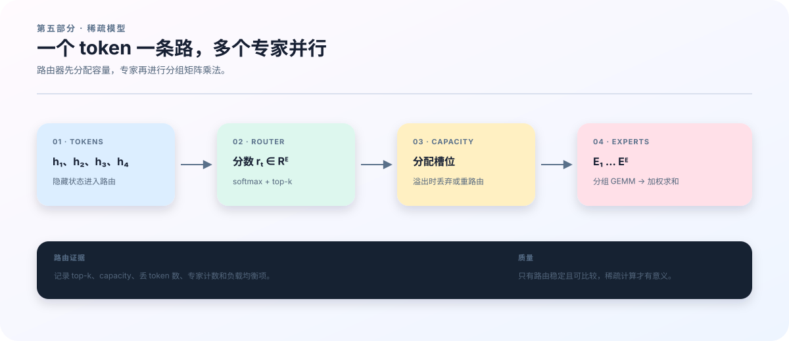

# 19　MoE：路由把模型变成一条动态计算图

## 为什么“复制 FFN”不是 MoE

如果把一个 FFN 复制八份，然后每个 token 都执行八份，参数量增加了，激活计算也增加了，这只是更大的 dense 模型。MoE 的关键是 router 根据 hidden state 选择少数专家，使总参数容量和每 token 的激活计算分离。

一个 token 的动态路径是：

~~~text
h
  ↓ router logits
  ↓ top-k expert ids and gate weights
  ↓ token dispatch
  ↓ expert FFN
  ↓ restore original order
  ↓ weighted sum + residual
~~~

任何一步出错都可能保留相同 shape，却改变模型。比如 token dispatch 后没有正确恢复原顺序，loss 仍然会是一个有限数字，只是每个位置接收了别人的专家输出。

<figure class="book-figure">
  
  <figcaption><strong>图 5　MoE 路由。</strong> 路由器、容量和专家分组共同决定每个 token 的动态计算路径；实验报告必须记录路由统计。</figcaption>
</figure>

## Router 的数学对象

设有 \(E\) 个专家，router 为位置 \(t\) 产生 \(r_t\in\mathbb{R}^{E}\)。softmax 得到所有专家的概率：

\[
p_{t,e}=\frac{\exp(r_{t,e})}{\sum_{j=1}^{E}\exp(r_{t,j})}.
\]

top-k 只保留分数最高的 \(k\) 个专家，得到集合 \(S_t\) 和重新归一化后的权重 \(g_{t,e}\)。稀疏专家输出为：

\[
y_t=\sum_{e\in S_t}g_{t,e} f_e(h_t).
\]

这里的 \(f_e\) 是第 \(e\) 个专家 FFN。router 概率决定“想去哪里”，top-k 决定“实际去哪里”，权重决定多个专家的结果如何合并。

## 四个 token 的手算路由

用两个专家 \(E_1,E_2\) 和 top-1 做一个最小例子。四个 token 的 router 概率如下：

| token | \(p(E_1)\) | \(p(E_2)\) | 选择 |
|---|---:|---:|---|
| \(t_1\) | 0.80 | 0.20 | \(E_1\) |
| \(t_2\) | 0.70 | 0.30 | \(E_1\) |
| \(t_3\) | 0.40 | 0.60 | \(E_2\) |
| \(t_4\) | 0.30 | 0.70 | \(E_2\) |

dispatch 后，\(E_1\) 收到 \(t_1,t_2\)，\(E_2\) 收到 \(t_3,t_4\)。两个专家分别执行自己的 FFN，再按原 token 顺序恢复：

~~~text
E1 receives t1 and t2, then returns f1(t1) and f1(t2).
E2 receives t3 and t4, then returns f2(t3) and f2(t4).
restore returns [f1(t1), f1(t2), f2(t3), f2(t4)].
~~~

如果恢复时把第二项和第三项交换，张量 shape 仍然是四行，但每个位置拿到的内容已经错位。这就是必须单独检查 token index 和 restore order 的原因。

## 负载均衡辅助损失

仓库统计每个专家接收的 token 负载。设 \(f_e\) 是实际被 top-k 选中的 token（含 mask 权重）占比，\(p_e\) 是所有 token 的平均 router 概率，一个常见的辅助项是：

\[
\mathcal{L}_{\mathrm{aux}}
=
E\sum_{e=1}^{E} f_e p_e.
\]

在上面的均衡例子中，\(f=(0.5,0.5)\)，平均概率约为 \(p=(0.55,0.45)\)，因此：

\[
\mathcal{L}_{\mathrm{aux}}
=2(0.5\times0.55+0.5\times0.45)=1.
\]

若四个 token 全部被送到 \(E_1\)，则 \(f=(1,0)\)。即使平均概率是 \((0.7,0.3)\)，辅助项也变为：

\[
2(1\times0.7+0\times0.3)=1.4.
\]

这个更高的值表示路由偏向更严重。实际训练还要记录 z loss，它约束 router logits 的整体尺度；它与语言模型 NLL 和负载辅助项回答的是不同问题。

当前 <code>moe.py</code> 返回 <code>loads</code>、<code>aux</code> 和 <code>z</code>，<code>sequence_loss</code> 再将它们传给 <code>training.py</code>。报告中应分开记录，不能把所有数值合并成一个不透明的“MoE loss”。

## 容量、token drop 与当前实现边界

如果每一步有 \(T\) 个 token、\(E\) 个专家、top-k 为 \(k\)，常见容量上限可写成：

\[
C=\left\lceil \frac{T\,k}{E}\times\mathrm{capacity\ factor}\right\rceil.
\]

例如 \(T=4,E=2,k=1\)、capacity factor 为 1 时，\(C=2\)。均衡路由正好每个专家两个 token；如果四个 token 都去 \(E_1\)，\(E_1\) 只能接收两个，剩下两个要么被丢弃，要么转为 padding/备用路径，要么等待动态扩容。

token drop 可以限制显存和通信，但会让部分 token 没有经过完整专家路径；不允许 drop 可能增加 padding、通信或 OOM 风险。当前仓库的参考 <code>moe_forward</code> 根据 top-k 结果构造 grouped dispatch，没有实现一个独立的 capacity factor/drop 策略。因此本文的容量例子是系统设计边界，不能描述成当前代码已经支持的开关。

比较 dense 与 MoE 时，至少报告：

- 总参数和 active 参数；
- 每个 token 的 expert 数；
- expert token counts 的均值、最大值和分位数；
- drop 或 padding token 数（当前实现应明确为未启用或未统计）；
- all-to-all 时间；
- 每个设备的峰值显存。

只比较总参数会低估 MoE 的活跃成本；只比较 active 参数又可能忽略 checkpoint 和 optimizer 的存储。

## Grouped GEMM 的角色

专家计算通常希望把属于同一专家的 token 聚合成一组矩阵乘法。假设四个 token 的分组大小为 \([2,2]\)，每个 token 的隐藏维度是 \(d=16\)，那么 grouped GEMM 可以把前两行交给专家 1，把后两行交给专家 2，最后根据排序索引恢复原序。

<code>grouped_gemm.py</code> 提供参考路径和高阶实现路径，但 JAX、批处理和高阶导可能限制可用 kernel。需要区分：

**数学路径**：token 按专家聚合，计算 expert FFN，再按原顺序还原。

**参考实现**：便于验证，可能逐专家执行矩阵乘。

**优化实现**：减少 kernel launch 和 padding，可能对 shape 有更严格要求。

参考路径正确，不代表优化路径等价；性能报告也不能拿参考路径的时间声称优化 kernel 的吞吐。

## 专家并行和 mesh

<code>ttt/distributed.py</code> 使用 data/expert 轴表达 batch 与专家的设备布局。expert parallel size 改变专家参数和 token 的所在设备，all-to-all 通信成为每步计算的一部分。

例如两个设备各保存一个专家时，global hidden 可以是 \([4,16]\)，每个设备本地只看到自己负责的 token 子集和专家参数。若只打印 rank 0 的本地参数量，会把全局模型误判成一半大小；若恢复 checkpoint 时 mesh 不同，还可能把 shard 解释成错误的完整数组。

多卡验证需要检查全局和本地 shape、路由计数、通信时间和 restore 后的下一步。checkpoint 恢复也必须恢复到目标 mesh，而不是先拼成单卡数组再假设等价。

## 最小两卡实验

~~~bash
bash scripts/run_gpu_train.sh \
  --config configs/runs/mesh_tiny.json \
  --data outputs/sample-tokens.npy \
  --output outputs/mesh-tiny

bash scripts/validate_mesh.sh \
  outputs/mesh-validation.json \
  outputs/mesh-checkpoint
~~~

这不是性能结论，而是系统门槛：专家 shape、路由计数、通信、两步 loss 和 restore 后的下一步都要有记录。先用不丢 token 的小配置验证路径，再探索容量和 kernel 优化。

下一章建立消融矩阵，把 TTT、Loop、MoE 的质量与计算成本放进同一张实验表。
