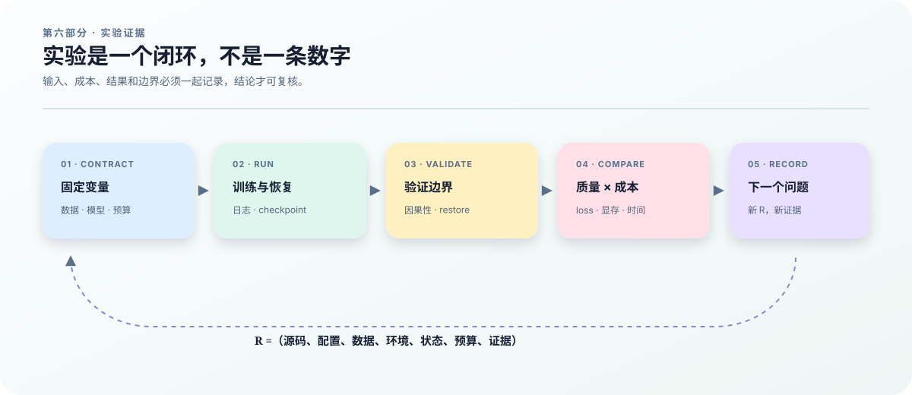

# 20　消融、成本与 Scaling：怎样知道收益来自哪里

## 从“跑出了结果”走到“回答了问题”

设两个训练作业都结束了，A 的验证 NLL 是 2.10，B 是 1.98。现在能说 B 的架构更好吗？还不能：B 可能读了更多数据、使用了不同 tokenizer，或者多花了一倍时间。一个实验首先需要可归因的问题，然后才需要结果。

本章把前几章的实现放进一个比较协议。核心问题是：同一架构启用测试时更新后，质量变化有多大，为此付出了什么成本？我们会先定义控制变量，再手算一张质量—成本表，最后说明配置生成器、profile 与 scaling 拟合分别能提供什么证据。需要的数学是平均数、方差和幂函数；每一步都给出具体含义。

<figure class="book-figure">
  
  <figcaption><strong>图 6　实验的闭环。</strong> 从问题开始，沿配置、运行、证据、判断走一圈。每一条结论都应能回到产生它的配置和测量，而不只是回到一个实验名称。</figcaption>
</figure>

## 一次只改变哪件事

前文的 <code>C2/F2</code>（或 <code>C4/F4</code>）对照中，两组保留相同的快 MLP 架构和初始参数，只改变内循环是否更新；名称中的数字表示 full-attention 层数。这样问的是“适应过程是否有效”。若把 C 组的 MLP′ 删除，参数量与前向函数都变化，问题就变成了“额外结构与更新的组合是否有效”，不能再把差异全部归因于更新。

建议先写下这张协议表，再提交训练。这里的“不变”包括具体文件和哈希，而不只是“都用同一数据集”的口头说明。

| 项目 | 更新消融中的约束 | 为什么影响归因 |
|---|---|---|
| tokenizer、词表、特殊 token | 相同版本与文件 | 改变预测任务和 token 数 |
| 数据划分、清洗、packing、mask | 相同 manifest 和采样规则 | 改变模型实际见到的分布 |
| 架构、初始化、精度 | 相同配置与种子 | 排除容量和初值差异 |
| batch、学习率、优化器、训练日程 | 相同，除非它本身是研究变量 | 改变优化过程 |
| 内循环开关 | 唯一主动改变项 | 定义本次处理变量 |
| 评估文本、上下文、状态重置 | 相同且明确 | 避免评估状态造成额外优势 |

初始化一致不意味着整条训练轨迹一致；启用更新会改变外循环梯度，后续静态参数当然可能分岔。控制的是起点与协议，不是强行让两组得到相同权重。评估也要独立说明快状态是否跨文档保留：重置状态的单文档性能与连续流适应性能是两个不同问题。

结构消融可以随后进行，例如去掉快 MLP、改变 suffix 深度、改变 attention 布局、开启 MoE 或重复块。每次变化都重新核算参数和成本；不能沿用最初那组配置的“125M”标签当作精确参数量。

## 用一张手算表同时看质量与成本

以下数字是**教学假设，不是仓库实验结果**。两组具有相同的 128M 参数，处理同样的 \(D_{\rm valid}=1{,}000{,}000\) 个有效目标 token，均不计编译与数据准备时间：

| 方案 | 内循环更新 | 验证 NLL | 稳态训练有效 token/s | 训练时间 | 峰值显存 |
|---|---|---:|---:|---:|---:|
| C | 关闭 | 2.10 | 20,000 | 50.0 s | 10 GiB |
| F | 开启 | 1.98 | 12,000 | 83.3 s | 13 GiB |

时间由 \(t=D_{\rm valid}/r\) 得到，例如 \(1{,}000{,}000/12{,}000\approx83.3\) 秒。相同 tokenizer、相同评估目标下，NLL 下降 \(0.12\) nat/token；对应 perplexity 比值为 \(e^{-0.12}\approx0.887\)。F 的单位 token 时间则是 C 的 \(20{,}000/12{,}000\approx1.67\) 倍。这张表支持“相同 token 预算下，质量改善伴随成本增加”的表述。

如果改为相同 50 秒预算，C 能处理一百万有效 token，而 F 只能处理约 60 万。表中的 1.98 来自 F 处理一百万 token 后，不能挪给 60 万 token 的模型。要回答同时间是否更好，需要实际评估那个较早的检查点。反过来，如果目标是达到某个 NLL，应比较两条学习曲线首次达到该阈值的时间，而不是只看最后一个点。

有效 token 数是 \(D_{\rm valid}=\sum_{k,b,t}m_{k,b,t}\)，不是简单的步数乘 batch 乘长度。padding、文档边界屏蔽或其他 mask 会让二者不同。报告同时保留“已调度位置数”和“参与 loss 的目标数”，才能解释同样 100 步为何训练信息量不一样。跨 tokenizer 的 per-token NLL 更不能直接比较；需要固定任务或引入按原始文本单位归一化的补充指标。

若约束是训练 FLOPs，设两组每个有效 token 成本为 \(f_C,f_F\)，相同预算要求 \(D_Cf_C\approx D_Ff_F\)。这里的成本必须对应真实的内循环、高阶求导、长度和 precision。只用 \(6ND\) 估算普通 dense 训练，无法自动覆盖 TTT 的更新轨迹、MoE 参考求导路径或长序列 attention 的额外开销。

## 为什么一个种子还不够

训练初值、数据顺序和硬件执行都可能造成波动。为了减少无关变化，可以按种子配对运行 C 和 F，再分析每一对的差值。假设三个配对种子给出 NLL 差值 \(-0.10,-0.12,-0.08\)，它们仍是教学数字：

$$
\bar\delta=-0.10,\qquad
s=\sqrt{\frac{(0)^2+(-0.02)^2+(0.02)^2}{3-1}}=0.02,\qquad
\operatorname{SE}(\bar\delta)=\frac{s}{\sqrt3}\approx0.0115.
$$

平均差描述观察到的收益；样本标准差描述种子间波动；标准误描述平均差估计的不确定程度，依赖样本近似独立等假设。三个种子远不足以证明对所有数据域或规模都稳定。不要仅凭这组数画一个没有说明假设的“95% 置信区间”，更不要把不同序列位置当作独立训练重复。

实验记录应保留每个种子的原始结果、失败作业和排除理由。若先看结果再挑选最有利种子，任何随后计算的均值都不再回答最初的比较问题。

## 生成实验配置，先检查它生成了什么

<code>ttt/experiments.py</code> 生成 dense、hybrid、TTT 及可选 MoE/Loop 消融配置。在已安装环境的远程机器、仓库根目录运行：

~~~bash
.venv/bin/python -m ttt.experiments \
  --output outputs/ch20/configs \
  --sizes 125m \
  --tokens 1000000 \
  --include-moe
~~~

预期得到 <code>outputs/ch20/configs/manifest.json</code> 和 <code>125m/</code> 下的各实验 JSON；标准输出也打印 manifest。查看 <code>experiments</code> 中的路径与 <code>scheduled_tokens</code>，以及 <code>pending</code> 中缺少成本测量的同 FLOPs 对照。由于训练步数向上取整，调度 token 数可能略大于一百万；它也不是 mask 后有效目标数。

这个命令只生成配置，不训练模型、不下载 tokenizer、不准备数据。默认实验配方引用 Llama tokenizer，后续训练前仍需验证访问权限、实际 tokenizer 文件与词表匹配。若输出不存在，先看命令的参数解析错误和输出目录权限；若同 FLOPs 对照仍在 pending，先补成本记录，而不是手工把状态改成完成。配置生成成功不能证明实验已经可训练或达到同算力条件。

成本输入按实验名记录 <code>training_flops_per_token</code>，并注明 <code>method</code> 为 <code>profiler</code> 或 <code>xla_estimate</code>。生成器用两组每 token 成本的比值调整基线步数。测量值必须来自对应配置，不能把 tiny 模型的单位成本套到 125M 配置。

## 推理 profile 与训练成本估计分别说明什么

若上一章的 tiny mesh 验证已经成功，它会留下真实检查点 <code>outputs/ch19/checkpoints/mesh-step-2.orbax</code>。以下命令沿用该检查点，并把上下文与生成长度限制为 \(8+4=12\)，小于其位置上限 16：

~~~bash
JAX_PLATFORMS=cuda .venv/bin/python -m ttt.profile \
  --checkpoint outputs/ch19/checkpoints/mesh-step-2.orbax \
  --context-length 8 \
  --decode-tokens 4 \
  --training-flops
~~~

标准输出是 JSON，包括 <code>parameters</code>、<code>prefill_seconds</code>、<code>decode_seconds</code>、<code>decode_tokens_per_second</code>、<code>state_bytes</code> 和 <code>inner_updates</code>；额外请求的训练估算字段是 <code>xla_estimated_training_flops</code> 与 <code>xla_estimated_flops_per_token</code>。这不是写入某个默认报告文件的命令，保存结果时应重定向到本次实验目录并记录命令与环境。

<code>profile_session</code> 先完整预热一次，再计时一次，且在读取时间前等待设备结果。它测量单 session 的 prefill 和逐 token decode，不是训练 tokens/s，也不是服务并发吞吐。<code>device_peak_bytes</code> 来自设备统计，可能为空，并且是进程范围的峰值，不是本次测量独占的显存增量。<code>parameters.fast_mlp</code> 是快权重初值子树的计数，已包含在 total 中，不能再次相加。

训练 FLOPs 字段来自编译图成本分析，不是硬件计数器实测，也不含完整数据输入、优化器、检查点保存的端到端成本；若后端没有提供统计，值可能为 null。若检查点不存在，先完成上一章验证；若长度越界，查检查点中实际配置；若估算缺失，保留缺失事实，不能填 0。当两组方法的编译图差别很大时，应同时记录这种估算和真实训练时间。

## Scaling 是可以被留出规模反驳的假设

单个规模的胜负不能自动外推到更大的模型。一个常用的经验模型把 loss 写成参数量 \(N\) 和训练目标数 \(D\) 的函数。本仓库 <code>ttt/scaling.py</code> 使用归一化变量：

$$
\widehat{\mathcal L}(N,D)
=L_\infty+
A\left(\frac{N}{10^6}\right)^{-\alpha}
+B_s\left(\frac{D}{10^9}\right)^{-\beta}.
$$

\(L_\infty\) 是拟合中的损失下限项；\(A,B_s\) 控制两项尺度；\(\alpha,\beta\) 控制随规模与数据量增长的下降速度。下标用于避免把系数 \(B_s\) 与 batch 大小 \(B\) 混淆；输出 JSON 保留代码中的键 <code>E</code>、<code>A</code>、<code>B</code>。把 \(N\) 翻倍使参数项乘 \(2^{-\alpha}\)，不是让总 loss 必然减半。这是对一组固定协议结果的经验拟合，不是关于所有架构的定理。

拟合器要求至少八条训练结果，至少覆盖三个不同参数规模和三个不同 token 量。每行输入必须提供 <code>parameters</code>、<code>tokens</code>、<code>loss</code>，可用 <code>held_out: true</code> 标出不参与拟合的规模。检查条件只核验数量和不同取值；研究者仍需设计交叉覆盖，避免“模型越大永远训练越久”使两种效应无法区分。

输出包含训练 RMSE、留出规模的预测和 bootstrap 区间。训练误差很小不代表外推可靠；bootstrap 重新采样现有观测，也不会自动涵盖数据污染、实现错误或模型形式错误。应先预留规模，再拟合，再比较留出误差；若需要反复换公式追逐留出点，应再设新的最终验证点。

本章没有把一组配置文件当作研究结论。结论需要质量、成本、重复运行和留出规模共同支持。下一章将把“有足够证据启动更大训练”的条件明确写出来。
