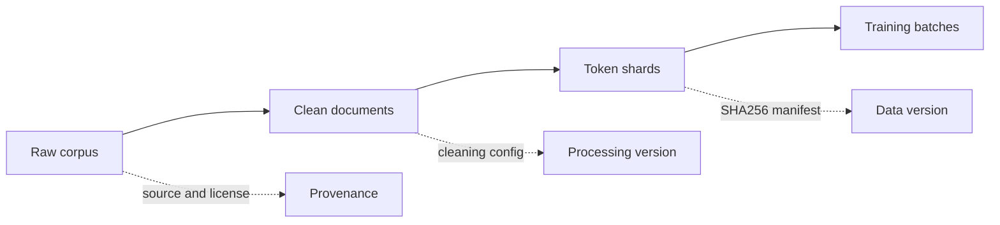

# 10. 训练数据：来源、格式与版本

## 从模型要学什么开始

训练基模的第一步不是创建 Transformer，而是决定模型将从什么数据分布中学习。

如果训练语料主要是网页文本，模型会更接近网页语言；如果加入大量代码、书籍或科学文献，模型的词频、句法、长度和知识分布都会改变。训练数据因此不是训练命令的一个参数，而是模型定义的一部分。

本章先建立一个简单的问题链：

```text
数据从哪里来？
    ↓
我们是否有权使用它？
    ↓
每条样本应该长什么样？
    ↓
清洗后如何知道它来自哪个版本？
    ↓
训练时如何复现同一批数据？
```

后面的清洗、去重、切分和 tokenizer 都建立在这条链上。

## 一份训练语料有三个层次

不要把下载下来的文件直接当成训练数据。一个可复现的语料通常有三层：

| 层次 | 内容 | 是否直接训练 |
|---|---|---|
| 原始语料 | 从公开数据集、网页或内部数据源获得的原始文件 | 否 |
| 清洗文档 | 经过格式、字符、语言、长度和重复检查的文档 | 通常否 |
| 训练数据 | tokenizer 后的 token 分片、mask 和 manifest | 是 |

原始文件应该保持不可变。清洗和 tokenizer 是派生过程；如果规则改变，应该生成新的版本，而不是覆盖旧文件。



## 每条文档需要什么信息

最小的 JSONL 记录可以这样写：

```json
{
  "id": "doc-0001",
  "text": "这里是一段原始文本。",
  "source": "dataset-a",
  "license": "CC-BY-4.0",
  "language": "zh"
}
```

其中 `text` 是模型真正看到的内容，其他字段用于追踪和过滤：

- `id` 必须稳定且唯一，便于去重和定位问题；
- `source` 指向具体数据源，不能只写一个模糊的总名称；
- `license` 让数据使用边界可检查；
- `language`、时间和领域字段可以支持后续配方和统计；
- 原始文件、清洗文件和 token 分片都要有 SHA256。

真正训练时，模型只读取 token 分片；当某个样本影响了结果，我们仍然应该能从 token 分片追溯到清洗文档，再追溯到原始来源。

## 来源和版本必须独立记录

仓库不提交语料本身，但需要保存来源记录，例如：

```json
{
  "source": "dataset-a",
  "url": "https://example.org/data",
  "version": "2026-01",
  "license": "CC-BY-4.0",
  "downloaded_at": "2026-11-07T00:00:00Z",
  "raw_sha256": "...",
  "notes": "允许研究使用，发布前需要再次核对条款"
}
```

这份记录解决两个实际问题：第一，别人知道数据从哪里来；第二，未来数据源发生更新时，我们能判断新旧训练结果是否仍然可比。

许可、个人信息、评测集污染和第三方内容不能由 tokenizer 或训练脚本自动解决，需要在数据进入训练前单独审查。

## 从文档版本到训练版本

一次完整的数据版本应该包含：

```text
raw source version
→ cleaning configuration
→ deduplication configuration
→ split configuration
→ tokenizer version
→ token shard manifest
```

最终的 `manifest.json` 至少记录：

```json
{
  "format_version": 1,
  "vocab_size": 259,
  "shards": [
    {
      "tokens": "shard-00000.npy",
      "count": 1000000,
      "sha256": "..."
    }
  ]
}
```

训练 checkpoint 保存的不是只有模型参数，还要保存数据指纹、采样 seed、sequence length 和 batch size。恢复训练时，代码必须确认这些信息仍然一致。

## 本书的第一条数据路线

我们先用一个很小但完整的例子走通这条链：

```text
examples/sample.txt
→ byte tokenizer
→ outputs/sample-tokens.npy
→ tiny baseline
→ checkpoint and resume
```

在这个例子中，我们先验证数据接口、token 范围、采样和恢复逻辑。之后再把同样的接口扩展到 JSONL、清洗文档、分片 manifest 和正式 tokenizer。

下一章进入清洗：我们会定义哪些文本应该被保留、哪些文本应该被过滤，以及如何把每个过滤决定写进统计报告。
