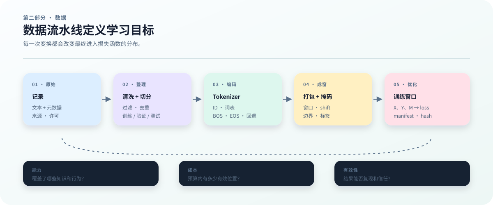

# 4　预训练数据：分布、质量与可复现性

## 为什么数据是基模训练的第一项设计

训练一个基模，不是把一批文本交给 GPU 后等待参数自动吸收“互联网知识”。模型只会看到数据管线最终产生的训练窗口；来源选择、过滤、去重、Tokenizer、packing 和 mask 共同决定这些窗口长什么样。因此，数据决定的不是一个附属的文件目录，而是模型实际要优化的目标。

数据至少从三个方面改变训练结果：

- **能力覆盖。** 网页、代码、书籍、论文和对话包含的词汇、结构与任务不同。来源混合比例改变模型接触到的知识类型，也会改变长上下文、代码语法和多语言能力的覆盖范围。
- **训练成本。** 同一段文本经过不同 tokenizer 可能产生不同数量的 token；更长的序列还会增加激活、注意力和 KV cache 的开销。清洗和去重也会改变在固定 token 预算下可以覆盖的有效内容。
- **评测可信度。** 如果验证集与训练集近重复，较低的验证损失可能只是记忆；如果过滤规则删掉了某一类文本，评测结果也不能代表预期用户分布。数据切分是评测协议的一部分。

下面的简化例子说明为什么“文件数量”不能代表训练分布：

| 来源 | 文档数 | 平均 token 数 | 直接按 token 拼接后的占比 | 可能带来的偏向 |
|---|---:|---:|---:|---|
| 网页 | 900,000 | 1,000 | 约 82% | 覆盖广，但模板和噪声较多 |
| 代码 | 50,000 | 2,000 | 约 9% | 语法和工具使用样本较集中 |
| 书籍 | 10,000 | 10,000 | 约 9% | 长篇结构更丰富，但数量较少 |

## 本章导读：先追踪一条短文本

本章先不讨论大规模下载。我们用短文本“猫坐下。”作为贯穿例子，依次追踪原始记录、清洗后的文档、token 流、训练窗口和 loss。读者读完应能解释一条 token 为什么会进入分母、为什么一个 EOS mask 会改变验证 loss，并能在仓库中生成一个带 manifest 的 tiny 分片。

假设原始记录有两条：记录 \(r_1\) 的正文是“猫坐下。”，记录 \(r_2\) 的正文是“猫坐下。”的网页镜像。若清洗和去重后只保留 \(r_1\)，均匀采样的概率从 \(P(r_1)=P(r_2)=1/2\) 变成 \(P(r_1)=1\)。这不是改变文件名，而是改变模型实际看到的分布。

为看清移位规则，先用人为指定的短序列 \(s=(10,11,12,2)\)，其中 2 是 EOS。它不是上面中文句子的真实编码；真实 byte 编码通常更长，我们会在 Tokenizer 章计算。这里长度为 3 的窗口是 \(X=(10,11,12)\)、\(Y=(11,12,2)\)、\(M=(1,1,1)\)。输入和目标相差一个位置，这条链把一份文档与交叉熵中的求和项连起来。

下面的命令把仓库中的 JSONL 样例编码为分片，并写出 manifest。它完成数据生成；是否能被 loader 正确读回，要在 Dataset 与训练前验收章进一步检查。生成成功本身不证明清洗质量、污染检测或模型泛化。

~~~bash
.venv/bin/python -m ttt.data \
  --input examples/sample.jsonl \
  --output outputs/book-data-contract \
  --sharded --tokenizer byte --shard-tokens 256
~~~

成功时应出现 <code>outputs/book-data-contract/manifest.json</code> 以及 token、mask 分片；若失败，先检查输入路径、词表大小和输出目录是否可写。下一节开始分别解释来源、清洗、去重和切分如何改变这条链。

直接拼接会让网页占据大多数训练位置；按来源均匀抽取又会得到另一种分布。两种方案都可以实现，但它们训练的目标不同。若网页中有 30% 是重复模板，清洗后有效 token 下降，代码和书籍的相对权重还会自动上升，除非重新声明并执行混合策略。后文会把这个例子写成可计算、可复现的采样协议。

<figure class="book-figure">
  
  <figcaption><strong>图 2　数据流水线。</strong> 数据章的对象不是一个文件夹，而是从原始记录到 \(X,Y,M\) 和 loss 的一串可审计变换。</figcaption>
</figure>

## Tokenizer 是什么：把文本变成模型能读的 token

模型不能直接接收 Unicode 文本。Tokenizer 是一个把文本编码成整数序列的规则或模型：它把一段文本 $u$ 映射为 token 序列 $s$，再把每个 token 映射到词表中的一个 ID。这里的 token 不一定是完整单词，也可能是字节、字符或子词；ID 本身只是索引，数值大小规律不代表语义相似度。

可以把这条转换链写成

$$
u \xrightarrow{\ \tau\ } s=(s_1,\ldots,s_L),
\qquad s_t\in\{0,\ldots,V-1\},
$$

其中 $\tau$ 是 tokenizer，$V$ 是词表大小，$L$ 是这段文本被编码后的 token 数。模型的 embedding 从 $V$ 行中取出输入表示，最后的分类头也把隐藏向量映射回这 $V$ 个可能的下一个 token。因此，同一段文本换一个 tokenizer，可能同时改变序列长度、训练位置数、显存开销和输出头维度。

Tokenizer 还要定义特殊 token 的语义，例如文档结束的 EOS、序列开始的 BOS、补齐用的 PAD，以及未知字符或字节回退规则。它们会影响文档边界、packing、loss mask 和评测结果，所以 tokenizer 不是一个可以在数据准备最后随手替换的预处理脚本，而是数据协议的一部分。正式实验至少要记录 tokenizer 文件或模型名、版本、词表大小、特殊 token ID 和归一化规则；更换其中任何一项，都应重新生成 token 分片并更新 manifest。Tokenizer 的训练、词表选择和效率比较见第 9 章。

## 把动机写成可计算的分布

下面正式定义两个容易被一句话带过的对象：**训练数据分布**和**预测损失**。只有定义清楚它们，清洗、Tokenizer、packing 和 manifest 才能放在同一条技术链上。按照全书记号，tokenizer 输出的文档 token 流记为 \(s\)，模型输入 token 记为 \(x\)，next-token 目标记为 \(y\)，模型参数记为 \(\theta\)。

设原始数据空间中的一条记录为

$$
r_i=(u_i,m_i),
$$

其中 $u_i$ 是文本，$m_i$ 是来源、许可证、语言、时间和文档簇等元数据。用 $P_{\mathrm{raw}}$ 表示原始记录的分布。对于一组固定的原始文件，最简单的均匀抽样情况是：

如果均匀抽取 \(N\) 条原始记录，那么每条记录的概率都是

$$
P_{\mathrm{raw}}(r_i)=\frac{1}{N}.
$$

例如只有两条记录 \(r_1\) 和 \(r_2\) 时，抽到它们的概率分别是 \(1/2\)。原始文件本身还不是最终的训练分布。我们需要经过来源选择、清洗、去重和切分，得到训练文档集合

$$
C_{\mathrm{train}}=\{r_1,\ldots,r_n\}.
$$

清洗包含两种不同操作：修改正文，以及决定是否保留记录。删除记录后，剩下记录的概率还需要重新归一化。例如，三条等概率记录删掉一条，保留的两条各占 \(1/2\)，而不是继续各占 \(1/3\)。去重还需要比较多条记录，不能简单视为逐条文本变换。为避免把这些操作混为一谈，我们先固定已经清洗、去重并切分出的训练集合，再定义如何抽样。

给保留的第 \(i\) 条记录一个非负权重 \(w_i\)，并要求至少一个权重大于零。文档层面的采样分布就是

$$
P_{\mathrm{doc}}(r_i)=
\frac{w_i}{\sum_{j=1}^{n}w_j}.
$$

均匀抽取文档、按文档长度抽取、按来源比例抽取，都会产生不同的 $P_{\mathrm{doc}}$。所以“训练集有多少文件”并不能单独说明模型实际看到了什么。

还要区分文档分布和训练位置分布。即使先均匀抽取文档，较长文档也可能在后续窗口中贡献更多 token；如果改为均匀抽取 token 起点，短文档、长文档和边界位置的权重又会不同。因此文档数、token 总数和真正参与 loss 的位置数不是同一个统计量。

Tokenizer \(\tau\) 把一条文档的文本映射到 token 序列：

$$
\tau(u_i)=s^{(i)}=(s^{(i)}_1,\ldots,s^{(i)}_{L_i}),
\qquad s^{(i)}_t\in\{0,\ldots,V-1\},
$$

其中 \(V\) 是词表大小。接下来需要明确：窗口是在一篇文档内抽，还是从许多文档连接成的长流中抽？这两个过程的概率不能用同一个含糊的“随机采样”代替。

如果每次先选一篇文档，再在其中选窗口，记第二步的条件分布为 \(P_\Pi\)。把所有可能文档的贡献相加，得到

$$
P_{\mathrm{win}}(X,Y,M)
=
\sum_i P_{\mathrm{doc}}(r_i)
\,P_{\Pi}(X,Y,M\mid \tau(u_i)).
$$

但当前仓库把文档编码后连接为一个固定长流 \(S=(S_1,\ldots,S_T)\)，mask 流也一同保存。一个长度为 \(L\) 的预测窗口需要 \(L+1\) 个连续 token。因此，合法起点为 \(a=1,\ldots,T-L\)。记从起点 \(a\) 取出并移位后的窗口为 \(W_a=(X_a,Y_a,M_a)\)，则均匀抽起点得到

$$
P_{\mathrm{win}}(W)
=\frac{1}{T-L}\sum_{a=1}^{T-L}\mathbf{1}\{W_a=W\}.
$$

这里的指示函数 \(\mathbf{1}\) 在条件成立时为 1，否则为 0。若两个起点恰好产生同样的窗口，两次贡献都要计算。这个表达式也包含跨文档窗口，而前一个“先选单篇文档”的公式不包含它们。文档顺序、EOS、BOS、窗口长度和 mask 都可能改变最终的 \(P_{\mathrm{win}}\)。

## 预测损失究竟是什么

设一个训练窗口由连续 token 流

$$
s=(s_1,s_2,\ldots,s_{L+1}).
$$

构造出 \(L\) 个输入位置。因果语言模型把当前位置的 token 作为输入，把下一个 token 作为目标：

$$
x_t=s_t,\qquad y_t=s_{t+1},
\qquad
X=(x_1,\ldots,x_L),\quad Y=(y_1,\ldots,y_L).
$$

模型参数为 $\theta$ 时，第 $t$ 个位置的预测损失是观察到的目标 token 的负对数概率：

$$
\ell_t(\theta)=-\log p_\theta(y_t\mid x_{1:t}).
$$

如果模型在位置 $t$ 输出 logits 向量 $\mathbf{z}_\theta(x_{1:t})$，那么

$$
p_\theta(v\mid x_{1:t})
=
\operatorname{softmax}(\mathbf{z}_\theta(x_{1:t}))_v.
$$

如果 $M=(m_1,\ldots,m_L)$ 是 loss mask，$m_t=1$ 表示该位置参与训练，$m_t=0$ 表示忽略，那么一个窗口的平均预测损失为

$$
\ell(\theta;X,Y,M)
=
-\frac{\sum_{t=1}^{L}m_t\log p_\theta(y_t\mid x_{1:t})}
{\sum_{t=1}^{L}m_t}.
$$

上式要求 \(\sum_t m_t>0\)。如果整窗都被忽略，它没有可定义的平均损失，数据检查应把这种情况单独报告。接下来还要决定如何合并多个窗口：每个窗口一票，还是每个有效 token 一票？记一个窗口的损失总和为 \(A=\sum_t m_t\ell_t\)，有效位置数为 \(K=\sum_t m_t\)。两种目标分别是

$$
\mathcal{L}_{\mathrm{window}}=\mathbb{E}[A/K],
\qquad
\mathcal{L}_{\mathrm{token}}=\frac{\mathbb{E}[A]}{\mathbb{E}[K]}.
$$

只有在有效位置数固定等条件下，两者才相同。例如，窗口一有 1 个有效位置，损失为 4；窗口二有 3 个有效位置，每个损失为 1。先算窗口平均再平均，结果为 \((4+1)/2=2.5\)；合并有效位置再平均，结果为 \((4+3)/4=1.75\)。后者让每个有效位置拥有相同权重。本书汇总数据集损失时采用这一口径。

有限评估只能看到采样得到的 \(N\) 个窗口。按所有未被 mask 的 token 做平均，估计量为：

$$
\widehat{\mathcal{L}}_N(\theta)
=
\frac{\sum_{k=1}^{N}\sum_{t=1}^{L_k}
m^{(k)}_t\ell^{(k)}_t(\theta)}
{\sum_{k=1}^{N}\sum_{t=1}^{L_k}m^{(k)}_t}.
$$

训练代码也在一个 minibatch 内按有效位置数归一化。但有限 minibatch 的“随机分子除以随机分母”，一般不是总体比值的无偏估计；有效位置数相差很大时，这个区别尤其重要。合并多个 batch 的评估结果，应累加损失总和与有效位置数后再相除，不能直接平均各 batch 的平均 loss。梯度更新的目的在于降低所选训练目标，单步更新并不保证每个窗口的损失都下降。

验证集损失使用同一个定义，但把 $P_{\mathrm{win}}$ 换成独立的 $P_{\mathrm{val}}$。因此训练损失回答“模型是否适应了训练分布”，验证损失回答“模型在另一份声明过的分布上预测得如何”。如果验证集与训练集近重复，第二个问题就没有被可靠地测量。

这也解释了本章的核心判断：我们优化的不是一份抽象的“语言知识”，而是由数据处理和采样协议共同定义的预测目标。改变 $P_{\mathrm{doc}}$、$\tau$、$\Pi$ 或 $M$，即使模型结构和优化器不变，目标函数也会改变。

## 一份原始文档如何变成训练信号

数据管线不是把文件搬到 GPU，而是连续执行一组会改变数学对象的变换：

~~~mermaid
flowchart LR
    A[原始文件] --> B[文档记录与元数据]
    B --> C[清洗、去重、切分]
    C --> D[Tokenizer: text → token IDs]
    D --> E[Packing 与窗口采样]
    E --> F[input_ids / labels / loss_mask]
    F --> G[交叉熵与梯度]
    G --> H[参数更新]
~~~

用一组仅用于说明的 token ID 表示一条短文档：

| 对象 | 内容 |
|---|---|
| 连续 token 流 \(s\) | \((10,11,12,2)\) |
| 教学数组 <code>input_ids</code>（数学记号 \(X\)） | \((10,11,12)\) |
| 教学数组 <code>labels</code>（数学记号 \(Y\)） | \((11,12,2)\) |
| 教学数组 <code>loss_mask</code>（数学记号 \(M\)） | \((1,1,1)\) |

这些名字用来解释三个数学对象。当前 loader 实际返回未移位的 <code>tokens</code> 和目标 <code>masks</code>；<code>sequence_loss</code> 再由 tokens 构造输入与标签。

这一个窗口产生的损失是

$$
-\frac{1}{3}
\left[
\log p_\theta(11\mid 10)
+\log p_\theta(12\mid 10,11)
+\log p_\theta(2\mid 10,11,12)
\right].
$$

如果最后一个 EOS 位置被 mask 掉，分母和求和项都会改变；如果窗口跨越两篇文档，模型学习到的条件上下文也会改变；如果 tokenizer 把同一段文本拆成更多 token，预测位置数和成本也会改变。训练信号不是原始文本本身，而是经过这些规则构造出的 $(X,Y,M)$。

## 每一步改变了什么

**来源选择改变支持范围。** 网页、代码、书籍和论文拥有不同的词汇、长度和结构。模型只能在它实际被采样到的区域内获得训练信号。

**清洗改变样本集合。** 删除乱码、导航栏、截断页面和异常记录会改变哪些文档保留在 $C_{\mathrm{train}}$ 中。过滤过强又可能删除代码、数学、少数语言或长文档。

**去重改变样本权重。** 同一篇文档出现一百次，相当于提高它在 $P_{\mathrm{doc}}$ 中的概率。训练集和验证集近重复，还会让验证损失失去独立性。

**切分改变评估对象。** 去重和按文档簇切分决定验证窗口是否真正代表未见内容。评测集污染会让低损失或高分更接近记忆，而不是泛化。

**Tokenizer 改变样本空间和成本。** 同一段字符经过不同 tokenizer 会产生不同 token 序列。词表大小同时影响 embedding、LM head、序列长度、attention、KV cache 和吞吐。

**Packing 和 mask 改变条件概率。** 是否跨文档、是否保留 EOS、哪些位置参与 loss，都会改变 $P_{\mathrm{win}}$ 或窗口损失。不能把 packing 当成只影响存储的实现细节。

## 一个具体例子：文件大小不是训练分布

假设有三个来源：

| 来源 | 文档数 | 平均长度 | token 总量 |
|---|---:|---:|---:|
| 网页 | 900,000 | 1,000 | 900M |
| 代码 | 50,000 | 2,000 | 100M |
| 书籍 | 10,000 | 10,000 | 100M |

直接拼接后，书籍贡献 \(100/1100\approx9.09\%\) 的 token。若每次均匀选一篇文档、且每篇只抽一个等长窗口，选到书籍的概率却只有 \(10{,}000/960{,}000\approx1.04\%\)。若先均匀选择三个来源，书籍又会占 \(1/3\) 的抽样次数。必须连同“选中文档后取多少窗口”一起说明采样方法，才能谈权重；均匀抽文档并不会自动提高长文档来源的权重。

如果网页中 30% 是重复模板，清洗后网页有效 token 可能降到 630M；若不重新计算混合比例，代码和书籍的实际权重就会自动上升。每个阶段都必须报告自己的分母，不能只在最后写一个总 token 数。

当前仓库的 `BatchStream` 从一个逻辑 token 流中随机采样窗口，还没有实现按来源调度的 mixture sampler。后面的 mixture 章节会定义这种能力，但本章不把未来设计写成当前功能。

## 训练前需要明确的数据规范

进入长时间训练前，数据管线至少要回答五个问题：

1. **来源是否清楚？** 能否定位原始发布版本、获取时间和许可证？
2. **质量是否可解释？** 每条过滤规则是否有版本、阈值、统计和抽样审计？
3. **切分是否可信？** train、validation 和 test 是否按文档或项目边界隔离，并检查近重复和污染？
4. **表示是否一致？** tokenizer、特殊 token、packing、label shift 和 mask 是否与模型配置一致？
5. **版本是否可恢复？** manifest、分片 hash、采样器状态和 checkpoint 是否能确认下一批数据？

数据可以被程序读取，不代表它满足这些条件。每个条件都对应后续章节和一个可保存的证据对象。

## 数据对象和版本边界

**原始文件**是下载或采集得到的不可变输入，例如压缩包、HTML、JSONL 或代码仓库快照。

**文档记录**是抽取出的正文和元数据，支持清洗、去重、切分和文档边界管理。

**Token 分片**是 tokenizer 生成的整数序列和监督 mask，附带词表、tokenizer 版本、dtype、分片数量和 SHA256。

**训练窗口**是采样器从 token 流中取得的一段固定长度序列，进一步变成 `input_ids`、`labels`、`loss_mask` 和位置状态。

这四种对象不能共用一个含糊的“数据版本”。原始文件不变，清洗规则可以产生新的文档版本；文档不变，Tokenizer 可以产生新的 token 版本；分片不变，sequence length 和 packing 也可以产生新的窗口协议。

## 当前仓库已经实现什么

`ttt/data.py` 提供 byte tokenizer 和 JSONL 到 token 文件的转换。普通输入可以写成一维 NPY；sharded 路径会生成 token 分片、mask 分片和 manifest。

`ttt/dataset.py` 的 `TokenDataset` 会检查 manifest 版本、`vocab_size`、文件路径、SHA256、token 范围、mask shape 和 mask 数值，再用 memory mapping 读取分片。`BatchStream` 使用 NumPy Generator 随机选择窗口，并保存 RNG state、数据指纹、sequence length、batch size 和 seed。

~~~bash
.venv/bin/python -m ttt.data \
  --input examples/sample.jsonl \
  --output outputs/book-data \
  --sharded \
  --tokenizer byte \
  --shard-tokens 256
~~~

`shard-tokens` 是存储分片大小，不是模型一次处理的 sequence length。当前窗口可以跨越 EOS 和文档边界，模型没有通用的“遇到 EOS 就重置 attention”接口，因此应把现有 loader 描述为连续 token 流 packing，而不是文档隔离的 packing。

当前 manifest 也没有完整的 document-offset sidecar，所以任意 token 到原始文档的反查仍是大规模数据管线需要补齐的能力。把已实现行为和设计要求分开，是本书数据章节的基本写法。

## 后续章节如何推进

- `11_data_acquisition.md`：来源版本、许可证、下载和溯源；
- `12_data_cleaning.md`：规范化、格式、语言、长度和质量过滤；
- `13_deduplication.md`：exact/near dedup 以及重复对采样权重的影响；
- `14_split_and_contamination.md`：训练、验证、测试边界和污染检查；
- `15_tokenizer.md`：Tokenizer、词表和参数维度；
- `16_packing_and_masks.md`：packing、label shift、文档边界和 loss mask；
- `17_dataset_and_manifest.md`：分片、manifest、mmap 和可恢复采样；
- `18_data_mixture.md`：来源混合和确定性采样；
- `19_data_preflight.md`：训练前的硬门槛；
- `20_baseline_model.md`：用 dense Causal LM 检查这些输入是否真的支持学习。

从下一章开始，“数据”不再是一个笼统的输入名词。我们会逐步追踪每个对象如何产生、如何改变训练分布，以及如何留下能够被下一次运行复核的证据。
