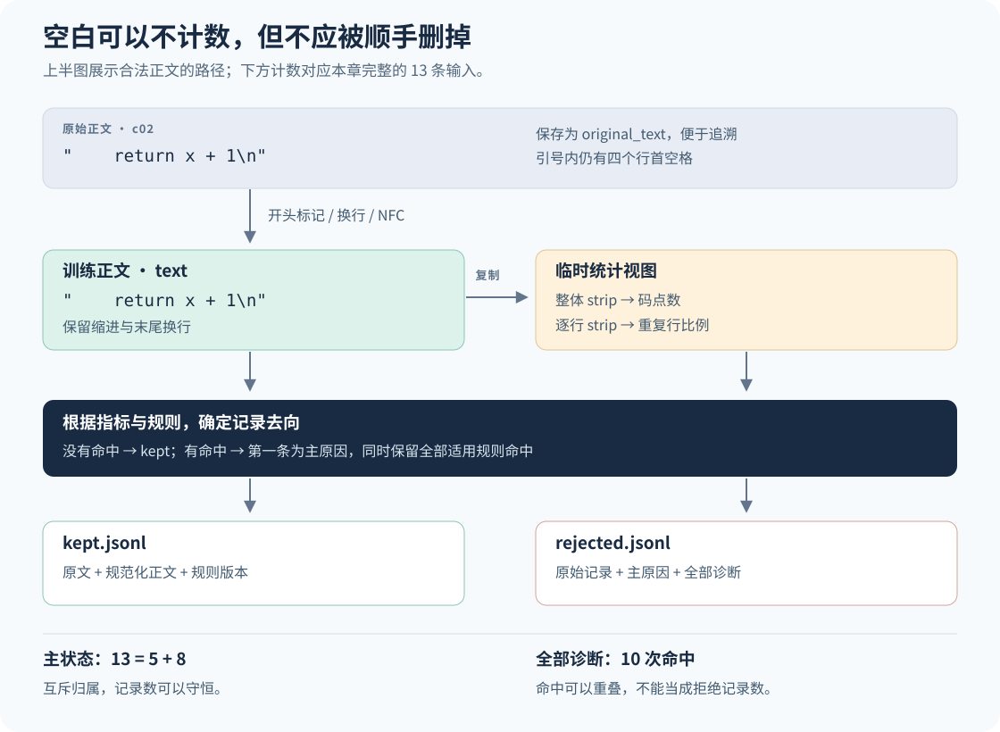

# 6　清洗文本：保留什么，改变什么，如何检查

## 从“删掉脏数据”到明确的学习目标

上一章把文本和来源记录一起保存下来。现在，假设这些记录包含三类内容：一段反复出现的网页导航、一段有缩进的 Python 代码，以及一句含有数学符号的说明。它们都能存进文本文件，但不应该用同一把尺子评判。

~~~text
首页
首页
首页

    return x + 1

Ａ＋①＝２，这些字形先保留。
~~~

重复导航很可能没有我们需要的正文信息；代码里的空格可能决定程序结构；数学文字里的圈号和全角字形可能正是作者要讨论的对象。如果采用“删掉短行、删掉非英文字母、去掉所有行首空白”这样的组合，表面上会得到整齐的文件，也可能恰好删除了我们想教给模型的东西。

模型通过反复预测训练文本中的下一个 token 来学习。某类文本被保留得越多，模型遇到这类模式的机会通常就越多；如果某类内容几乎全部被过滤，它也就很难通过这份语料学到相应的表达。清洗因此同时承担两项工作：减少无用或损坏的内容，并控制有用内容的误删。**保留率是一项处理统计，不是质量分数。**

本章从三个不同的问题出发：文件是否被正确读成文字，文字是否需要规范化，以及这条记录是否适合保留。随后，我们用仓库内的 13 条原创记录手算决策，再运行一个只依赖 Python 标准库的小程序，得到保留文件、拒绝文件和可以对账的报告。这里的阈值刻意设得很小，是为了让每个决定都能检查；它们不是大规模预训练的推荐配方。

## 文件里的字节，屏幕上的文字

计算机保存文件时存储的是字节。一个字节有 256 种可能的取值，常用两个十六进制数字表示，例如 `41`。Unicode 为文字提供码点编号，例如字母 `A` 对应 `U+0041`；UTF-8 则规定怎样把这些码点表示成字节。**解码**把字节变成 Python 的 `str`，**编码**把 `str` 变回字节。一个码点可以占多个 UTF-8 字节。[Python Unicode HOWTO](https://docs.python.org/3.12/howto/unicode.html)

以 `Café` 为例，末尾看起来只有一个带重音的字母，实际上可以有两种表示：一个 `é`，或一个 `e` 后接组合重音。下面列出的是同一个小词的表示方式，不是 tokenizer 的词表编号。

| 表示 | Unicode 码点 | UTF-8 字节（十六进制） | Python `len` |
|---|---|---|---:|
| `Cafe\u0301`：`e` 加组合重音 | `0043 0061 0066 0065 0301` | `43 61 66 65 cc 81` | 5 |
| `Café`：预组合的 `é` | `0043 0061 0066 00E9` | `43 61 66 c3 a9` | 4 |

这里的 `\u0301` 是 Python/JSON 表示码点的转义写法，不是正文里的六个可见字符。两行通常显示成相同的词，码点和字节却不同。Python 对字符串调用 `len` 计算的是码点个数；它既不是 UTF-8 字节数，也不保证等于人眼看到的字符个数，更不是模型的 token 数。这一区别马上会影响长度阈值。

如果原始文件使用 UTF-8，读取时却指定了错误的编码，得到的乱码属于解码问题。Unicode 规范化不会推断原来的编码，也不能把已经被替换成 `�` 的未知内容可靠地恢复出来。本章程序对整个输入文件采用严格 UTF-8 解码：遇到非法字节就报错，并且不生成清洗结果。这样可以在错误发生的位置停下来，而不把损坏的文本当成正常输入。

还要区分文件格式和内容格式。JSONL 是把一个 JSON 值放在一行中的存储方式；本章要求每行是带 `text` 字段的对象。`text` 可以来自网页正文，也可以来自代码仓库。**解析 JSON 成功不等于 HTML 正文抽取成功。** 例如：

~~~html
<nav>首页　登录</nav><article>
雨水进入河流。
</article>
~~~

如果只去掉尖括号标签，会同时留下“首页　登录”和“雨水进入河流。”；正文抽取还需要判断哪些节点属于文章、哪些属于导航。正文中的段落边界也要保留，否则两段话可能被直接黏在一起。本章小程序接收已经抽取好的纯文本，不解析 HTML，也不提供正文抽取器。若来源仍是网页源码，应先完成并评估抽取，再把结果送进这里的文本规则；把原始 HTML 直接传给程序不会自动完成这一步。

## NFC 与 NFKC 到底改变了什么

规范化处理的是已经正确解码的 Unicode 字符串。NFC 把规范等价的表示统一到组合形式，例如把 `e` 加组合重音变成 `é`。NFKC 还处理兼容等价，因此会合并更多区别。Python 用 `unicodedata.normalize("NFC", text)` 和 `unicodedata.normalize("NFKC", text)` 实现这两种形式。[Python `unicodedata`](https://docs.python.org/3.12/library/unicodedata.html#unicodedata.normalize)

| 原始表示 | NFC 结果 | NFKC 结果 | 应注意的区别 |
|---|---|---|---|
| `Cafe\u0301` | `Café` | `Café` | 两个码点组成的重音字母变成一个码点 |
| `Ａ`（`U+FF21`） | `Ａ` | `A`（`U+0041`） | 全角与普通宽度的区别消失 |
| `①`（`U+2460`） | `①` | `1`（`U+0031`） | 圆圈所表示的字形区别消失 |

NFKC 不是一般意义上的“更好的 NFC”。如果文本正在说明“① 与 1 的区别”，规范化后的这句话可能变成“1 与 1 的区别”。在数学或技术文本中，兼容字符的区别还可能携带语义，因此不能不加区分地合并。[Unicode 规范化标准 UAX #15](https://www.unicode.org/reports/tr15/tr15-58.html)

NFC 也不保持原始字节：上表第一行已经改变了码点数和 UTF-8 字节。所谓保守，是指本章选择较少的合并范围，而不是承诺任意用途下完全无损。我们保留 `original_text`，另外生成供训练使用的 `text`。这样才能知道最终模型读到了什么，也能在规则改变后从原文重新处理。

本章对训练正文只做三个变换：去掉开头的一个 `U+FEFF` 标记，统一 `CRLF`/`CR` 换行为 `LF`，然后做 NFC。开头标记的处理同样是本章明确选择的策略；如果研究对象本身就是文件编码示例，仍要重新审视它。程序把这些选择写进报告，而不是把它们藏在一个含糊的“标准清洗”名称后面。

~~~python
def normalize_text(text: str) -> str:
    text = text.removeprefix("\ufeff")
    text = text.replace("\r\n", "\n").replace("\r", "\n")
    return unicodedata.normalize("NFC", text)
~~~

### 计数时可以忽略空白，保存时不能顺手删掉

`str.strip()` 返回移除了首尾空白的字符串；它不只删除换行，也会删除空格和制表符。[Python `str.strip`](https://docs.python.org/3.12/library/stdtypes.html#str.strip)

~~~python
text = "    return x + 1\n"
count_view = text.strip()    # "return x + 1"，只用于计数
training_text = text        # 仍包含四个行首空格和末尾换行
~~~

如果把 `text.strip()` 的结果写回正文，第一行代码的缩进就丢失了；如果对每行都调用它并重新拼接，整个代码块的缩进层次都会消失。即使当前片段不能独立执行，我们也不应在清洗时擅自改变它在原上下文中的结构。

因此程序建立不同用途的视图。训练正文保留空白；长度统计临时忽略整个文本首尾的空白；重复行统计再临时忽略每行两端的空白，并跳过空行。这些统计视图不会写回 `text`。例如两行缩进不同的文字可能在重复统计里被视为相同，但最终保存的代码仍保留各自的缩进。

图 6.1：从上到下读。规范化产生训练正文，再复制出只用于统计的视图；判断结果决定记录进入哪个输出文件。右侧两种计数回答不同问题：主状态给每条输入唯一归属，诊断则保存可以重叠的规则命中。统计视图没有回写训练正文的箭头。

## 用 13 条记录把规则说清楚

输入文件是 `examples/book/fixtures/cleaning_records.jsonl`，可以直接在编辑器中查看。以下是第一条记录的结构；后面的记录沿用这些字段，并故意加入格式错误。

~~~json
{"id":"c01","source":"web","language":"en","kind":"prose","text":"Cafe\u0301 by the sea."}
~~~

`id` 用于定位样本；`source` 表示来源组；`language` 是输入自带的语言标签；`kind` 区分一般文字 `prose` 和代码 `code`；`text` 是正文。这里没有运行语言识别模型，所以不能把 `language` 说成程序推断出的结果。程序要求前四个字段是非空字符串、`text` 是字符串，并限制 `kind` 只能是这两个值。这样的字段及类型约束通常称为 **schema（记录结构约束）**。

结构检查先于文本检查。`text: 42` 的问题是类型错误，不应先转换成 `"42"` 再判断太短；坏 JSON 连完整对象都无法确定，也不能随意从半行字符串中猜出一个样本 ID。程序分别记为 `invalid_schema` 和 `invalid_json`。读取器还拒绝 `NaN`、`Infinity`，以及超出本例有限浮点范围的数字，例如 `1e999`，同样记为 `invalid_json`。最后一类是本读取器的接受范围限制，不是说 `1e999` 在 JSON 语法中非法；拒绝日志保留原始行供检查。通过结构检查后，还会检查正文能否编码为 UTF-8；JSON 转义可以表达某些孤立代理码点，这些不合法的正文记为 `invalid_unicode`。默认样例没有触发最后一种情况，报告仍保留其零计数。

对合法文本，本次规则采用以下参数。长度指规范化后、去掉首尾空白的临时视图中的**码点数**。

| 规则 | 本次决定 | 为什么这样设计 |
|---|---|---|
| 空文本 | 临时视图为空则拒绝 | 空格、换行或制表符本身不提供这个例子需要的正文 |
| 最短长度 | `prose` 至少 12，`code` 至少 1 | 用两类阈值展示按领域区别处理；12 不是通用质量标准 |
| 最长长度 | 超过 120 则拒绝 | 便于在小样例中演示处理上限；不是长文质量结论 |
| 重复行 | 只检查 `prose`，至少 3 个非空行，重复比例至少 0.6 时拒绝 | 演示导航重复；代码中重复语句可能合法，因此不套用这条启发式 |

重复比例也需要一个无歧义的定义。设非空比较行有 \(n_{\mathrm{line}}\) 行，去重后剩 \(u_{\mathrm{line}}\) 种不同内容。本章定义：

$$
\rho_{\mathrm{line}}=
\begin{cases}
1-\dfrac{u_{\mathrm{line}}}{n_{\mathrm{line}}}, & n_{\mathrm{line}}>0,\\
0, & n_{\mathrm{line}}=0.
\end{cases}
$$

分子中的不同内容数表示“每种行只保留一次”时还会留下多少行；因此 \(n_{\mathrm{line}}-u_{\mathrm{line}}\) 是多出来的重复次数。三行都是“首页”时，\(n_{\mathrm{line}}=3\)、\(u_{\mathrm{line}}=1\)，所以 \(\rho_{\mathrm{line}}=2/3\)，超过 0.6。三行各不相同时比例为 0。这里比较的是完整行，不是在计算跨文档相似度；下一章才会讨论后者。

下面逐条列出默认规则下的**手算预期**。`\n` 表示换行，表中的“121 个 a”是为了节省版面；fixture 里实际保存了完整的 121 个字母。

| 行 / ID | 输入正文或问题 | 主状态 | 全部诊断命中 |
|---|---|---|---|
| 1 / `c01` | `Cafe\u0301 by the sea.`；NFC 后 16 个码点 | `kept` | 无 |
| 2 / `c02` | `    return x + 1\n`；代码 | `kept` | 无 |
| 3 / `c03` | `Ａ＋①＝２，这些字形先保留。`；14 个码点 | `kept` | 无 |
| 4 / `c04` | `\r\n \t`；只有空白 | `empty` | `empty`, `too_short` |
| 5 / `c05` | `短定义。`；4 个码点 | `too_short` | `too_short` |
| 6 / `c06` | `首页\n首页\n首页`；8 个码点 | `too_short` | `too_short`, `repeated_line` |
| 7 / `c07` | 121 个 `a` | `too_long` | `too_long` |
| 8 / `c08` | `重复的导航行` 连续三行；20 个码点 | `repeated_line` | `repeated_line` |
| 9 / `c09` | `text` 是数字 `42` | `invalid_schema` | `invalid_schema` |
| 10 / 无可解析 ID | JSON 在 `"text":` 后截断 | `invalid_json` | `invalid_json` |
| 11 / `c11` | `kind` 是未支持的 `table` | `invalid_schema` | `invalid_schema` |
| 12 / `c12` | `A short note about rain.` | `kept` | 无 |
| 13 / `c13` | 三行带缩进的 `pass`；代码 | `kept` | 无 |

有两个细节值得停下来检查。`c06` 的长度是 \(2+1+2+1+2=8\)：首尾空白被忽略，内部两个换行仍各占一个码点。`c13` 的重复行比例也等于 \(2/3\)，但它的类型是代码，重复行规则不适用，所以报告中的指标可以很高而诊断列表为空。指标值和拒绝决定是两件事。

`c05` 则暴露出规则的局限：一条短定义并不因为长度只有 4 就自动失去价值。我们故意保留这个反例。读懂清洗不仅要会解释为什么删掉 `c06`，也要能够指出删掉 `c05` 可能不符合任务目标。

## 为什么要同时保存主原因和全部命中

一条空白文本既为空，也短于 12；`c06` 又短又重复。如果每命中一条规则就把“删除文档数”加一，这两条记录会各被删除两次，账面数量就不再对应真实文件。

程序为每条输入保存一个唯一的主状态 `primary_reason`，并另外保存可能包含多个值的 `diagnostics`。顺序固定为：坏 JSON、坏 schema、非法正文 Unicode、空文本、太短、太长、重复行。主状态取第一条命中的规则；没有命中就为 `kept`。解析或结构检查失败时，后续正文指标没有定义，因此程序不会伪造它们。正文合法时，则把所有适用文本规则都检查一遍，保留全部命中。

设输入非空行数为 \(n_{\mathrm{input}}\)，保留数为 \(n_{\mathrm{kept}}\)，以规则 \(r\) 为主原因的拒绝数为 \(n_{\mathrm{rejected},r}\)。每条输入恰好进入一个类别，先按类别划分再相加，就得到：

$$
n_{\mathrm{input}}
=n_{\mathrm{kept}}+\sum_r n_{\mathrm{rejected},r}.
$$

默认例子的主原因计数是：

$$
13=5+\underbrace{(1+2+0+1+2+1+1)}_{8\text{ 条拒绝记录}}.
$$

括号中的顺序与前面的规则顺序一致。这是一条以**输入记录**为单位的守恒式；它不声称字节、码点或 token 数守恒。如果正文被拆成多个片段，应另外记录父文档与子片段关系，不能把输入文档数和输出片段数放进同一等式。

全部命中回答的则是“多少条输入触发了规则 \(r\)”。本例中 `too_short` 命中 3 次、`repeated_line` 命中 2 次，而它们的主原因计数分别是 2 和 1。各规则全部命中加起来是 10，超过实际拒绝的 8 条，原因正是重叠。报告因此将 `primary_counts` 和 `diagnostic_counts` 分开保存。

报告还给出按主原因顺序扣除后的阶段表。它是一种记账视图，不能误读成对已拒绝文本不再计算诊断。

| 完成的检查 | 本阶段主拒绝数 | 剩余记录数 |
|---|---:|---:|
| 输入非空行 | 0 | 13 |
| `invalid_json` | 1 | 12 |
| `invalid_schema` | 2 | 10 |
| `invalid_unicode` | 0 | 10 |
| `empty` | 1 | 9 |
| `too_short` | 2 | 7 |
| `too_long` | 1 | 6 |
| `repeated_line` | 1 | 5 |

长度下限这一阶段删了 2 条，占进入该阶段 9 条记录的 \(2/9\approx22.2\%\)，占原始 13 条的 \(2/13\approx15.4\%\)。两个百分比都可以使用，但必须带上分母。修改规则顺序也可能改变主原因分布，即使最终保留集合没有变化。

## 运行程序，把预期变成可以核查的文件

程序位于 `examples/book/cleaning_walkthrough.py`，只依赖 Python 标准库。以下命令在仓库根目录执行；若已按环境章节创建 `.venv`，可以直接使用同一解释器。按本项目的执行约定，CPU 验证在指定远端节点上进行，编辑本章并不要求在本地运行。

~~~bash
.venv/bin/python examples/book/cleaning_walkthrough.py \
  --output outputs/book-cleaning-v1
~~~

`--input` 默认指向仓库自带 fixture，不需要下载语料或补一个不存在的输入路径。程序拒绝覆盖已经存在的输出目录；重新运行时请给新目录名。终端摘要按默认规则应包含 `input_records: 13`、`kept_records: 5` 和 `rejected_records: 8`。这些数字首先来自前面的逐条推演；运行成功后，以本次实际生成的文件为证据，不能把这张手算表当成执行日志。

输出目录包含三个文件，它们各自回答一个问题：

| 文件 | 实际保存的内容 | 怎样阅读 |
|---|---|---|
| `kept.jsonl` | 5 条保留记录；`original_text` 保存输入正文，`text` 保存规范化正文，`cleaning` 保存规则版本和输入行号 | 检查 `c01` 的重音组合、`c02` 的缩进、`c03` 的全角与圈号 |
| `rejected.jsonl` | 每条拒绝记录的主原因、诊断、原对象和原始输入行；可计算时还保存正文指标 | 检查 `c04` 与 `c06` 的重叠命中，以及第 10 行的解析错误 |
| `report.json` | 参数、计数、分组统计、逐条决定、Unicode 小例子和版本摘要 | 对照上面的表格逐条核查 |

输出 JSON 使用 `\uXXXX` 转义表示非 ASCII 字符，所以用编辑器查看时可能看到转义形式。用 JSON 解析器读回后仍是原来的 Unicode 字符；这不等于把中文删除了。这样也能把拒绝记录中无法编码为 UTF-8 的孤立代理码点写入诊断日志。

下面的命令读取实际产物，只打印我们要检查的内容。它不会再次执行清洗，也不会修改文件。

~~~bash
.venv/bin/python - <<'PY'
import json
from pathlib import Path

root = Path("outputs/book-cleaning-v1")
report = json.loads((root / "report.json").read_text(encoding="utf-8"))
rows = [json.loads(line) for line in (root / "kept.jsonl").read_text(encoding="utf-8").splitlines()]
print("主状态：", report["primary_counts"])
print("全部命中：", report["diagnostic_counts"])
print("保留 ID：", [row["id"] for row in rows])
for row in rows:
    if row["id"] in {"c01", "c02", "c03"}:
        print(row["id"], repr(row["original_text"]), "->", repr(row["text"]))
PY
~~~

`repr` 会把换行显示为 `\n`，并把字符串放在引号里，因此行首空格是否存在更容易看清。预期的保留 ID 按输入顺序为 `c01, c02, c03, c12, c13`；`c02` 的字符串仍从四个空格开始。

为了让报告可以解释和复查，还需要理解其中几组字段：

| 报告字段 | 确切含义 |
|---|---|
| `input_sha256`, `script_sha256` | 输入文件字节和当前脚本字节的 SHA-256 摘要；用于辨认本次输入与实现 |
| `python_version`, `unicode_version` | 实际解释器版本和 `unicodedata` 使用的 Unicode 数据库版本 |
| `parameters`, `rule_order` | 本次阈值、规范化选择、规则适用范围及主原因优先顺序 |
| `input_records`, `ignored_blank_lines` | 非空输入行数，以及跳过的空白行数；普通文件末尾换行不额外算一行 |
| `primary_counts`, `diagnostic_counts`, `stages` | 互斥状态计数、可重叠命中计数、按主原因扣除的阶段计数 |
| `groups`, `group_scope` | 仅对 schema 合法记录，按输入中的 `source/language/kind` 分组统计；不包含坏 JSON 和坏 schema |
| `decisions` | 每条输入的行号、可取得的 ID、主状态和诊断；正文合法时含长度、行数、重复比例等指标 |
| `unicode_examples` | 前面三个例子的原文、NFC、NFKC、码点与 UTF-8 字节 |
| `count_conservation` | 程序已检查主状态计数守恒；不代表语料质量经过评估 |

本例共有 10 条 schema 合法记录，因此 `groups` 的输入数相加是 10，而全局 `input_records` 是 13。这两个数的差异来自明确的统计范围，不应把缺失的三条强行分配给某个语言组。对缺少合法来源信息的记录单独计数，通常比凭猜测补标签更可解释。

输入 UTF-8 解码失败会使整个运行停止；单条 JSON 或 schema 错误则进入拒绝日志，其他记录继续处理。程序先完成分析，再创建输出目录，并最后写报告。磁盘写入中断仍可能留下不完整目录；若没有完整的三个文件和可读的报告，不能把它算作成功运行。

## 改一个阈值，看哪些内容回来了

固定输入，只把 `prose` 的最短长度从 12 改成 4：

~~~bash
.venv/bin/python examples/book/cleaning_walkthrough.py \
  --output outputs/book-cleaning-min4 \
  --min-prose-chars 4
~~~

先预测再检查输出。`c05` 长度恰好为 4，因此现在会被保留；`c06` 不再太短，但仍命中重复行，所以仍被拒绝，只是主原因变为 `repeated_line`。预期保留数从 5 变成 6，拒绝数从 8 变成 7；`too_short` 主原因变为 0，`repeated_line` 主原因变为 2。空白 `c04` 仍命中 `empty` 和 `too_short`。这说明规则变化不仅会改变保留集合，也可能只改变某条记录的归因。

这还不是“更好的规则”已经得到证明。我们只知道一个短文本回来了。是否应该保留它，需要看目标语料是否欢迎这种内容，并查看更多同类样本。如果短文本多数是导航、按钮或抓取残片，放宽长度也可能把大量噪声放回来。

语言和领域会影响这种权衡。相同码点数的中文与英文并不保证包含相同的信息量；代码中的短行、公式中的符号、诗歌里的重复也都有可能合法。实际规则可以按来源、语言和内容类型分别配置阈值，但应以分层抽样检查为依据，而不是仅凭直觉添加例外。本章程序只实现了 `prose/code` 两套最短长度和按组统计，**没有实现按语言自动选阈值，也没有识别诗歌或数学质量的分类器**。

分层检查的意思是先把样本分成有意义的小组，再分别观察结果。本例中的代码组保留 2/2，中文短定义来源保留 0/1；总体 5/13 的数字无法表达这两个差异。但小组样本只有一两条，也不能据此估计真实生产语料的误删率；它们的作用是让我们看见统计是否能定位问题。

如果要估计误删，需要额外给抽查样本标注“按当前训练目标应当保留”或“应当拒绝”。在同一个已标注样本集合中，误删率可以定义为：

$$
\text{误删率}
=\frac{\text{应当保留但实际拒绝的记录数}}
{\text{应当保留的记录总数}}.
$$

这个比例要求样本中至少有一条应当保留的记录；分母为零时应记为未定义，不能填成零误删率。分母包括被正确保留的好样本，不能只抽拒绝集合就算出这个比例。比如 10 条人工确认应保留的样本中误删 2 条，误删率为 20%；这和“所有拒绝样本中有多少误删”是另一个问题。若为了找问题而大量抽取边界样本，得到的比例描述的是这批边界样本，不能直接外推整个语料。程序没有自动生成这类人工质量标签，报告中的 `keep_rate` 也不是上述误删率。

## 从这个例子走向更大的语料

这次程序把全部小样例和决定装进内存，是为了让记录、文件和报告能一一对应。生产语料需要分块读取、断点恢复、稳定的记录身份和更严格的来源 schema；网页来源还需要正文抽取，质量判断可能需要经过评估的分类器。这些能力没有因为本章小例子运行成功就自动具备。

保留下来的 `text` 现在是一个明确版本的文本视图。下一章将在固定视图上比较文档是否重复，并说明为什么“同一意思”“同一字符串”和“同一训练样本”不能混为一谈。之后再进入 tokenizer 与训练窗口构造。这样的顺序能让每一步回答自己的问题：本章先检查文本如何变化、为什么保留或拒绝，而不是用一次 token 编码成功代替清洗验证。
