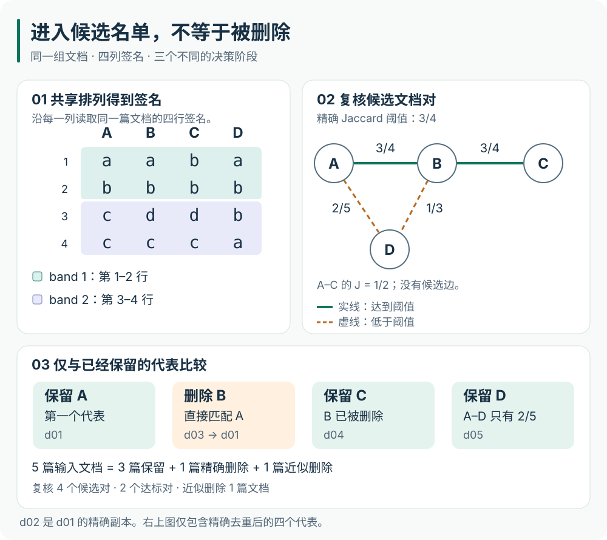

# 7　去重：控制同一段信息出现多少次

## 为什么清洗之后还要去重

上一章的清洗回答“这条记录是否值得保留”。但一篇质量很好的文章被转载一百次，仍然可能全部通过清洗。如果训练时反复看到这些副本，模型获得的并不是一百种独立知识，而是同一内容被重复强调。一张书页复印一百份，会让书变厚，却不会自动增加一百页的新知识。

重复首先改变训练分布。设一个小语料只有两种内容，且文档等长：内容甲有九个副本，内容乙只有一个。均匀抽一篇文档时，抽到甲的概率是 \(9/10\)，乙是 \(1/10\)；各保留一个副本后，两者都变成 \(1/2\)。这里没有修改采样器，但文件中的副本数量已经充当了隐含的采样权重。若文档长短不同、采样单位变成 token 或训练窗口，还必须按照相应的采样协议重新计算，不能直接沿用这个文档比例。

重复还可能越过评估边界。训练集中有一篇文章，验证集中有它的镜像，模型在验证时就可能遇到已见过的片段。Lee 等人的[原始研究](https://arxiv.org/abs/2107.06499)同时研究了训练语料重复、记忆与训练—评估重叠。它支持我们认真检查这些问题，但论文中的收益不能当作本项目已经测得的收益。

去重因此需要回答三个不同的问题：什么内容算相同；怎样在大量文档中找到可能相同的对象；找到以后保留谁。这三个问题分别对应**比较表示、候选检索和保留规则**。本章会用五篇很短的原创文档，把它们逐步连接起来。所有表格中的小数据都是教学构造，后面的脚本负责把这些手算步骤变成可检查的产物。

## 先定义“比较什么”，再计算摘要

下面是仓库中 `examples/book/dedup_documents.jsonl` 的全部五条文本。`\n` 表示换行符 LF，`\r\n` 表示 CRLF；它们是 JSON 中的转义写法，读取后分别成为一个或两个控制字符。颜色单词只是方便手算的标记，没有额外的语义含义。

| 文档 ID | 来源 | `text` 的 JSON 写法 | 精确去重后的简称 |
|---|---|---|---|
| `d01` | notes | `"red blue green amber\n"` | 文档 A |
| `d02` | mirror | `"red blue green amber\r\n"` | A 的副本 |
| `d03` | notes | `"red blue green amber gold\n"` | 文档 B |
| `d04` | notes | `"blue green amber gold\n"` | 文档 C |
| `d05` | notes | `"red blue green violet silver\n"` | 文档 D |

如果直接比较原始字节，`d01` 与 `d02` 不相同。我们先明确本次实验的规则：把 Unicode 文本规范化为 NFC，并把 CRLF 统一成 LF；保留大小写、标点、缩进、行尾空格和其他字符。NFC 处理的是规范等价的写法，例如一个预组合的“é”和“e 加组合重音”。它不做翻译，也不根据词义判断两篇文档是否相同。规范等价仍可能合并某些符号的编码区别，因此这里比较的是选定表示，不是证明语义无损。这里也没有把单独出现的 CR 全部替换掉。

规范化后的字符串叫**比较文本**。它只用于判断重复，选中代表后保存的仍是代表文档原有的 `text`。这个区分很重要：用于判断相似的表示可以比训练文本更粗，但不应该悄悄改写训练内容。例如，去掉所有空格可能方便比较网页，却会破坏代码缩进。

~~~python
import hashlib
import unicodedata

def comparison_text(text):
    return unicodedata.normalize("NFC", text).replace("\r\n", "\n")

def exact_key(text):
    compared = comparison_text(text)
    return hashlib.sha256(compared.encode("utf-8")).hexdigest()
~~~

这里的 SHA-256 把任意长度的字节串映射为固定长度的摘要，常见显示形式是 64 个十六进制字符。可以把摘要理解为索引标签：先按标签把可能相同的文档放到一起，再比较完整的比较文本。相同输入一定得到相同摘要；反过来，“摘要相同”并不是逻辑上证明输入相同，因为不同输入可能发生**哈希碰撞**。教学脚本在摘要相同之后仍比较完整文本，所以即使测试故意让所有文档获得同一个摘要，也不会把五条记录全部误合并。

代表选择也必须明确。这个实验按文档 ID 的字典序处理记录，完全相同的比较文本保留最先出现的 ID。因此 `d02 → d01`；`d01`、`d03`、`d04`、`d05` 分别代表自己。处理次序由 ID 决定，倒转输入文件行序不会改变结果。真实项目可以优先保留授权信息完整、正文更完整的来源，但需要把优先级和并列时的规则写下来。

这一步称为 **exact deduplication，精确去重**。其中“精确”针对我们明确规定的比较文本，不是声称原始文件逐字节相同。副本的来源也不应随正文一起丢失：代表映射保留了追溯副本的入口；实际语料目录还需要保存各副本的来源和授权记录。

## 从一段文字得到可比较的集合

精确去重后还剩 A、B、C、D 四篇文档。B 只比 A 多一个词，但它们的全文摘要已经不同。若希望识别这种重叠，需要换一种比较表示。

本章先按空白切词，再取相邻两个词组成的短片段，称为 **word bigram shingle**。例如 A 的文本经过切词成为：

~~~text
red | blue | green | amber
~~~

一个宽度为 2 的窗口从左往右移动，每次移动一个词，得到三个片段：

~~~text
(red, blue)    (blue, green)    (green, amber)
~~~

这里的切词只是去重实验的比较规则，**不是语言模型的 tokenizer**。模型 tokenizer 的词表和 token ID 会在后面的章节讲解。中文、没有空格的语言和代码不能直接假定“按空白切词”就合适；可以使用字符片段或适合领域的切分规则，并保存相应版本。

为了让表格可读，把所有六种片段命名为以下标签。这些字母是本例的集合元素标签，不是模型参数或 tokenizer ID。

| 标签 | 代表的二元词组 |
|---|---|
| `a` | `(red, blue)` |
| `b` | `(blue, green)` |
| `c` | `(green, amber)` |
| `d` | `(amber, gold)` |
| `e` | `(green, violet)` |
| `f` | `(violet, silver)` |

文档 A、B、C、D 的 shingle 集合分别记为 \(\mathcal A,\mathcal B,\mathcal C,\mathcal D\)：

$$
\mathcal A=\{a,b,c\},\qquad
\mathcal B=\{a,b,c,d\},\qquad
\mathcal C=\{b,c,d\},\qquad
\mathcal D=\{a,b,e,f\}.
$$

“集合”意味着同一种片段只记一次，没有排列顺序，也不保存重复次数。`red blue red blue` 产生三个位置上的片段，但集合只有 `(red, blue)` 和 `(blue, red)` 两种。因此，这种表示保留了一部分局部词序，却丢掉了全文结构和片段频率。它能帮助找重叠，不能代替语义理解，也不能独自衡量文档内部的重复强度。

集合重叠通常用 **Jaccard 相似度**表示。对两个有限集合 \(\mathcal S,\mathcal T\)，只要它们的并集非空，定义：

$$
J(\mathcal S,\mathcal T)
=\frac{|\mathcal S\cap\mathcal T|}{|\mathcal S\cup\mathcal T|}.
$$

\(\cap\) 表示交集，即两边都有的元素；\(\cup\) 表示并集，即至少在一边出现的元素；外面的竖线表示集合包含多少种元素。分子数“共同拥有多少种”，分母数“总共涉及多少种”，所以这个比例位于 0 和 1 之间。

以 A、B 为例，它们共有 \(a,b,c\)，合起来涉及 \(a,b,c,d\)，因此：

$$
\mathcal A\cap\mathcal B=\{a,b,c\},\qquad
\mathcal A\cup\mathcal B=\{a,b,c,d\},\qquad
J(\mathcal A,\mathcal B)=\frac34.
$$

再看 A、D。它们都含有 \(a,b\)，但并集是 \(a,b,c,e,f\)，所以 \(J(\mathcal A,\mathcal D)=2/5\)，不是用“共有两个词组”直接宣布它们重复。完整手算结果如下：

| 文档对 | 交集大小 | 并集大小 | Jaccard |
|---|---:|---:|---:|
| A、B | 3 | 4 | \(3/4\) |
| A、C | 2 | 4 | \(1/2\) |
| A、D | 2 | 5 | \(2/5\) |
| B、C | 3 | 4 | \(3/4\) |
| B、D | 2 | 6 | \(1/3\) |
| C、D | 1 | 6 | \(1/6\) |

只有一个词的文档生成不了二元词组。两个空集合会让上式变成 \(0/0\)，而 MinHash 也找不到最小元素。教学脚本拒绝这种输入；实际流水线必须把过短文档分流，或者另行定义适合它们的规则，不能给所有空集合填同一个签名后全部合并。

## MinHash：把大集合压缩成短签名

四篇文档只有六个文档对，逐对计算 Jaccard 很容易。但 \(N\) 篇文档有 \(N(N-1)/2\) 个无序文档对：因为每篇文档有 \(N-1\) 个伙伴，而每对被数了两次。即使每次集合比较很快，文档数量增长时，两两比较也会迅速成为瓶颈。

MinHash 先为每篇文档计算一个较短的**签名**。签名可以理解为按同一套规则抽取的几个代表元素。它的关键不是“尽量避免签名相同”，而是让相似集合更容易在签名的同一位置相同。随后再用这些短签名组织候选检索。

先只生成一个签名位置。把整个元素全集 \(\{a,b,c,d,e,f\}\) 排成一个顺序，每篇文档沿着**同一个顺序**寻找自己最先出现的元素。例如排列顺序为：

$$
d\prec c\prec b\prec a\prec e\prec f.
$$

\(\prec\) 表示在这个排列中排得更早。A 不含 \(d\)，第一个能找到的是 \(c\)；B 和 C 都含 \(d\)，所以它们选择 \(d\)；D 不含 \(d,c\)，于是选择 \(b\)。这一轮的签名值依次为 \(c,d,d,b\)。

用 \(\pi\) 表示一个排列，\(\operatorname{rank}_\pi(u)\) 表示元素 \(u\) 在这个排列中的位置。可以把这个操作写成：

$$
h_\pi(\mathcal S)
=\underset{u\in\mathcal S}{\operatorname{argmin}}\,
  \operatorname{rank}_\pi(u).
$$

这里的 \(\operatorname{argmin}\) 返回“让位置最小的那个元素”，不是最小位置的数值。教材和库也常保存该元素的排列秩或哈希值；在排列没有冲突时，同一轮比较是否相等是等价的。本章保存元素标签，便于直接核对。不同文档不能各自使用互不相关的排列，否则“相同位置的签名是否相等”就失去了这里的意义。

为了手算，我们明确选择下面四个排列。它们是**固定教学排列**，没有声称它们是一次独立均匀随机抽样。

| 签名行 | 从早到晚的排列 | A | B | C | D |
|---|---|---|---|---|---|
| 1 | `a b c d e f` | `a` | `a` | `b` | `a` |
| 2 | `b c d a e f` | `b` | `b` | `b` | `b` |
| 3 | `d c b a e f` | `c` | `d` | `d` | `b` |
| 4 | `c d a b e f` | `c` | `c` | `c` | `a` |

因此 A 的签名是 \((a,b,c,c)\)，B 是 \((a,b,d,c)\)，C 是 \((b,b,d,c)\)，D 是 \((a,b,b,a)\)。一列中的元素可能重复，因为每行使用了不同排列；一列并不是从文档里不放回地抽四个不同元素。

### 为什么签名相同的概率等于 Jaccard

下面证明的是随机版本的性质，而不是对上面四个固定排列作概率声明。设 \(\mathcal S,\mathcal T\) 都是非空有限集合，从共同有限全集的**所有排列中等概率抽一个排列**。记 \(\mathcal U=\mathcal S\cup\mathcal T\)，观察 \(\mathcal U\) 中最早出现的元素 \(u_\star\)。

首先，\(\mathcal U\) 中每个元素成为最早元素的机会相同。原因是均匀随机排列不偏爱任何元素：交换两个元素的名称，就能把“第一个元素最早”的每种排列一一对应到“第二个元素最早”的一种排列。所有可能最早的元素互斥且覆盖全部情况，所以每个元素的概率都是 \(1/|\mathcal U|\)。

其次，分两种情况看 \(u_\star\) 在哪里：

1. 如果 \(u_\star\in\mathcal S\cap\mathcal T\)，两边都含有它，而且并集中没有任何元素比它更早。因此两边都选中它，签名相同。
2. 如果 \(u_\star\) 只在其中一个集合中，含有它的集合会选中它，另一个集合不可能选中它。因此签名不同。

这也证明了“签名相同”**当且仅当**并集中的最早元素落在交集。把交集里各个元素成为最早元素的概率相加，就得到：

$$
\begin{aligned}
\Pr\!\left[h_\pi(\mathcal S)=h_\pi(\mathcal T)\right]
&=\Pr\!\left[u_\star\in\mathcal S\cap\mathcal T\right]\\
&=\sum_{u\in\mathcal S\cap\mathcal T}\frac1{|\mathcal S\cup\mathcal T|}\\
&=\frac{|\mathcal S\cap\mathcal T|}{|\mathcal S\cup\mathcal T|}\\
&=J(\mathcal S,\mathcal T).
\end{aligned}
$$

例如 A、B 的并集有四个元素。最早元素为 \(a,b,c\) 时签名相同，为 \(d\) 时不同，所以碰撞概率是 \(3/4\)。这个概率描述重复选择随机排列的结果，不是“看到一次签名相同，就有 \(3/4\) 的概率两篇文章是重复文档”。后一个说法还需要定义什么是真重复，以及候选文档总体如何分布。

真实文本的 shingle 全集很大，不会显式生成所有元素的完整随机排列。实现通常使用带种子的哈希族给元素生成次序，再取最小值；是否近似满足每个元素等机会成为最小值、如何处理哈希冲突，都取决于实现。不能把“换了几个整数 seed”直接当作独立均匀排列的数学证明。Charikar 的[原始研究说明](https://ftp.zx.net.nz/pub/archive/gatekeeper.dec.com/pub/DEC/SRC/technical-notes/SRC-1997-028-html/charikar.html)明确区分了精确的 min-wise 独立性和近似性质；工程报告应保存哈希算法、种子和版本。

如果独立抽取 \(m_{\mathrm{hash}}\) 个这样的理想排列，用 \(I_j\) 表示第 \(j\) 行是否相同，相同取 1，不同取 0，那么签名相同行的比例为：

$$
\widehat q=\frac1{m_{\mathrm{hash}}}\sum_{j=1}^{m_{\mathrm{hash}}}I_j.
$$

记真实 Jaccard 为 \(q=J(\mathcal S,\mathcal T)\)。因为每个 \(I_j\) 以概率 \(q\) 等于 1，以概率 \(1-q\) 等于 0，其平均值即期望为 \(1\cdot q+0\cdot(1-q)=q\)。期望对求和具有线性关系，所以 \(\mathbb E[\widehat q]=(m_{\mathrm{hash}}q)/m_{\mathrm{hash}}=q\)。这叫无偏：反复重抽排列，估计的长期平均值等于目标值，不代表每次估计都精确。

偏离平均值的平方的期望称为方差。对这个只有两个取值的变量，可以直接按照两种情况计算：

$$
\operatorname{Var}(I_j)
=q(1-q)^2+(1-q)(0-q)^2
=q(1-q).
$$

第一项对应取值 1，第二项对应取值 0，各自用发生概率加权。在各行独立时，求和的方差相加，再除以 \(m_{\mathrm{hash}}^2\)，得到：

$$
\operatorname{Var}(\widehat q)=
\frac{q(1-q)}{m_{\mathrm{hash}}}.
$$

这解释了为什么更多签名行通常能降低估计波动，同时也要占用更多空间。我们固定四行时，A、B 的一致比例恰好为 \(3/4\)，但 B、C 的一致比例也是 \(3/4\)，A、D 却得到 \(2/4\)，不同于真实的 \(2/5\)。不能把这个固定小表当作对随机估计精度的测量。

## LSH：一小段全部相同，就进入候选名单

短签名让每次比较更便宜，但如果仍比较所有文档对，次数还是平方级。**局部敏感哈希**（locality-sensitive hashing，LSH）进一步利用签名分桶，使相似文档较容易进入同一个桶。桶只是带标签的一组文档；进入同桶后，才有机会被拿出来逐对复核。

本章把四行签名分为两个 band，每个 band 包含连续两行。只在同一个 band 内比较：两篇文档该 band 的所有行都相同，就成为候选；任意一个 band 满足条件即可。于是，“band 内全部相同”是一个 AND 条件，“至少一个 band 相同”是一个 OR 条件。

| 文档 | band 1：第 1、2 行 | band 2：第 3、4 行 |
|---|---|---|
| A | `(a,b)` | `(c,c)` |
| B | `(a,b)` | `(d,c)` |
| C | `(b,b)` | `(d,c)` |
| D | `(a,b)` | `(b,a)` |

band 1 中 A、B、D 进入同一个桶，产生 A—B、A—D、B—D 三对。band 2 中 B、C 进入同一个桶，新增 B—C 一对。最后对文档对本身去重，得到四个候选对。若同一对在两个 band 都命中，也只需要复核一次。桶键必须包含 band 编号，不能把 band 1 的值与 band 2 的值混在一起比较。

<figure class="book-figure book-figure--diagram" markdown="1">

{target="_blank" rel="noopener"}

<figcaption markdown="span">
**图 7.1**　先从签名色带找到四个候选对，再比较实线与虚线对应的精确 Jaccard。最后沿保留顺序读：B 被 A 代表以后，不能再以 B 为理由删除 C。四个候选对、两条达标边与一篇近似删除文档是三个不同的量。
</figcaption>

[打开 SVG 原图](../assets/figures/dedup-candidates-zh.svg){target="_blank" rel="noopener"}
[高清 PNG](../assets/figures/exports/dedup-candidates-zh.png){download="dedup-candidates-zh.png"}
[矢量 PDF](../assets/figures/exports/dedup-candidates-zh.pdf){download="dedup-candidates-zh.pdf"}
窄屏可左右滑动；点图查看原尺寸。

</figure>

### 候选概率从哪里来

设两篇文档的真实 Jaccard 为 \(q\)，每个 band 有 \(r_{\mathrm{LSH}}\) 行，共有 \(b_{\mathrm{LSH}}\) 个 band，总行数是 \(m_{\mathrm{hash}}=b_{\mathrm{LSH}}r_{\mathrm{LSH}}\)。假设各行由独立的均匀随机排列生成：

- 一行匹配的概率是 \(q\)。
- 一个指定 band 的所有行都匹配的概率是 \(q^{r_{\mathrm{LSH}}}\)，因为独立事件同时发生的概率相乘。
- 这个 band 不完全匹配的概率是 \(1-q^{r_{\mathrm{LSH}}}\)。
- 所有 band 都不完全匹配的概率是 \((1-q^{r_{\mathrm{LSH}}})^{b_{\mathrm{LSH}}}\)，因为各 band 使用不相交的独立行。
- “至少一个 band 完全匹配”是最后一种情况的补事件，所以：

$$
P_{\mathrm{candidate}}(q)
=1-\left(1-q^{r_{\mathrm{LSH}}}\right)^{b_{\mathrm{LSH}}}.
$$

这就是常写成 \(1-(1-s^r)^b\) 的分带公式；这里使用带下标的 band 参数，并用 \(q\) 表示相似度，避免与全书的 batch 和 token 流记号混淆。AND—OR 构造及公式也可对照 [Stanford CS336 的去重课程源码](https://github.com/stanford-cs336/lectures/blob/main/lecture_14.py)。

在两行一组、共两组的理想随机设置下，相似度 \(q=3/4\) 的一对文档成为候选的概率是：

$$
1-\left(1-\left(\frac34\right)^2\right)^2
=1-\left(\frac7{16}\right)^2
=\frac{207}{256}
\approx 0.8086.
$$

所以它仍有 \(49/256\) 的概率没有进入候选。相似度只有 \(q=2/5\) 的一对文档，候选概率也不为零：

$$
1-\left(1-\left(\frac25\right)^2\right)^2
=1-\left(\frac{21}{25}\right)^2
=\frac{184}{625}
=0.2944.
$$

这些是随机模型下的理论概率。我们的固定四个排列只产生一张确定的候选名单，不能用它声称实测召回率约为 80.86%。LSH 有可能漏掉相似文档，也可能带回并不相似的文档，它并不是一把完美的硬阈值开关。

保持每组行数不变，增加 band 数会增加“至少一次命中”的机会，也会增加候选复核成本。保持 band 数不变，增加每组行数会让单组完全匹配更难。若总签名行数固定，这两个参数还互相约束；应根据实际数据上的候选量、漏检和误检选择，而不能只看一个“去重阈值”参数。

## 候选、相似对和删除决定是三件事

现在为教学实验选取最终相似度阈值 \(q_\star=3/4\)。这只是为了展示决策的一个值，不是推荐给所有语料的生产默认值。对四个候选对重新读取完整 shingle 集合、计算精确 Jaccard，得到：

| 候选对 | 精确 Jaccard | 是否达到 \(q_\star\) |
|---|---:|---|
| A—B | \(3/4\) | 是 |
| A—D | \(2/5\) | 否 |
| B—C | \(3/4\) | 是 |
| B—D | \(1/3\) | 否 |

如果看到“进入同一桶”就删除文档，D 就可能因与 A 共享 band 1 而被误删。复核过滤掉这种候选，但复核本身也没有判断文档事实是否相同：它只是精确执行当前定义的集合相似度规则。仅修改一个日期、一个否定词或一个程序运算符，也可能是需要保留的重要差异。

更隐蔽的问题出现在 A、B、C 之间：

$$
J(\mathcal A,\mathcal B)=\frac34,\qquad
J(\mathcal B,\mathcal C)=\frac34,\qquad
J(\mathcal A,\mathcal C)=\frac12.
$$

A 与 B 达到阈值、B 与 C 达到阈值，并不能推出 A 与 C 达到阈值。数学上说，按阈值定义的“足够相似”关系**不具有传递性**。这不同于精确字符串相等：如果 A 等于 B、B 等于 C，那么 A 必须等于 C。

可以把每篇文档画成一个点，达到阈值的文档对画成边。A—B—C 连成一条路径。**连通分量**指能够沿若干条边互相到达的一组点，因此三个点属于同一个连通分量。如果每个分量只保留 ID 最小的 A，就会同时删除 B、C，即使 A 与 C 没达到阈值。这个结果是聚类规则带来的链式合并，并不是 Jaccard 计算错误。

教学脚本采用更严格的删除规则：按 ID 从小到大处理；只有当当前文档与**一个已经保留的代表**直接成为候选，而且精确 Jaccard 达标时，才删除当前文档。若多个保留代表都符合条件，选择 ID 最小的那个。按这个规则：

1. A 最先出现，没有已有代表，保留 A。
2. B 与已保留的 A 直接匹配且相似度为 \(3/4\)，删除 B，记录 `d03 → d01`。
3. C 虽与 B 相似，但 B 已删除。C 没有与已保留的 A 形成达标候选，因而保留 C。
4. D 与保留的 A 是候选，但相似度只有 \(2/5\)；与 C 不是候选。因此保留 D。

这种规则避免了本例中的链式过度合并，但不保证最终保留文档之间没有任何真实相似对：候选检索仍然可能漏检。它也不是全局最优的代表选择，结果依赖我们明确选定的 ID 优先级。生产语料需要考虑授权、质量、完整性与语言覆盖，不能把 ID 最小当作通用的质量标准。

删除规则与切分规则还可以不同。为了避免评估重叠，可以把 A、B、C 的连通分量作为必须进入同一数据划分的组，同时在这个组内保留 A、C 两篇文本。前者保守地保护评估边界，后者限制实际删除。这两类组应分别记录，不能让“同组切分”偷偷变成“同组只留一篇”。

## 运行这一组文档，而不只是描述算法

本章的实际入口是 `examples/book/dedup_walkthrough.py`。它使用 Python 3.10 及以上版本的标准库，不需要 JAX、GPU、网络下载或额外依赖；`collections`、`fractions`、`hashlib` 和 `itertools` 都是标准库模块。它只处理随仓库提交的六种 shingle 教学数据，不是能够直接接收任意网页语料的生产去重器。

在已经克隆仓库的 CPU 机器上，从仓库根目录执行；本项目维护时在指定远端 CPU 节点运行这些命令：

~~~bash
python3 examples/book/dedup_checks.py
python3 examples/book/dedup_walkthrough.py --output outputs/book-dedup-v1
~~~

输出目录必须不存在。再次比较时使用新目录名，例如 `outputs/book-dedup-v2`，避免覆盖上一轮证据。脚本自动读取旁边的 `dedup_documents.jsonl`，生成：

| 产物 | 内容与检查方式 |
|---|---|
| `report.json` 的 `exact_keys`、`exact_representatives` | 核对 `d01`、`d02` 的 key 相同，且 `d02` 的代表为 `d01` |
| `shingle_sets`、`illustrative_permutations`、`signatures` | 把正文的集合表、排列表逐项对应到实际数组 |
| `band_buckets`、`candidate_pair_reviews` | 检查每个 band 的成员、四个去重后的候选对，以及各自的交集、并集和精确相似度 |
| `representative_decisions`、`final_representatives` | 区分“这对达到阈值”与“这个文档最终被谁代表” |
| `exhaustive_permutation_checks` | 对六个文档对分别穷举 \(6!=720\) 个排列，核对碰撞比例和精确 Jaccard 相同 |
| `counts` | 查看文档去向计数与候选对复核计数 |
| `deduped.jsonl` | 保留文档的原始记录，包括原有 `text` 和 `source` |

这里 \(6!=6\times5\times4\times3\times2\times1=720\)：第一个位置有六种选择，第二个有五种，依次相乘。对 A、B，手算可知 720 个排列中应有 540 个碰撞，因为四个并集元素中有三个属于交集。穷举是对这个小例子的检查，不是大语料生产算法，也不能代替前面的普遍证明。

按前面规则推算，**预期结果**为：

~~~json
{
  "input_documents": 5,
  "kept_documents": 3,
  "exact_removed_documents": 1,
  "near_removed_documents": 1,
  "candidate_pairs_reviewed": 4,
  "pairs_at_or_above_threshold": 2
}
~~~

这段 JSON 是由例子推导的预期值，不冒充执行日志。运行后应读取自己生成的 `report.json` 来确认。保留的 ID 应为 `d01,d04,d05`；精确删除 `d02`；近似删除 `d03`。报告同时保存规则版本、Python 版本、输入文件 SHA-256 和脚本 SHA-256，便于确认自己运行的是哪一份材料。

文档去向满足一个简单的守恒关系：

$$
N_{\mathrm{input}}
=N_{\mathrm{kept}}
+N_{\mathrm{exact\ removed}}
+N_{\mathrm{near\ removed}},
\qquad
5=3+1+1.
$$

这三种最终去向互不重叠，并覆盖全部输入文档。`candidate_pairs_reviewed=4` 计数的是复核过的**文档对**，`pairs_at_or_above_threshold=2` 计数的是达标的**文档对**；它们既不是删除文档数，也不能再加到右边。B 同时参与 A—B 和 B—C 两条达标边，却只是一篇文档；最终只删除 B，正好说明“边的数量”与“被删除的点的数量”不是同一件事。

配套检查还故意制造摘要碰撞、倒转输入顺序，并检查空集合和错误的分带长度是否被拒绝。这些检查针对实际容易出错的行为。如果结果不符，先定位到第一张不同的中间表：精确代表不同就检查规范化和 ID；集合不同就检查切词与片段宽度；候选不同就检查排列和 band；最终保留不同就检查代表规则。不要只调整最终计数，让它看起来等于预期。

## 把教学算法放回真实数据流水线

小例子让我们看清每一步，但没有解决大语料的全部工程问题。当前训练数据入口不会因为读入 JSONL 就自动执行本章的 MinHash/LSH；本章脚本独立生成 `deduped.jsonl`。正式去重应作为上游有版本的处理阶段，产出正文、原始 ID 到代表 ID 的映射、候选与决策报告，再与后续 tokenizer 和 token manifest 关联。

首先明确范围。一个来源内部没有重复，不等于合并多个来源后没有重复。来源内、来源间以及训练—验证之间应分别检查。全局只保留一个来源的副本，还可能改变语言、领域或授权来源的覆盖；因此报告需要按照这些维度检查去重前后的变化，而不是只汇报删了多少比例。

其次明确单位。本章比较整篇文档；两篇长文可能只共享一段，而整篇 Jaccard 不高。段落去重或重复子串检测可以补充这种情况，但删除中间一段可能破坏指代、推导和代码上下文。它们需要新的切分与保留规则，不能当作调整一个文档阈值就已经完成。

然后校准错误。把实际不该删除的文档删掉，称为误删；把按目标规则应该归为重复的文档漏掉，称为漏检。校准时既要抽查命中的候选，也要抽查没有命中的文档对或用更强的独立检索方法找潜在遗漏。只看候选名单，无法估计候选检索错过了多少。人工标注“是否应合并”时也需要书面标准，例如事实更新、代码差异和授权版本如何处理。

最后考虑资源与可复现性。教学脚本把文本和集合放在内存中，且为了说明概率穷举排列；真实系统通常需要分片、外部排序或分布式索引。一个装满网页模板的巨大桶仍可能产生大量候选，LSH 不保证每份数据都只需线性时间。若限制桶大小、截断候选或改变哈希实现，都会影响漏检，应进入规则版本和报告。一个可信的去重产物不仅要能说明“删除了多少”，还要能追到“删的是谁、因为什么、由谁代表”。

下一章将接着处理另一条边界：在已经知道文档之间有哪些关系以后，怎样建立训练集和验证集，使验证成绩尽可能反映对未见内容的预测能力。
