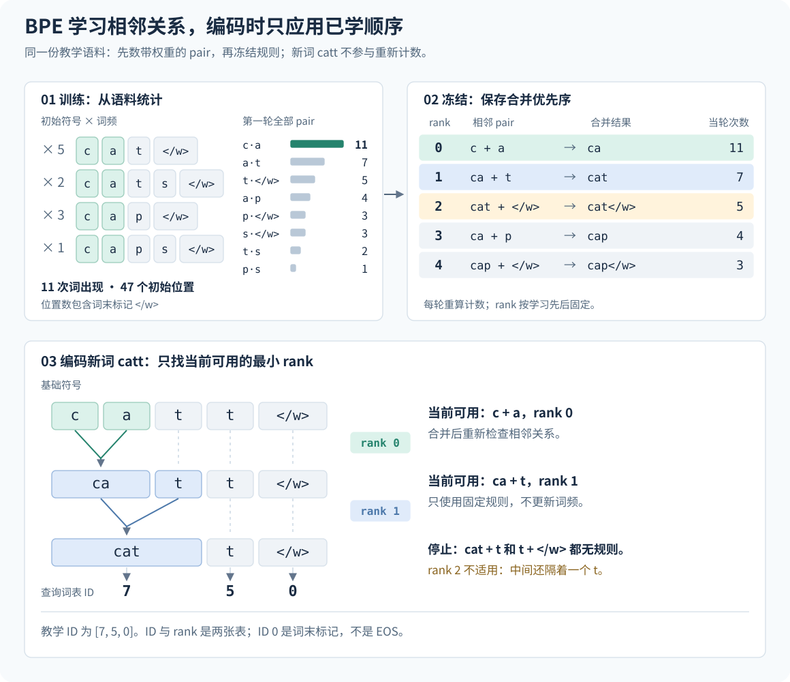

# 9 Tokenizer：从文本到固定维度的词表

## 同一句话，为什么会变成不同长度的输入

人读一句话时，会自然地辨认汉字、单词和标点。模型接收的却是一串整数。要把“猫坐下”交给模型，我们必须先约定：是每个汉字占一个位置，还是把“坐下”作为一个整体？英文 `cats` 是一个位置，还是 `cat` 与 `s` 两个位置？这些选择发生在神经网络计算之前，由 **tokenizer（分词器）** 决定。

这里的“分词”比日常理解的“找出单词”更宽。一个 **token（词元）** 可以是完整单词、单词的一部分、一个汉字，也可以是 UTF-8 编码中的一个字节。对同一段原文，不同 tokenizer 可能产生不同数量的 token。因此，模型能接收 4096 个 token，并不意味着能接收 4096 个汉字或 4096 个英文单词。前面的章节讨论了训练分布；现在要进一步决定，这个分布中的文本怎样变成模型可以处理的离散序列。

设原文为 \(u\)，tokenizer 为 \(\tau\)，输出为

$$
\tau(u)=s=(s_1,\ldots,s_L),\qquad s_t\in\{0,\ldots,V-1\}.
$$

这里 \(L\) 是这段文本产生的序列长度，\(V\) 是词表大小。**词表（vocabulary）** 保存 token 与整数 ID 的对应关系。例如，把“猫”编成 17、把“坐下”编成 42，就是一种可能的教学约定。17 比 42 小，不表示“猫”的含义更小；它们只是查表时使用的地址。后面的模型训练会学习这些地址所对应的向量。

Tokenizer 同时影响训练位置数、上下文覆盖和参数量，因此属于模型训练方案的一部分。本章先通过一个可以全部手算的小语料理解 BPE，再解释其他常见方法的区别，最后把分词规则连接到训练脚本、模型维度和数据分片。

## 词表只是分词器的一部分

假设词表里有 `c`、`a`、`t`、`ca` 和 `cat`。输入 `cat` 时，至少有三种合法切分：`c | a | t`、`ca | t` 和 `cat`。词表告诉我们哪些片段可用，却没有告诉我们应该选哪一种。决定切分的规则，也是 tokenizer 必须保存的内容。

**归一化（normalization）** 决定是否把全角字母转成半角、是否合并某些 Unicode 表示；**预分词（pre-tokenization）** 先划定哪些片段可以在内部继续切分；**编码器（encoder）** 按固定规则把这些片段变成 ID；**解码器（decoder）** 从 ID 恢复文本。特殊 token 则表示文档起止、填充等协议中的控制信息。

~~~text
原始文本 → 归一化 → 预分词 → 按已学规则切分 → 查询词表 → token ID
token ID → 查询 token → 解码 → 可恢复的文本
~~~

最后得到的是“可恢复的文本”，因为前面的操作可能已经丢掉信息。例如，归一化若把全角 `Ａ` 改成 `A`，解码时就无法判断原文使用了哪种字形。保存词表，却遗漏 normalizer、合并顺序或 decoder，保存的就不是完整的 tokenizer。

还要区分两种“训练”。**Tokenizer 训练**从文本统计中学习词表及切分规则；**语言模型训练**在编码后的序列上学习 embedding、注意力、MLP 等神经网络参数。下面的 BPE 小实验不需要 GPU，也不需要先建立 Transformer。通常应先训练并冻结 tokenizer，再生成语言模型的训练数据。

## 从四个词开始，完整训练一次 BPE

BPE 是 byte-pair encoding 的缩写。用于文本分词时，它反复把常见的相邻符号对合并成一个新符号。名字里的 byte 来自算法历史；本节为了手算，使用字符作为起点，稍后再讨论字节。文本子词分词中使用这一方法的经典来源是 [Sennrich 等人的原始论文](https://aclanthology.org/P16-1162/)。

### 先确定我们到底在数什么

下面是一份人为构造的教学语料。四行表示四种词形，频次表示该词在完整语料中出现多少次；不是说四行的权重都相同。

| 词形 | 出现次数 | 初始符号序列 |
|---|---:|---|
| `cat` | 5 | `c · a · t · </w>` |
| `cats` | 2 | `c · a · t · s · </w>` |
| `cap` | 3 | `c · a · p · </w>` |
| `caps` | 1 | `c · a · p · s · </w>` |

`·` 只显示相邻符号之间的分隔，不属于语料。`</w>` 是一个不可再拆的**词末标记**，区分“词在这里结束”和“词后面还有字符”。它是教学算法的边界符号，不是模型的 EOS。这个实验按词独立处理，不跨词合并，也不处理句子的空白恢复。

初始词表有六个符号：`c`、`a`、`t`、`p`、`s` 和 `</w>`。完整语料有 \(5+2+3+1=11\) 次词出现。把每个词的符号数乘以频次，初始位置总数为

$$
5\times4+2\times5+3\times4+1\times5=47.
$$

47 包括 11 个词末标记，是教学表示中的位置数，不是原文字符数。只有说清计数单位，后面的“缩短多少”才有确定含义。

设词形 \(w\) 的频次为 \(f(w)\)，当前符号序列为
\((q_1^{(w)},\ldots,q_{m_w}^{(w)})\)。相邻 pair \((a,b)\) 的加权次数定义为

$$
C(a,b)=
\sum_w f(w)
\sum_{i=1}^{m_w-1}
\mathbf{1}\!\left[q_i^{(w)}=a,\ q_{i+1}^{(w)}=b\right].
$$

\(\mathbf{1}[\cdot]\) 是指示函数：条件成立时取 1，否则取 0。内层数出 pair 在一个词形中出现几次，外层乘词频并汇总。例如 \((c,a)\) 在四种词形中各出现一次，所以为 \(5+2+3+1=11\)；\((a,t)\) 只出现在 `cat` 和 `cats`，所以为 \(5+2=7\)。

第一轮所有 pair 的计数如下，没有省略低频项：

| 相邻 pair | 贡献来源 | 加权次数 |
|---|---|---:|
| `(c, a)` | 四种词形 | 11 |
| `(a, t)` | `cat`、`cats` | 7 |
| `(t, </w>)` | `cat` | 5 |
| `(a, p)` | `cap`、`caps` | 4 |
| `(p, </w>)` | `cap` | 3 |
| `(s, </w>)` | `cats`、`caps` | 3 |
| `(t, s)` | `cats` | 2 |
| `(p, s)` | `caps` | 1 |

这里数的是相邻位置，不是“两个字符是否出现在同一个词中”。`(c,t)` 此时不相邻，所以不在表中。

### 第一轮之后，必须重新计算相邻关系

第一轮选择频次最大的 `(c, a)`，替换成新符号 `ca`。四种词形都少一个位置；按词频加权，共减少 11 个位置，得到 \(47-11=36\)。

~~~text
cat   ×5: ca · t · </w>
cats  ×2: ca · t · s · </w>
cap   ×3: ca · p · </w>
caps  ×1: ca · p · s · </w>
~~~

现在 `(c,a)` 已不存在，`(a,t)` 也不存在，新的相邻 pair 包括 `(ca,t)`、`(ca,p)`。继续拿第一张频次表选第二个 pair，就会合并已经不存在的符号。每轮都必须按**当前序列**更新计数。

下面展开接下来每轮的全部候选。每行表示合并**之前**的计数，冒号后为次数，第一项是本轮选中的 pair。

| 轮次 | 当前全部 pair 及加权次数 |
|---:|---|
| 2 | `(ca,t):7`；`(t,</w>):5`；`(ca,p):4`；`(p,</w>):3`；`(s,</w>):3`；`(t,s):2`；`(p,s):1` |
| 3 | `(cat,</w>):5`；`(ca,p):4`；`(p,</w>):3`；`(s,</w>):3`；`(cat,s):2`；`(p,s):1` |
| 4 | `(ca,p):4`；`(p,</w>):3`；`(s,</w>):3`；`(cat,s):2`；`(p,s):1` |
| 5 | `(cap,</w>):3`；`(s,</w>):3`；`(cat,s):2`；`(cap,s):1` |

第二轮把 `ca · t` 合成 `cat`；第三轮把 `cat · </w>` 合成 `cat</w>`。第三轮只改变词形 `cat`，不会改变 `cats`，因为后者的 `cat` 后面是 `s`。第四轮把 `ca · p` 合成 `cap`。

第五轮需要处理平局：`(cap,</w>)` 与 `(s,</w>)` 都是 3。本节规定，先比较频次，频次相同时比较 pair 的 Unicode 字典序：先比较第一个字符串，相同才比较第二个。`cap` 排在 `s` 前，所以选 `(cap,</w>)`。这是教学实现的规则，不代表所有 BPE 库都采用同一规则。若不固定平局规则，遍历顺序的变化就可能改变词表。

五轮的完整状态如下。每一步只替换本轮指定的相邻 pair：

| 状态 | 新增 token | `cat` × 5 | `cats` × 2 | `cap` × 3 | `caps` × 1 | 加权位置数 |
|---|---|---|---|---|---|---:|
| 初始 | — | `c a t </w>` | `c a t s </w>` | `c a p </w>` | `c a p s </w>` | 47 |
| 第 1 轮 | `ca` | `ca t </w>` | `ca t s </w>` | `ca p </w>` | `ca p s </w>` | 36 |
| 第 2 轮 | `cat` | `cat </w>` | `cat s </w>` | `ca p </w>` | `ca p s </w>` | 29 |
| 第 3 轮 | `cat</w>` | `cat</w>` | `cat s </w>` | `ca p </w>` | `ca p s </w>` | 24 |
| 第 4 轮 | `cap` | `cat</w>` | `cat s </w>` | `cap </w>` | `cap s </w>` | 20 |
| 第 5 轮 | `cap</w>` | `cat</w>` | `cat s </w>` | `cap</w>` | `cap s </w>` | 17 |

五个新符号加六个基础符号，词表共有 11 项。原来的单字符不能因为暂时不再单独出现就被删除；编码新词时仍可能使用。

本例没有重叠合并，因此每轮减少的位置数恰好等于选中 pair 的次数。但这不是普遍恒等式。例如 `a a a` 有两个相邻的 `(a,a)`，从左到右不重叠替换后只能得到 `aa a`，仅减少一个位置。脚本明确实现了这一规则，不能把 pair 频次当作所有情况下的实际替换次数。

### 编码时应用 merge rank，不重新学习频次

现在来了一个训练语料中没有出现过的词 `catt`。如果对它重新统计频次并学习词表，表示就会依赖当前输入，模型训练时的 ID 含义也会失去稳定基础。正常编码只应用已学规则。

给五条规则按学习顺序标上 **merge rank（合并优先序）**。脚本的 rank 从 0 开始：

| rank | 固定规则 |
|---:|---|
| 0 | `c + a → ca` |
| 1 | `ca + t → cat` |
| 2 | `cat + </w> → cat</w>` |
| 3 | `ca + p → cap` |
| 4 | `cap + </w> → cap</w>` |

编码先拆成基础符号，找出当前相邻 pair 中拥有规则的那些 pair，应用 rank 最小的规则，再检查新的邻接关系。没有可用规则时停止。

~~~text
c · a · t · t · </w>
    rank 0
ca · t · t · </w>
    rank 1
cat · t · </w>
    没有可用规则，停止
~~~

虽然词表有 `cat</w>`，此时也不能用，因为 `cat` 后面还有一个 `t`。另一个新词 `catcap` 会依次使用 rank 0、1、3、4，得到 `cat | cap</w>`。两次编码都没有新增 token 或重估语料频次。

然后再查 ID 表。脚本先按 Unicode 字典序排列基础符号，再按学习顺序追加新符号；因此 `catt` 的 token 是 `cat | t | </w>`，教学 ID 为 `[7, 5, 0]`。这些数只属于小实验，不能复制到模型配置里。本实验没有 BOS、EOS 或 PAD；ID 0 是词末标记。

图 9.1：先在左上核对 `(c,a)` 的 11 次来自哪四种词形，再沿下半图应用右上已经冻结的 rank 表。合并后保留各 token 的位置跨度，使未参与合并的第二个 `t` 清晰可见：它阻止 `cat` 与词末标记相邻，因此 rank 2 不能使用。最后一行才查询词表 ID；ID 和 rank 不是同一张表。图中数字是前述小语料的手算结果。[可编辑 TikZ 源](../assets/figures/bpe-learning-vs-encoding-zh.tex)

### 把手算变成可核对的产物

仓库的 [`examples/book/bpe_walkthrough.py`](https://github.com/WenbinWang12/Modern-Sequence-Models-from-Scratch/blob/main/examples/book/bpe_walkthrough.py) 仅使用 Python 标准库，把计数、合并、训练和编码分别写成函数。两个关键决定直接可见：

~~~python
# 训练：频次优先，同频时按 pair 字典序决定。
chosen = min(counts, key=lambda pair: (-counts[pair], pair))

# 编码：只在已有规则中选 rank 最小的一项。
pair = min(candidates, key=lambda candidate: ranks[candidate])
~~~

在准备好的 Linux 实验环境中，从仓库根目录执行：

~~~bash
.venv/bin/python examples/book/bpe_walkthrough.py \
  --output outputs/book/bpe-walkthrough.json
~~~

运行会保存每轮合并前后的序列、全部 pair 次数、最终词表、新词编码轨迹、Python 版本和脚本 SHA-256。**根据理论计算**，五轮 pair 次数应为 `[11, 7, 5, 4, 3]`，位置数应从 47 变为 `[36, 29, 24, 20, 17]`。这些是手算预期；你本次运行的证据是生成的 JSON。

脚本拒绝覆盖已有报告，重新运行时请使用新的输出文件名。它刻意只处理单个词及已知基础字符。输入“猫”会报错，因为初始字母表没有它。这说明，能组合出训练中未见的词，不等于能表示任意文字；正式 tokenizer 的覆盖问题需要另外解决。

## WordPiece 与 Unigram：不同的切分决定

理解 BPE 后，应分别问其他方法两个问题：训练保存了什么？编码依据什么选择切分？共享“子词词表”的外观，并不意味着使用同一算法。

### WordPiece 的一个确定含义：BERT 怎样编码

以 BERT 的 WordPiece 编码器为具体对象：从词的左侧开始，选择词表中能匹配的最长片段；词中间的片段带 `##` 前缀。例如，教学词表有 `cat` 和 `##s`，没有 `cats`，则 `cats` 被编码为 `cat | ##s`。`##` 表示这是后续片段，不是原文里的井号。

若剩余部分不能完成切分，BERT 的实现会把这个词记为未知词，而不是重新训练规则；具体行为可核对 [BERT 原始 tokenization.py 中的 WordpieceTokenizer](https://github.com/google-research/bert/blob/master/tokenization.py)。这里解释的是该实现的**最长匹配编码**。WordPiece 词表训练不能简单等同于前面的最大 pair 次数过程，本章也没有实现完整的 WordPiece 训练器。仓库的正式训练入口仅提供 BPE 和 Unigram。

### Unigram：给不同切分打概率分

Unigram 为片段赋予概率。对候选切分 \(\sigma=(v_1,\ldots,v_K)\)，在片段独立假设下使用乘积：

$$
P(\sigma)=\prod_{j=1}^{K}p(v_j),
\qquad \sum_{v\in\mathcal V}p(v)=1.
$$

\(\mathcal V\) 是片段集合；“独立”是分词模型计算分数的假设，不是在声称自然语言中的词互不相关。这个概率也不是后续神经语言模型给出的条件概率。

仍用 `cat`，人为给出五项词表：

| 片段 | `c` | `a` | `t` | `ca` | `cat` |
|---|---:|---:|---:|---:|---:|
| \(p(v)\) | 0.10 | 0.10 | 0.20 | 0.25 | 0.35 |

概率和为 1。三种合法切分分别得到

$$
\begin{aligned}
P([\texttt{cat}])&=0.35,\\
P([\texttt{ca},\texttt{t}])&=0.25\times0.20=0.05,\\
P([\texttt{c},\texttt{a},\texttt{t}])&=0.10\times0.10\times0.20=0.002.
\end{aligned}
$$

取最大分数得到 `cat`。若要在这些切分中采样，先按同一原文归一化：总分为 \(0.402\)，完整 `cat` 的条件概率是 \(0.35/0.402\approx0.871\)，而不是直接把 0.35 当作三种候选中的抽样概率。改变片段概率可能改变最佳切分；这里没有 merge rank。

长字符串不能显式枚举所有切分。由于对数单调递增，最大乘积等价于最大对数和。设 \(D(j)\) 为前 \(j\) 个字符的最佳对数分数，空前缀设为 \(D(0)=0\)，则

$$
D(j)=
\max_{\substack{0\le i<j\\u_{i+1:j}\in\mathcal V}}
\left[D(i)+\log p(u_{i+1:j})\right].
$$

意思是枚举最后一个片段的起点，把它接在最佳前缀之后。记录每个位置选中的起点，再从末尾回溯，就能恢复切分。对上表，前两个字符的最佳分数为 \(\log0.25\)；到第三个字符时比较 \(\log0.35\) 与 \(\log0.25+\log0.20\)，仍选择整个 `cat`。无法覆盖的前缀使用负无穷分数。

上面的概率是教学设定。真实训练需要估计概率并缩减词表。若 \(\mathcal S(u)\) 是所有能拼成 \(u\) 的切分，训练希望**最大化**下面的对数似然；若采用最小化损失的写法，则应对整个式子取负号：

$$
\mathcal J_{\mathrm{tok}}
=\sum_u f(u)\log
\left[
\sum_{\sigma\in\mathcal S(u)}
\prod_{v\in\sigma}p(v)
\right].
$$

先将同一字符串的各切分概率相加，再按文本频次计算对数似然。训练会交替估计分词统计、更新概率，并删除对目标贡献较小的候选，同时保护必要基础字符。原始方法见 [Kudo 的 Unigram 子词模型论文](https://aclanthology.org/P18-1007/)。本节解释了分数、最佳切分和训练目标；EM 更新、候选生成及剪枝实现不在此展开，实验交给固定版本的库。

SentencePiece 是支持 BPE、Unigram 等方法的工具包。把“BPE、Unigram、SentencePiece”列成三个同层级的算法，会混淆方法与实现工具。

## 从字符覆盖到字节覆盖

字符 BPE 只能编码初始字母表包含的字符。对中英混合语料，枚举所有可能的字符并不方便。另一条路径是先把文本编码成 UTF-8 字节：每个字节取 0 到 255，共 256 种值。只要这些基础字节都可表示，就能把有效 UTF-8 文本拆回基础单位；高频字节片段还可以通过 BPE 合并，或交给 Unigram 的片段模型。

这里必须分开看三个操作。**ByteLevel 预分词器**把字节映射为供算法处理的字符表示；**完整初始 alphabet**要求 trainer 保留全部 256 种基础表示，即使训练样本没有出现；**ByteLevel decoder**再把这些表示转回字节与文本。只设置预分词器，不能代替后两步。Tokenizers 0.22.2 的 [BpeTrainer 与 UnigramTrainer API](https://raw.githubusercontent.com/huggingface/tokenizers/v0.22.2/bindings/python/py_src/tokenizers/trainers/__init__.pyi) 都支持 `initial_alphabet`；Unigram 的 [训练源码](https://github.com/huggingface/tokenizers/blob/v0.22.2/tokenizers/src/models/unigram/trainer.rs) 把它并入必须保留的字符。

仓库脚本现在把 `ByteLevel.alphabet()` 传给两种 trainer，并设置 decoder。这不意味着两种算法相同：BPE 仍学习合并规则，Unigram 仍学习片段分数。这里实现的是完整字节基础表示，也不应与其他 tokenizer 的 `<0xXX>` 未知字符回退协议混为一谈。

默认另有四个特殊 token，因此请求词表大小至少为 \(256+4=260\)。这个下界只保证有地方放基础单位，不保证实际词表恰好等于请求值。语料太少、BPE 可用 pair 不足或库的训练约束，都可能使实际值偏离目标；模型配置必须读取实际产物。

### 字节完整，也不等于原文无损

脚本使用 NFKC 归一化。原文 `Ａ① 猫🙂` 归一化后是 `A1 猫🙂`。解码得到后者，只说明保留了**归一化后的文本**；它无法恢复原来的全角字母和圈号数字。清洗章采用 NFC 时保留的兼容字形，仍会在这一 tokenizer 阶段改变，因此单看上游清洗规则不能断言整个数据流程无损。

因此，对于没有被当作控制 token 处理的普通文本，关闭额外空白清理后，本章检查的是

$$
\operatorname{decode}\!\left(\operatorname{encode}(u)\right)
=\operatorname{NFKC}(u),
$$

而不是无条件等于 \(u\)。检查时应关闭自动加入特殊 token，并覆盖训练外的中文、emoji、换行、制表符与兼容字形。若选择 `--no-byte-level`，脚本改用 Whitespace 预分词；它不保留任意原始空白，也没有完整字节覆盖保证，不能照搬上述预期。若需要保留字形差异，应在训练 tokenizer **之前**重新选择归一化策略。

仓库还提供无需训练的 `ByteTokenizer`：字节 0–255 对应 ID 3–258，PAD、BOS、EOS 分别为 0、1、2，总词表为 259。它不做前面的 NFKC 归一化，适合检查数据与模型接口；代价是序列较长，例如一个常见汉字通常占三个 UTF-8 字节。覆盖是否完整与序列是否紧凑，是两个不同问题。

## 词表怎样固定模型的输入与输出维度

ID 不是向量，模型先用 embedding 矩阵把它变成向量。设隐藏维度为 \(d\)，则

$$
E\in\mathbb R^{V\times d},\qquad
s_t\longmapsto E_{s_t,:}\in\mathbb R^d.
$$

每个 token 占一行，所以词表越大，矩阵行数越多。模型经过若干层计算，得到长度为 \(d\) 的隐藏向量 \(h\)。为了预测下一个 token，还要为每个词表候选输出分数：

$$
z=hW_{\mathrm{out}},\qquad
W_{\mathrm{out}}\in\mathbb R^{d\times V},\qquad
z\in\mathbb R^V.
$$

这里将 \(h\) 写成行向量，\(z\) 的分量称为 logits。softmax 再把分数转成总和为 1 的概率。因此，**固定词表后，最终分类头的输出维度就固定为 \(V\)**。MLP 的中间宽度可以另选，但在此架构中回到残差流的输出仍为 \(d\)，最后由词表投影把 \(d\) 映射到 \(V\)。

输入 embedding 与输出投影可以共享权重，称为 **tied embeddings**，即 \(W_{\mathrm{out}}=E^{\mathsf T}\)。不共享时两个矩阵各有 \(Vd\) 个参数；共享时只保存一份。下面忽略偏置：

| \(V\) | \(d\) | 单份 embedding 参数量 \(Vd\) |
|---:|---:|---:|
| 259 | 16 | 4,144 |
| 32,000 | 16 | 512,000 |
| 128,000 | 16 | 2,048,000 |
| 32,000 | 768 | 24,576,000 |
| 128,000 | 768 | 98,304,000 |

大词表可能用更少位置表示常见文本，却需要更大的 embedding 与输出投影，也可能让稀有 token 缺少训练样本。所以选择词表需要同时考虑压缩效果、语言与领域覆盖、模型规模和训练预算，不能只看词表更大或序列更短。

## 用仓库脚本训练，并保存可重用的 tokenizer

正式入口是 [`scripts/train_tokenizer.py`](https://github.com/WenbinWang12/Modern-Sequence-Models-from-Scratch/blob/main/scripts/train_tokenizer.py)。下面假设已按环境章节准备好 `.tools/uv` 和 `.venv`；只增加 tokenizer 依赖，保留此前的其他 extras：

~~~bash
.tools/uv sync --frozen --inexact --python .venv/bin/python --extra tokenizer
~~~

训练输入应来自清洗、去重、切分后的训练部分，不能把验证或测试数据一起用来选词表。即使不训练神经网络，看到评测文本仍会改变词表与编码长度。还应记录 tokenizer 训练样本中的语言与领域比例：纯英文小样本学出的合并不一定适合中英混合模型。

准备 `data/tokenizer/train.jsonl`，每行是包含字符串字段 `text` 的 JSON 对象。下面是训练入口示例，仓库不会自动提供这份正式语料：

~~~bash
.venv/bin/python scripts/train_tokenizer.py \
  --input data/tokenizer/train.jsonl \
  --output outputs/tokenizer-32k \
  --algorithm bpe --vocab-size 32000 --text-key text
~~~

脚本把 JSONL 字段写成临时文本，统一 CRLF/CR 为 LF，每条记录后加换行，并保留字段原有的内部换行。因此这是按文本文件行读取的 tokenizer 训练语料，临时文件的一行未必对应原 JSONL 的一篇文档。文档边界协议在随后生成模型数据时处理。

默认启用 byte-level。`--algorithm unigram` 同时更换 model 与 trainer；`--min-frequency` 仅作用于 BPE，`--max-piece-length` 仅作用于 Unigram。关键的覆盖设置为：

~~~python
initial_alphabet = sorted(pre_tokenizers.ByteLevel.alphabet())

# 两种 trainer 都传入同一套基础字节表示。
trainer = trainers.BpeTrainer(
    vocab_size=32_000,
    initial_alphabet=initial_alphabet,
    special_tokens=["<pad>", "<bos>", "<eos>", "<unk>"],
)
~~~

这是解释配置关系的片段，完整执行入口仍为上面的脚本。脚本同时设置 NFKC、ByteLevel 预分词器与 decoder，保存 Hugging Face tokenizer 目录。`tokenizer_metadata.json` 记录请求与实际词表大小、特殊 ID、normalizer、decoder、基础字符表大小、库版本、输入摘要和 `tokenizer.json` 的 SHA-256。

摘要能核对文件是否相同，却不能保证不同库版本、并行调度或平局实现下重新训练一定逐字节相同。教学 BPE 明确规定了平局规则；库实现则应以固定版本和最终文件为准。脚本拒绝已有输出目录，并在训练前后检查输入及实际训练文本的摘要，发现变化就拒绝保存新 tokenizer；元数据分别记录原输入与转换后的训练文本摘要。每个实验应使用新路径，并归档完整目录及元数据。

## 接入数据管线之前，检查什么

第一类检查是**表示正确性**：ID 在 \([0,V)\) 内，特殊 ID 不冲突，未知输入处理符合预期，编码解码符合归一化策略。`tests/test_tokenizer_training.py` 用仅含 ASCII 的小语料训练 BPE 和 Unigram，再检查训练外的中文、emoji、空白与 NFKC 变化。它检验覆盖与接口，不评价语言质量。

第二类是**编码成本**。对固定原文，设 UTF-8 字节总数为 \(N_{\mathrm{bytes}}\)，普通 token 总数为 \(T\)，报告

$$
r_{\mathrm{tok/byte}}=\frac{T}{N_{\mathrm{bytes}}}.
$$

比较时要使用同一批原文、相同字节统计口径，并说明是否计入 BOS/EOS。例如同一份 1000 字节文本分别编码为 500 或 800 个 token，比率就是 0.5 或 0.8。前者占用的训练位置更少，但不能据此推断模型质量更好。

按语言、领域分别计算比率，再看文档长度分布、截断比例、UNK 比例和特殊 token 频率。总体均值可能掩盖中文变长、代码缩进处理错误或小语种频繁落到 UNK 的问题。单 token 交叉熵也不能在不同 tokenizer 之间直接当作同单位的质量分数：它们预测的基本事件已改变。

第三类是**特殊 token 协议**。BOS 表示序列开始，EOS 表示序列或文档结束，PAD 用于填充，UNK 表示未知项。字符串、ID、添加位置和是否参与损失都要一致。声明 BOS ID，不代表每次 `encode` 都会自动插入；数据脚本再加入一次，也可能造成重复。

[`ttt.data`](https://github.com/WenbinWang12/Modern-Sequence-Models-from-Scratch/blob/main/ttt/data.py) 提供 `ByteTokenizer` 和 `HuggingFaceTokenizer`。后者先调用 `encode(add_special_tokens=False)`，再按配置手动加入 BOS；EOS 由数据准备阶段追加。当前行为如下，loss mask 的逐位置含义将在下一章展开：

| 数据路径 | BOS | EOS | loss mask |
|---|---|---|---|
| 普通 NPY | 有 BOS ID 时由 `encode` 加入 | 有 EOS ID 时每篇文档追加 | 无单独 mask 文件，目标默认有效 |
| 分片普通 LM | 同上 | 同上 | BOS 为 0，其余 token 为 1 |
| 分片监督数据 | prompt 加入，response 不重复加入 | response 后追加 | prompt 为 0，response 与 EOS 为 1 |

生成分片时传入固定的本地 tokenizer 目录。下面是两个替代实验；`corpus.jsonl` 要换成已准备的语料，第二条还要求先完成 tokenizer 训练：

~~~bash
.venv/bin/python -m ttt.data --input corpus.jsonl \
  --output data/pretrain-byte --sharded --tokenizer byte

.venv/bin/python -m ttt.data --input corpus.jsonl \
  --output data/pretrain-bpe --sharded --tokenizer outputs/tokenizer-32k
~~~

两条命令使用不同输出目录。数据 manifest 记录 tokenizer 名称、词表大小、输入与分片摘要；特殊 ID、normalizer、库版本及 tokenizer 文件摘要需要连同训练脚本元数据归档，不能假设 manifest 自动包含所有字段。加载远端 tokenizer 时还要固定 revision 和本地文件；当前 CLI 没有单独暴露 revision 参数。

Tokenizer 的身份包括词表、切分规则和前后处理配置，不能简化为词表大小。更换 tokenizer 后必须重建 token 分片，并核对实际 \(V\) 与模型配置。旧 ID 仍在合法范围内，不代表它指向同一个 token；已有 checkpoint 也不能只改 `vocab_size` 就继续使用。

现在我们得到了一条有明确含义的 token 流。下一章把它变成模型真正消费的固定窗口：哪些位置作为输入，哪些作为预测目标，跨文档边界怎样影响监督与可见上下文。
