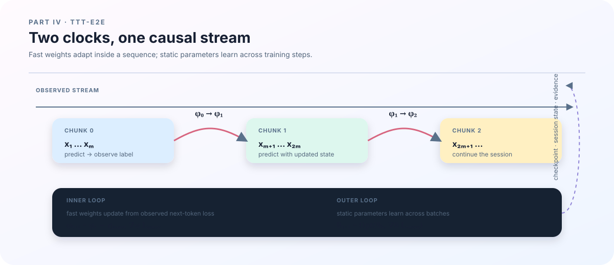

# 16. Forward order: how one token travels through TTT-E2E

## Do not start with a kernel

TTT-E2E contains several new terms: prefix, suffix, fast weights, inner loss, MLP-prime, and KV cache. The safest first reading is to follow one token through the residual stream. Once the order is clear, the implementation details have a place to attach.

The model first looks up a token ID in an embedding table. Each block then sends the hidden state through attention or a gated-delta state update, followed by an MLP. Selected later blocks have one additional fast MLP-prime. The final hidden state is normalized and projected into vocabulary logits.

~~~text
token ids
   ↓
embedding
   ↓
attention / gated delta + residual
   ↓
fast MLP-prime + residual       (selected later blocks)
   ↓
static MLP or MoE + residual
   ↓
final norm → lm_head → logits
~~~

Every arrow is an interface for a shape, a mask, a cache, and a gradient. Moving MLP-prime before or after the ordinary MLP changes the algorithm. Updating it after every token, at the end of a chunk, or before the next chunk also changes the meaning of the state.

<figure class="book-figure">
  
  <figcaption><strong>Figure 3. Two clocks in TTT.</strong> Each chunk predicts with the current fast weights and updates \( \phi \) from observed labels; \( \theta \) is updated across batches by the outer loop.</figcaption>
</figure>

## The order implemented in this repository

The forward path in <code>TTTE2EForCausalLM._block</code> first executes the attention branch. A layer whose type is <code>full_attention</code> or <code>sliding_attention</code> calls attention. A <code>gated_delta</code> layer instead updates a recurrent state. The branch output is added back to the hidden state, producing the attention residual.

If the configuration contains <code>fast_mlp</code>, the block then reads the current fast-weight version of MLP-prime. It applies normalization, SwiGLU, and an optional post-normalization, and adds the result to the residual stream. Only after that does the block execute the ordinary static MLP or the MoE branch.

The conceptual order is therefore:

~~~text
attention / gated delta
→ fast MLP-prime
→ static MLP or MoE
~~~

This is an additional adaptation path, not a replacement of the original feed-forward network. If fast weights are absent, the configuration and parameter tree do not silently create a fast path. A shape check can confirm that tensors fit, but it cannot confirm that this semantic order is correct.

## Prefix and suffix

The configuration divides the block stack into a prefix and a suffix. The prefix runs the static part once and produces hidden states for every position. The suffix consumes those hidden states while carrying the updateable fast weights.

This division avoids repeating all static computation inside the inner loop, but it creates an alignment requirement. The prefix cache, hidden states, positions, and masks must describe the same sequence positions that the suffix scans. A suffix is not an independent piece of text; it receives representations produced for those exact positions.

In the current training path, <code>sequence_loss</code> pads a token sequence to a multiple of <code>ttt_chunk_size</code> and reshapes it into chunks. It runs the prefix once, then scans the suffix chunk by chunk. The fast state starts at <code>initial_fast_weights</code>, and the next chunk receives the state returned by the previous chunk. If the final chunk contains padding, its masked labels must not change the fast state.

## Why fast weights are not ordinary parameters

Ordinary parameters are shared by many examples and updated by the outer optimizer. They survive from one training step to the next. Fast weights are temporary task or session state: an inner loss can change them while a sequence is being processed.

Use two time indices to keep the clocks separate:

$$
\theta_{k+1}
=
\operatorname{AdamW}\!\left(
\theta_k,\,
\nabla_\theta \mathcal{L}_{\mathrm{outer}}
\right),
$$

$$
\phi_{t+1}
=
\phi_t
-\eta_{\mathrm{inner}}
\nabla_\phi
\mathcal{L}_{\mathrm{inner}}
\left(x_t;\theta,\phi_t\right).
$$

Here \( \theta \) denotes static model parameters and \( \phi \) denotes fast weights. The outer loop learns how the fast state should be initialized and used; the inner loop adapts that state to the current context. Putting \( \phi \) directly into the AdamW optimizer state would merge two different time scales and would no longer describe TTT.

## Prefix prediction, label use, and causality

A safe causal update has this order:

~~~text
use fast_t to predict y_t
→ compute inner loss from the observed label
→ update to fast_{t+1}
→ let later chunks use fast_{t+1}
~~~

The label used for an inner update must be available at the point where the update happens. If a suffix label is used to update the state before the same position is predicted, the model receives future information and the measured loss is too optimistic.

The test is simple to state. Change a later suffix token while keeping the prefix fixed, then compare the logits at earlier positions. Earlier logits must remain unchanged up to the numerical tolerance. This test catches semantic leakage that tensor-shape tests cannot see.

The current inner step computes a value and gradient with respect to fast weights, then applies <code>sgd_update</code>. The outer loss differentiates through <code>sequence_loss</code>. Whether higher-order gradients are retained depends on the resulting computation graph and on any rematerialization or checkpointing policy. “The fast state changed” and “the outer loss differentiates through that change” are separate claims.

## A small chunk calculation

Let the sequence length be \(8\) and the chunk size be \(4\). The numbers \(0\) through \(7\) below are code array indices; in the book's mathematical notation they correspond to positions \(1\) through \(8\):

~~~text
chunk 0: positions 0, 1, 2, 3
chunk 1: positions 4, 5, 6, 7
~~~

Chunk 0 predicts with \( \phi_0 \), obtains \( \mathcal{L}_0 \), and updates to \( \phi_1 \). Chunk 1 predicts with \( \phi_1 \), obtains \( \mathcal{L}_1 \), and may then produce the next state. If the last chunk has only two real positions, the other two are padding. The mask sets those label weights to zero, so padding contributes neither loss nor an inner update.

This is why chunk size is an algorithmic variable, not merely a batching detail. A smaller chunk lets the fast state observe context more often but increases scan and update overhead. It also changes the boundary through which gradients and caches are carried.

## How to validate that the forward pass is semantically correct

A useful validation set contains at least four checks:

1. Compare the dense path with fast MLP disabled, including shapes and numerical values.
2. Change suffix tokens and verify that prefix logits do not change.
3. Compare full-sequence execution with prefill/decode streaming under the same initial state and masks.
4. When changing chunk size, record whether it is an intended algorithm change or only an implementation optimization.

The GPU validation script writes architecture and runtime reports. Every report must be tied to the configuration, initial parameter state, mask, and software revision. One passing sequence length does not prove that every <code>layer_type</code>, chunk size, or session boundary is correct.

The next chapter turns this forward order into an explicit inner loop and outer loop, and follows the loss through both time scales.

## Shape walk for one token

Use the tiny configuration with \(d=16\), \(V=259\), batch \(B=1\), and \(L=4\) positions:

| Stage | Code object | Shape | Check |
|---|---|---|---|
| Input | <code>input_ids</code> | \([1,4]\) | every integer is in \([0,259)\) |
| Embedding | hidden | \([1,4,16]\) | token IDs become residual vectors |
| Attention/delta | residual | \([1,4,16]\) | only permitted history is read |
| MLP-prime | fast branch | \([1,4,16]\) | intermediate width returns to 16 |
| Output | logits | \([1,4,259]\) | every position has 259 candidate scores |

The last column matters as much as the shape: it explains why each interface has that shape.

## A numerical causality assertion

Let code indices 0 and 1 be the prefix and 2 and 3 be the suffix. Run twice with the same initial parameters and mask, changing only the token at index 3 from 18 to 19. Record the maximum absolute logit difference:

~~~text
max_abs_diff(logits_a[:, 0:2, :], logits_b[:, 0:2, :]) <= 1e-6
max_abs_diff(logits_a[:, 2:, :], logits_b[:, 2:, :]) may be > 0
~~~

The first line failing indicates future information reached the prefix. The second line may change because the suffix saw a different input. This assertion tests the causal mask and fast-state boundary more directly than an output-shape check.

## Minimal validation

On a remote GPU node, run <code>bash scripts/validate_gpu.sh outputs/gpu-validation.json</code>. The report should contain an architecture summary, full-sequence versus streaming logits, a causality check, state shapes, and restore results. If it fails, inspect the configuration, mask, and initial state in the report first. Passing one tiny length does not establish every layer type or context length.

## Summary

- Forward order determines what each residual path and state can observe.
- Fast weights are sequence or session state, not ordinary AdamW parameters.
- Prefix/suffix, chunks, and masks must use the same position coordinate.
- Causality requires a numerical future-token perturbation test.
- The next chapter expands this state transition into inner and outer gradient paths.
