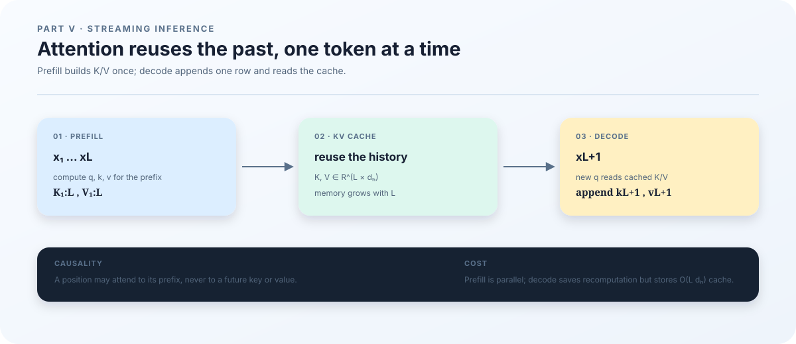

# 18. Attention, caches, and streaming inference

## Why generating a sentence requires state

The previous chapter established when fast weights change. We now change the execution pattern from a whole sequence to tokens arriving one at a time. Suppose the model has read “The weather today” and receives another token. It needs the known prefix to continue predicting. Recomputing the prefix on every call repeats the same historical key and value calculations. A KV cache stores those intermediate results to avoid that repetition.

We retain the tiny example with hidden width \(d=16\) and TTT chunk length \(C=4\). First we calculate attention with two-dimensional vectors; then we track a session from \(x_1\) through \(x_6\). The prerequisites are matrix multiplication and softmax, whose roles we connect explicitly below. The goal is to explain which history each step reads, which state it writes, and why future tokens remain inaccessible.

<figure class="book-figure">
  
  <figcaption><strong>Figure 4. From sequence processing to token processing.</strong> Follow the new token to its query and follow the historical arrows to the keys and values it can read. The figure explains the cache; a TTT session additionally retains fast weights, positions, and an unfinished chunk.</figcaption>
</figure>

## From retrieving relevant information to two positions

Attention is a weighted retrieval operation. A query represents what the current position needs, a key represents what a candidate position offers, and a value carries the information retrieved. These are learned linear projections, not human-assigned semantic labels:

$$
Q=HW_Q,\qquad K=HW_K,\qquad V=HW_V.
$$

Here \(H\in\mathbb R^{L\times d}\) contains one sequence's hidden states, \(L\) is its length, and one head has \(Q,K\in\mathbb R^{L\times d_h}\). The dot product \(q_t^\top k_s\) measures compatibility in the learned representation space. Dividing by \(\sqrt{d_h}\) controls its scale: if the components are independent with zero mean and unit variance, the dot product has variance \(d_h\), and the scaled result has variance 1. This motivates the scaling; it does not assert that trained queries and keys follow those assumptions exactly.

Set \(L=d_h=2\), using already projected matrices:

$$
Q=\begin{bmatrix}1&0\\1&0\end{bmatrix},\quad
K=\begin{bmatrix}1&0\\0&1\end{bmatrix},\quad
V=\begin{bmatrix}10&0\\0&10\end{bmatrix}.
$$

Before masking, the scores are

$$
S=\frac{QK^\top}{\sqrt2}
=\begin{bmatrix}0.7071&0\\0.7071&0\end{bmatrix}.
$$

Position 1 must not read position 2 in an autoregressive language model. Otherwise, an input from the future might reveal the answer it is supposed to predict. An additive causal mask contributes zero to allowed scores and negative infinity to forbidden scores:

| Query position \ historical position | \(s=1\) | \(s=2\) |
|---|---:|---:|
| \(t=1\) | \(0\): allowed | \(-\infty\): future |
| \(t=2\) | \(0\): allowed | \(0\): allowed |

Write this additive attention mask as \(\mathcal M\), distinguishing it from the data chapters' loss mask. Applying softmax independently to each row gives weights \(A\) and output \(O\):

$$
\mathcal M=\begin{bmatrix}0&-\infty\\0&0\end{bmatrix},\qquad
A=\operatorname{softmax}_{\rm row}(S+\mathcal M)
=\begin{bmatrix}1&0\\0.6698&0.3302\end{bmatrix},
$$

$$
O=AV=\begin{bmatrix}10&0\\6.698&3.302\end{bmatrix}.
$$

Position 1 uses only the first value; position 2 mixes both. Keeping the diagonal is correct: the representation at input position \(t\) includes \(x_t\) and predicts \(x_{t+1}\). Observing the current input is different from observing its next-token label. This scaled dot-product construction and causal masking follow the [original Transformer formulation](https://arxiv.org/abs/1706.03762).

## What a KV cache does and does not store

In ordinary causal attention, a new token needs its own \(q,k,v\); its key and value are appended to the cache. Historical keys and values remain available, and the new query compares against the currently visible keys. A KV cache is intermediate computation, not a new set of trainable parameters, and it cannot replace model weights.

For memory estimates, batched inference is often described with the conceptual layout \([B,n_{\rm kv},L,d_h]\), where \(B\) is the number of sessions and \(n_{\rm kv}\) the number of KV heads. This repository's <code>KVCache</code> serves a single session and actually stores keys and values as \([\text{capacity},n_{\rm kv},d_h]\), plus a positions array of length capacity. An assertion copied from the conceptual layout would incorrectly reject this implementation.

If each key/value element uses \(b\) bytes, and all layers share the same length and head configuration, the KV data alone occupy approximately

$$
M_{\rm KV}=2B\,n_{\rm layers}\,n_{\rm kv}\,L\,d_h\,b.
$$

With \(B=1\), \(n_{\rm kv}=2\), \(L=4096\), \(d_h=64\), and \(b=2\), this is \(2{,}097{,}152\) bytes, or \(2\) MiB, per layer; 12 layers use \(24\) MiB. This excludes weights, fast weights, activations, workspace, positions, and allocator overhead. With grouped-query attention, several query heads share fewer KV heads; use the KV head count in the formula.

Three lengths must remain distinct: observed token count, allocated cache capacity, and the attention window currently visible. <code>TTTSession</code> grows capacity, while sliding attention restricts visible history through positions and masking. A window constraint does not establish that the allocator holds exactly “window length times bytes per token.” Inspect actual arrays and device memory statistics.

## Prefill and decode follow the same timeline

Prefill processes an already supplied prefix; decode processes a subsequently arriving token. These names describe call patterns, not different causal rules. In this repository, both <code>prefill</code> and <code>decode</code> ultimately use <code>observe</code>. Splitting the same token stream across calls should preserve its prediction and update semantics.

Continue with \(C=4\). The four inputs \(x_1,x_2,x_3,x_4\) have targets \(x_2,x_3,x_4,x_5\). After observing \(x_4\), the last label is still unavailable. The following table assumes enabled inner updates and a nonempty fast-weight tree. The cache column describes valid history; allocated capacity can be larger.

| After the call | position | pending_count | Pending targets | Fast weights | updates | Valid cache |
|---|---:|---:|---|---|---:|---|
| reset | 0 | 0 | none | \(\phi_0\) | 0 | none |
| prefill \(x_1,\ldots,x_4\) | 4 | 4 | \(x_2,x_3,x_4\) | \(\phi_0\) | 0 | \(x_1,\ldots,x_4\) |
| decode \(x_5\) | 5 | 1 | none | \(\phi_1\) | 1 | \(x_1,\ldots,x_5\) |
| decode \(x_6\) | 6 | 2 | \(x_6\) | \(\phi_1\) | 1 | \(x_1,\ldots,x_6\) |

When \(x_5\) arrives, the program first completes the previous chunk's labels, performs its update, and then processes \(x_5\) with \(\phi_1\) to predict \(x_6\). This does not leak \(x_5\) into the prediction of \(x_5\), which was already made while processing \(x_4\). “None” in the third row means the new chunk has no known target yet, not that the model has failed to observe \(x_5\).

Historical suffix caches may have been produced under earlier fast weights. This implementation retains them instead of re-encoding all history after every update. Therefore, rerunning the entire prefix with the latest \(\phi\) is not a valid equality reference. Compare <code>sequence_loss</code> and <code>TTTSession</code> under the same chunk boundaries and cache history rules. Their agreement establishes that the batch and streaming paths implement the same algorithm.

## A session is jointly evolving state

Saving KV alone cannot restore TTT inference. The following fields jointly determine the next call:

| State | Why it matters |
|---|---|
| fast_weights | Determine the current adapted computation |
| cache, position | Determine visible history, positional encoding, and writes |
| pending_features, pending_targets, pending_count | Reconstruct the unfinished inner-loop sample |
| chunk_cache, chunk_start | Retain the suffix history at the current chunk's start |
| last_logits | Preserve the most recent next-token distribution |
| updates, rng_key | Preserve update counts and the random process |

<code>ttt/session_store.py</code> saves arrays together with metadata. Loading checks model revision, configuration, inner-loop settings, array shapes and dtypes, token ranges, positions, and chunk boundaries. The format version is 2, and loading targets the first local device. These are implementation constraints, not a promise of arbitrary model-version or distributed-topology migration.

A meaningful restoration check saves in the middle of a chunk, sends the same suffix through the original and restored sessions, and compares logits, fast weights, update counts, and positions. It should also cover a full chunk whose final target has not yet arrived. The repository contains <code>tests/test_session_store.py</code> and <code>tests/test_runtime_consistency.py</code>. The single-GPU validation script does not call the former; its success cannot stand in for session restoration coverage.

## Connecting implementation to evidence

| Question | Code location |
|---|---|
| Key/value layout, RoPE, causal and window masks | <code>ttt/models/ttt_e2e/attention.py</code> |
| Prefill/decode, arriving labels, chunk completion | <code>ttt/runtime.py</code> |
| Chunk-based training reference | <code>ttt/inner_loop.py</code> |
| Saving sessions and checking restores | <code>ttt/session_store.py</code> |
| GPU causality and streaming checks | <code>ttt/validate.py</code> |

After completing environment setup, run this command at the repository root on a remote GPU machine. It does not require local-computer testing.

~~~bash
bash scripts/validate_gpu.sh outputs/ch18/validation.json
~~~

Success produces <code>validation.json</code> and a sibling <code>environment.json</code>; the former has top-level <code>passed: true</code>. Every case includes <code>logits_max_error</code> and <code>inner_updates</code>. Full-sequence and streaming logits must have maximum absolute error below \(10^{-3}\). The script also changes tokens in the second half and checks that first-half logits remain unchanged within its numerical tolerances. That check is the operational counterpart of forbidding position 1 from reading position 2.

For a streaming mismatch, first inspect token order, target offsets, and update timing. If failure occurs only across a window or capacity expansion, inspect positions, capacity, and masks. For a CUDA failure before any case starts, inspect the environment report and JAX device discovery. This command does not validate on-disk session restoration, arbitrary lengths, every attention backend, or improved language quality.

We have connected the attention equations to a session timeline. The next chapter adds another decision to the same hidden state: which subset of parameters should process this token?
