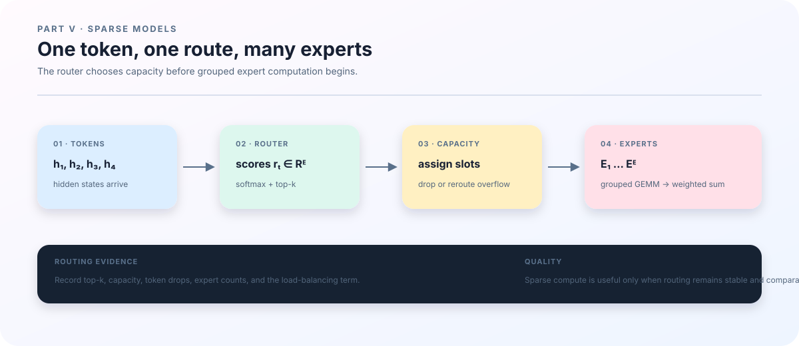

# 19. MoE: letting tokens choose a computation path

## More stored parameters need not mean more work per token

The previous chapter explained how a token reads history. We now keep attention and change the feed-forward network: prepare several sets of expert parameters and select only a few for each token. An expert is typically an MLP; the small network that selects experts is the router. Together they form a mixture of experts, or MoE.

Stored parameter count and activated parameter count are different quantities. With \(n_{\rm exp}\) SwiGLU experts of hidden width \(d\) and intermediate width \(d_{\rm ff}\), expert parameters total approximately \(3n_{\rm exp}dd_{\rm ff}\), ignoring biases. Selecting \(k_{\rm sel}\) experts makes the expert forward multiplications correspond mainly to \(3k_{\rm sel}dd_{\rm ff}\) parameters per token. Routing, sorting, communication, and memory movement still cost time; these counts are not GPU speedup factors.

We first route four tokens to one of two experts and trace sorting and restoration by hand. Then we extend the picture to top-2 routing and the repository's four-expert, two-device validation. Prerequisites are hidden states, softmax, and feed-forward matrix shapes. We initially omit shared experts, fast routing, and memory corrections, and place them in the framework at the end.

<figure class="book-figure">
  
  <figcaption><strong>Figure 5. One MoE forward pass.</strong> Track both token identity and expert grouping: computation may reorder rows, but the residual stream needs the original order. Capacity illustrates a common design choice; the current reference path does not drop tokens according to a capacity limit.</figcaption>
</figure>

## From routing scores to a weighted output

For hidden state \(h_t\in\mathbb R^d\), the router produces \(n_{\rm exp}\) logits and converts them to probabilities:

$$
r_t=W_rh_t,\qquad
p_{t,e}=\frac{\exp(r_{t,e})}{\sum_{j=1}^{n_{\rm exp}}\exp(r_{t,j})}.
$$

This equation uses column vectors. Code generally places tokens in matrix rows, with <code>linear</code> handling the corresponding transpose. The current implementation selects top-\(k_{\rm sel}\) using \(r_{t,e}+b_e\), where \(b_e\) is <code>load_bias</code>. Mixing weights come from the original \(p_{t,e}\), normalized within the selected set \(S_t\):

$$
S_t=\operatorname{TopK}(r_t+b,k_{\rm sel}),\qquad
\widetilde p_{t,e}=
\frac{p_{t,e}}{\sum_{j\in S_t}p_{t,j}},\qquad
y_t=\sum_{e\in S_t}\widetilde p_{t,e}F_e(h_t).
$$

\(F_e\) denotes expert \(e\). Selection scores and mixing weights are distinct: a load bias can change who is selected without being inserted into the probability softmax. Set \(b=0\) in the following example, so ranking by probability agrees with ranking by logits.

| Original token index (code) | \(p_{t,1}\) | \(p_{t,2}\) | Top-1 expert |
|---:|---:|---:|---|
| 0 | 0.8 | 0.2 | \(E_1\) |
| 1 | 0.4 | 0.6 | \(E_2\) |
| 2 | 0.7 | 0.3 | \(E_1\) |
| 3 | 0.3 | 0.7 | \(E_2\) |

A single selected expert receives normalized weight 1. The two experts receive tokens \([0,2]\) and \([1,3]\). Grouped row order is \([0,2,1,3]\), with group sizes \([2,2]\); output must return to \([0,1,2,3]\). Computing every expert correctly still gives the wrong model if token 2's result is handed to token 1.

With top-2, each token produces two token–expert assignments, temporarily duplicating input rows. For three expert probabilities \((0.6,0.3,0.1)\), the selected weights become \((2/3,1/3)\). If the selected expert outputs are \((2,0)\) and \((0,3)\), the combined output is \((4/3,1)\). Restore each assignment before aggregating by original token; the second path must survive grouping.

Top-1 here is a sorting example. Under this implementation's renormalization, its selected weight is always 1, and the discrete selection does not provide the ordinary derivative. The language-model loss therefore does not train the router through this mixing weight; auxiliary terms can still provide gradients. Do not generalize this teaching example to the training definition of every top-1 MoE. The two-device validation uses top-2.

## Capacity and load are different questions

When every token prefers the same expert, sequential processing remains logically possible, but that expert can become a computation or memory bottleneck. Fixed-capacity implementations commonly allocate

$$
C_{\rm exp}=
\left\lceil\gamma\frac{T_{\rm tok}k_{\rm sel}}{n_{\rm exp}}\right\rceil
$$

slots per expert, where \(\gamma\) is the capacity factor and \(T_{\rm tok}\) the token count in one routing operation. Our example has \(T_{\rm tok}=4\), \(k_{\rm sel}=1\), \(n_{\rm exp}=2\), and \(\gamma=1\), giving capacity 2. The balanced assignment fits exactly. A separate routing outcome sending all four tokens to \(E_1\) overflows by two slots; the system must define dropping, overflow buffers, rerouting, or another policy.

This is design context, not an existing repository feature. <code>moe_forward</code> currently groups assignments without dropping: actual assignment counts determine <code>group_sizes</code>, and there is no capacity-factor setting or automatic overflow dropping. That avoids this dropping semantics but not load imbalance, communication, or temporary-memory costs. [Switch Transformer](https://arxiv.org/abs/2101.03961) is a primary reference for capacity and balancing choices.

To encourage distributed assignments, code computes average routing probability \(\bar p_e\) and assignment frequency \(\rho_e\). With all tokens valid,

$$
\bar p_e=\frac1{T_{\rm tok}}\sum_t p_{t,e},\qquad
\rho_e=\frac{\#\{\text{assignments to }e\}}
                  {T_{\rm tok}k_{\rm sel}},\qquad
\mathcal L_{\rm aux}=n_{\rm exp}\sum_e
\bar p_e\,\operatorname{stopgrad}(\rho_e).
$$

With a mask, numerator and denominator use valid-token weights. Our four-token example has \(\bar p=(0.55,0.45)\) and \(\rho=(0.5,0.5)\), giving \(\mathcal L_{\rm aux}=1\). If every token instead has probabilities \((0.9,0.1)\) and top-1 chooses \(E_1\), the value is \(2\times0.9=1.8\). This shows a different signal for concentrated load. It does not prove that 1 is a universal lower bound, and it is not a language-model accuracy score.

Code also computes \(\mathcal L_z=T_{\rm tok}^{-1}\sum_t(\log\sum_e e^{r_{t,e}})^2\), again mask-weighted when appropriate, to control router-logit scale. Training adds auxiliary and z-loss terms according to configuration. Report NLL separately when discussing language-model quality; changing a regularization coefficient is not itself an improvement in prediction.

## Why group the matrix multiplications

Calling an MLP separately for every routed token creates many small matrix multiplications that may underuse the GPU. Grouped computation places inputs for the same expert together and applies that expert's matrices. For our four tokens, the logical operations include

$$
\begin{bmatrix}h_0\\h_2\end{bmatrix}W_1,\qquad
\begin{bmatrix}h_1\\h_3\end{bmatrix}W_2.
$$

Grouped GEMM describes several input groups multiplied by their respective weights. It does not merge experts into an ordinary dense layer. <code>moe.py</code> stably sorts expert IDs, constructs token indices and group sizes, computes SwiGLU gate/up/down projections, and scatters results back before weighting them. The order \([0,2,1,3]\) is a minimal case that can be checked by hand.

However, using grouped GEMM does not establish that higher-order training computes only selected experts' FLOPs. The ordinary primal forward in <code>grouped_gemm.py</code> uses <code>jax.lax.ragged_dot</code>. Its custom JVP supports batching and higher derivatives through a reference path that loops over experts and combines results with masks. The opening active-parameter estimate describes algorithmic structure; actual inner/outer-loop training cost needs compiled cost analysis and device measurements. This matters for the next chapter's compute-matched comparisons.

## Where the experts live on two GPUs

The tiny mesh validation has four experts with \(d=d_{\rm ff}=16\). Under code's weight storage convention, one gate-weight tensor has global shape \([4,16,16]\): expert, output, input. With two GPUs and <code>expert_parallel_size=2</code>:

| Object | Global shape | GPU 0 local shape | GPU 1 local shape |
|---|---|---|---|
| Expert gate weights | \([4,16,16]\) | \([2,16,16]\) | \([2,16,16]\) |
| Validation token IDs | \([2,5]\) | \([2,5]\) | \([2,5]\) |
| Prediction mask | \([2,4]\) | \([2,4]\) | \([2,4]\) |

The mesh is \(\text{data}=1,\text{expert}=2\), so inputs are not split again along data. Five tokens supply four next-token targets, extending the preceding chapter's alignment to distributed inputs. JAX arranges transfers according to sharding and the computation graph. There is no single handwritten all-to-all call in this code that accounts for all communication; inspect compiled execution or a profiler for actual collectives.

After installing the environment, run from the repository root with exactly two GPUs visible to the remote job. The script places all visible devices in its mesh: eight visible GPUs produce data=4, expert=2, which cannot partition the built-in batch of 2. Request a two-GPU allocation or select two devices within the scheduler's allocated mapping; do not overwrite that mapping with machine-global GPU indices.

~~~bash
bash scripts/validate_mesh.sh \
  outputs/ch19/mesh.json \
  outputs/ch19/checkpoints
~~~

The expected report contains <code>passed: true</code>, <code>scale: "tiny"</code>, <code>mesh</code>, <code>expert_shards</code>, and <code>checkpoint_roundtrip: true</code>. With exactly two GPUs, expect data=1 and expert=2, with global expert dimension 4 and local expert dimension 2. The script runs two training steps; in tiny mode, it restores model and optimizer state and compares the subsequent training step.

If the device count is not divisible by expert parallelism, inspect visible devices and mesh settings first. If expert matrices cannot be partitioned, inspect expert count and partition axes. For restoration failures, inspect the checkpoint directory and original error instead of bypassing the check. Success covers this short sequence, precision, and topology; it does not establish large-model load balance, communication efficiency, or long-run quality gains.

## Separate the research questions

<code>moe.py</code> also allows fast-router corrections or Delta-memory reads to modify logits, and shared-expert outputs to join the residual stream. Distinguish the three adaptation routes: <code>mlp</code> updates the additional dense MLP-prime before MoE, <code>router</code> updates a routing adapter, and <code>delta_router</code> modifies routing through recurrent memory state. The current inner loop does not update <code>moe.experts</code>; expert parameters are trained by the outer loop.

These switches alter adaptation location or state mechanisms. Enabling all of them at once does not support a clear claim that “MoE is better.” Start with grouping and restoration in ordinary MoE, then separately compare dense MLP-prime adaptation, routing-adapter updates, memory routing, and repeated shared-parameter computation.

The evidence chain is now concrete: scores determine selections, selections determine assignments, assignments determine groups, and grouped results return to token outputs. Measure load and cost along that same chain. The next chapter puts those costs alongside model quality.
