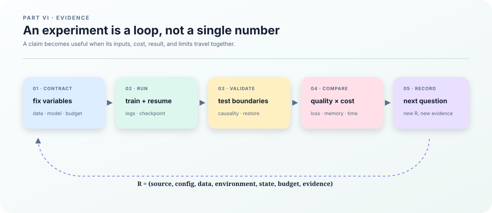

# 20. Ablations, cost, and scaling

## Write the comparison protocol first

Names such as A, D, E-plus, C/F, or Loop have no scientific meaning until their structural differences are written down. A fair comparison fixes every input except the declared axis. Otherwise a lower loss may come from more tokens, a different tokenizer, a larger batch, or a faster kernel.

<figure class="book-figure">
  
  <figcaption><strong>Figure 6. The experiment loop.</strong> A loss curve becomes comparable evidence only when data, budget, implementation, recovery, and limits travel with it.</figcaption>
</figure>

Keep an experiment identity such as

$$
R=(S,C,I_{\mathrm{data}},E,K,Q_{\mathrm{budget}},O),
$$

where \(S\) is source code, \(C\) the resolved configuration, \(I_{\mathrm{data}}\) the data/tokenizer identity, \(E\) the environment, \(K\) the random state, \(Q_{\mathrm{budget}}\) the token and compute budget, and \(O\) the output protocol. A row in a result table should point to this identity rather than just a model nickname.

## What must be held fixed

| Field | Meaning |
|---|---|
| structure | TTT, MLP-prime, Loop, MoE, or dense placement |
| tokens | effective training tokens and valid supervised tokens |
| parameters | total parameters and active parameters |
| data | tokenizer, manifest, order, split, and mask |
| runtime | dtype, mesh, batch, context, compile and timing protocol |
| outcome | training loss, held-out loss, cost, and failure status |

Equal parameter counts do not imply equal FLOPs, memory, communication, compilation time, or serving latency. MoE can have many inactive parameters; TTT can add inner forward and backward work even when its static parameter count is similar to a dense control.

## A small mental model for cost

For a dense baseline, a rough training cost is often proportional to

$$
\text{work}\sim N_{\mathrm{param}}N_{\mathrm{tok}}.
$$

This is a scale estimate, not a profiler measurement. TTT adds inner forward/backward and fast-weight updates. MoE adds routing, dispatch, padding, expert matrix multiplies, and all-to-all communication. Therefore the cost report should separate static forward, inner update, routing, state, communication, checkpoint, and compilation rather than applying one universal multiplier.

The scaling script fits a simple trend such as

$$
\mathcal L(N_{\mathrm{param}},N_{\mathrm{tok}})=
\mathcal L_\infty+A N_{\mathrm{param}}^{-\alpha}+B N_{\mathrm{tok}}^{-\beta}.
$$

This fit needs multiple independent runs over a meaningful range. Pending or failed rows are not observations and must not be filled with made-up numbers.

## Three experiment axes

1. **Structure:** change TTT, MLP-prime placement, Loop placement, routing location, or number of experts.
2. **Scale:** change width, depth, context, token budget, or device count.
3. **Runtime:** change prefill/decode, batch, cache length, mesh, dtype, or kernel.

Change one axis at a time when possible. If a scientific question requires a joint change, name it as a joint factor in the manifest. Separate functional, quality, and systems experiments: a tiny run can prove that a path executes, but it cannot prove a held-out loss gain; a faster kernel can improve throughput without changing quality.

## Code that generates and profiles runs

`ttt/experiments.py` generates ablation configurations. `ttt/profile.py` records parameter, state, prefill/decode, compilation, and execution costs. `ttt/scaling.py` aggregates parameter/token scaling data and keeps missing inputs explicit.

~~~bash
python3 -m ttt.experiments \
  --output configs/ablations/generated \
  --sizes 125m 760m \
  --include-moe

python3 -m ttt.profile \
  --checkpoint CHECKPOINT \
  --context-length 1024 \
  --decode-tokens 16 \
  --training-flops

python3 -m ttt.scaling \
  --input scaling.jsonl \
  --output outputs/scaling.json
~~~

These commands create configuration and measurement artifacts; they do not make a comparison fair automatically. The manifest, commit, tokenizer, token count, hardware, and measurement method remain part of the review.

## What a result row means

An unfinished result should keep `null` rather than pretending to be zero:

~~~json
{
  "variant": "F2",
  "tokens": 1000000000,
  "parameters": 125000000,
  "active_parameters": 125000000,
  "held_out_loss": null,
  "compile_seconds": null,
  "steady_tokens_per_second": null,
  "peak_memory_bytes": null,
  "status": "pending"
}
~~~

Failure rows are also evidence. OOM, compiler timeout, communication failure, and NaN define the boundary of a method. Record the configuration, device, stage, and reason instead of deleting the row from the table.

## A reproducible minimum matrix

Generate the configurations first, inspect their resolved fields, and only then submit training:

~~~bash
python3 -m ttt.experiments \
  --output configs/ablations/generated \
  --sizes 125m 760m \
  --include-moe
~~~

For every completed row, link the output directory and its `experiment.json`, data and tokenizer digest, metrics, profiler report, and failure record if any. The next chapter turns those rows into GPU gates: functional correctness, distributed restore, and target-scale feasibility.
