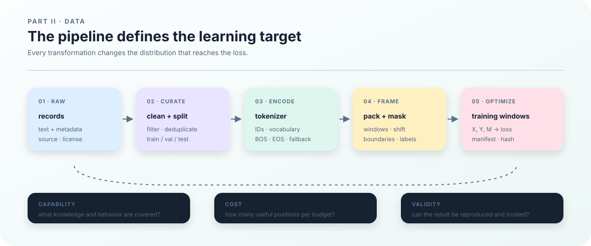

# 4. Pretraining Data: Distribution, Quality, and Reproducibility

## Why data is the first design decision

Pretraining is not a matter of putting a pile of text on a GPU and waiting for the model to absorb “the internet.” The model only sees the training windows produced by the data pipeline. Source selection, filtering, deduplication, tokenization, packing, and masking together define what the optimizer is asked to learn. Data is therefore part of the model specification, rather than a directory chosen after the architecture.

Data changes the result in at least three ways:

- **Capability coverage.** Web pages, code, books, papers, and conversations contain different vocabularies, structures, and tasks. Their mixture changes coverage of knowledge, long context, programming syntax, and languages.
- **Training cost.** Different tokenizers produce different token counts for the same text. Longer sequences also increase activation, attention, and KV-cache costs. Cleaning and deduplication determine how much distinct content fits within a fixed token budget.
- **Evaluation validity.** If validation contains near duplicates of training, a low validation loss may measure memorization. If filtering removes a class of text, the evaluation no longer represents the intended users. Splitting is part of the evaluation protocol.

This small example shows why file counts do not describe the training distribution:

| Source | Documents | Mean tokens | Share after direct token concatenation | Possible bias |
|---|---:|---:|---:|---|
| Web | 900,000 | 1,000 | about 82% | broad coverage, with templates and noise |
| Code | 50,000 | 2,000 | about 9% | concentrated syntax and tool-use examples |
| Books | 10,000 | 10,000 | about 9% | richer long-form structure, fewer documents |

Direct concatenation makes web tokens dominate; source-uniform sampling gives a different distribution. Both are implementable, but they optimize different objectives. If 30% of web text is duplicated templates, cleaning lowers its effective token count and automatically increases the relative weight of code and books unless the mixture is recomputed. Later sections turn this example into an explicit, reproducible sampling protocol.

<figure class="book-figure">
  
  <figcaption><strong>Figure 2. The data pipeline.</strong> The data chapter treats training as an auditable chain from raw records to \(X,Y,M\) and the loss.</figcaption>
</figure>

## What is a tokenizer? Turning text into model-readable tokens

A model cannot consume Unicode text directly. A tokenizer is a rule or learned model that encodes text as an integer sequence: it maps a text string $u$ to tokens $s$, then maps each token to an ID in a fixed vocabulary. A token need not be a complete word; it may be a byte, character, or subword. The ID is an index, so its numeric value does not express semantic similarity.

The conversion can be written as

$$
u \xrightarrow{\ \tau\ } s=(s_1,\ldots,s_L),
\qquad s_t\in\{0,\ldots,V-1\},
$$

where $\tau$ is the tokenizer, $V$ is the vocabulary size, and $L$ is the number of tokens produced for this text. The model's embedding looks up rows from this vocabulary, and the final classification head maps a hidden vector back to the same $V$ possible next-token IDs. Replacing the tokenizer can therefore change sequence length, the number of training positions, memory cost, and the output-head dimension at the same time.

A tokenizer also defines special-token semantics, such as EOS for a document boundary, BOS for a sequence start, PAD for alignment, and unknown or byte-fallback behavior. These choices affect document boundaries, packing, loss masks, and evaluation, so a tokenizer is part of the data protocol rather than a preprocessing script that can be swapped in at the end. A reproducible run records at least the tokenizer file or model name, revision, vocabulary size, special-token IDs, and normalization rules. Changing any of them requires regenerating token shards and updating the manifest. Chapter 9 covers tokenizer training, vocabulary selection, and efficiency measurements.

## Turn the motivation into a measurable distribution

We now define two objects that are often left implicit: the **training data distribution** and the **prediction loss**. Cleaning, tokenization, packing, and manifests only fit together once these objects are explicit. Following the book-wide notation, a tokenized document stream is \(s\), an input token is \(x\), a next-token target is \(y\), and model parameters are \(\theta\).

Let one raw record be

$$
r_i=(u_i,m_i),
$$

where $u_i$ is text and $m_i$ contains metadata such as source, license, language, time, and document group. Let $P_{\mathrm{raw}}$ denote the distribution of raw records. For a fixed collection of raw files, the simplest uniform-sampling case is:

If we sample uniformly from \(N\) raw records, then

$$
P_{\mathrm{raw}}(r_i)=\frac{1}{N}.
$$

For two records \(r_1\) and \(r_2\), each has probability \(1/2\). A collection of raw files is not yet the final training distribution. After source selection, cleaning, deduplication, and splitting, we obtain a training collection

$$
C_{\mathrm{train}}=\{r_1,\ldots,r_n\}.
$$

If cleaning, splitting, and source mixing form a transformation $C$, the document distribution can be written as

$$
P_{\mathrm{doc}}=C_{\#}P_{\mathrm{raw}},
$$

where $\#$ denotes pushing a distribution through a transformation. For a fixed document collection, if the sampler selects record $i$ with weight $w_i$, the empirical document distribution is

$$
P_{\mathrm{doc}}(r_i)=
\frac{w_i}{\sum_{j=1}^{n}w_j}.
$$

Uniform document sampling, length-weighted sampling, and source-level sampling therefore define different distributions. The number of files alone does not say what the model sees.

Document distribution and training-position distribution are also different objects. Uniformly selecting documents can still give longer documents more loss positions. Sampling token starts uniformly produces another weighting over short documents, long documents, and boundaries. Document count, token count, and supervised loss positions are not interchangeable statistics.

A tokenizer $\tau$ maps document text to a token sequence and pushes the document distribution into a token-sequence distribution:

$$
\tau(u_i)=s^{(i)}=(s^{(i)}_1,\ldots,s^{(i)}_{L_i}),
\qquad s^{(i)}_t\in\{0,\ldots,V-1\},
$$

where $V$ is the vocabulary size. A window sampler then applies sequence length, packing, EOS, and document-boundary rules. Let this operation be $\Pi$. It induces:

$$
P_{\mathrm{tok}}=\tau_{\#}P_{\mathrm{doc}},
\qquad
P_{\mathrm{win}}=\Pi_{\#}P_{\mathrm{tok}}.
$$

For document-local sampling, this can be written explicitly as:

$$
P_{\mathrm{win}}(X,Y,M)
=
\sum_i P_{\mathrm{doc}}(r_i)
\,P_{\Pi}(X,Y,M\mid \tau(u_i)).
$$

The complete chain can be summarized as:

$$
P_{\mathrm{raw}}
\xrightarrow{\,C\,}P_{\mathrm{doc}}
\xrightarrow{\,\tau\,}P_{\mathrm{tok}}
\xrightarrow{\,\Pi+\text{pack/shift/mask}\,}P_{\mathrm{win}}(X,Y,M)
\xrightarrow{\,p_\theta\,}\mathcal{L}.
$$

For a concatenated logical stream, $\Pi$ acts on the packed stream rather than one document, but the same idea applies: the window distribution is induced by the complete data protocol. In practice, $P_{\mathrm{win}}$ is the object closest to the “training data distribution”. It depends on source weights, cleaning, deduplication, tokenization, packing, window length, and masks.

## What exactly is prediction loss?

Let a training window contain the consecutive token stream

$$
s=(s_1,s_2,\ldots,s_{L+1}).
$$

A causal language model uses the token at each position as input and the following token as target:

$$
x_t=s_t,\qquad y_t=s_{t+1},
\qquad
X=(x_1,\ldots,x_L),\quad Y=(y_1,\ldots,y_L).
$$

For model parameters $\theta$, the loss at position $t$ is the negative log probability assigned to the observed target token:

$$
\ell_t(\theta)=-\log p_\theta(y_t\mid x_{1:t}).
$$

If the model emits logits $\mathbf{z}_\theta(x_{1:t})$ at position $t$, then

$$
p_\theta(v\mid x_{1:t})
=
\operatorname{softmax}(\mathbf{z}_\theta(x_{1:t}))_v.
$$

If $M=(m_1,\ldots,m_L)$ is a loss mask, with $m_t=1$ for supervised positions and $m_t=0$ for ignored positions, the average window loss is

$$
\ell(\theta;X,Y,M)
=
-\frac{\sum_{t=1}^{L}m_t\log p_\theta(y_t\mid x_{1:t})}
{\sum_{t=1}^{L}m_t}.
$$

The population objective induced by the pipeline is

$$
\mathcal{L}(\theta;P_{\mathrm{win}})
=
\mathbb{E}_{(X,Y,M)\sim P_{\mathrm{win}}}
\left[\ell(\theta;X,Y,M)\right].
$$

A finite run sees $N$ sampled windows. If the loss is averaged over all unmasked tokens, the empirical objective is

$$
\widehat{\mathcal{L}}_N(\theta)
=
\frac{\sum_{k=1}^{N}\sum_{t=1}^{L_k}
m^{(k)}_t\ell^{(k)}_t(\theta)}
{\sum_{k=1}^{N}\sum_{t=1}^{L_k}m^{(k)}_t}.
$$

Minibatch optimization approximates gradients of this empirical objective. “The model learns from the data” therefore means that its parameters are updated so that average next-token negative log likelihood decreases on windows produced by the declared sampler.

Validation loss uses the same definition with an independent $P_{\mathrm{val}}$ in place of $P_{\mathrm{win}}$. Training loss asks whether the model fits the training distribution; validation loss asks how it predicts on another declared distribution. If validation contains near duplicates of training, the second question has not been measured reliably.

This is why the chapter treats data as part of the objective. Changing $P_{\mathrm{doc}}$, $\tau$, $\Pi$, or $M$ changes the target function even when architecture and optimizer remain unchanged.

## How a raw document becomes a training signal

The data pipeline is not just a file transfer to the GPU. It is a sequence of transformations that changes the mathematical object being optimized:

~~~mermaid
flowchart LR
    A[Raw file] --> B[Document record and metadata]
    B --> C[Clean, deduplicate, split]
    C --> D[Tokenizer: text → token IDs]
    D --> E[Packing and window sampling]
    E --> F[input_ids / labels / loss_mask]
    F --> G[Cross-entropy and gradients]
    G --> H[Parameter update]
~~~

For an illustrative token sequence:

| Object | Value |
|---|---|
| Token stream \(s\) | \((10,11,12,2)\) |
| Code field `input_ids` (mathematical \(X\)) | \((10,11,12)\) |
| Code field `labels` (mathematical \(Y\)) | \((11,12,2)\) |
| Code field `loss_mask` (mathematical \(M\)) | \((1,1,1)\) |

The window loss is

$$
-\frac{1}{3}
\left[
\log p_\theta(11\mid 10)
+\log p_\theta(12\mid 10,11)
+\log p_\theta(2\mid 10,11,12)
\right].
$$

Masking the final EOS changes both the numerator and denominator. Crossing a document boundary changes the available context. A tokenizer that produces more tokens increases the number of prediction positions and the cost. The training signal is therefore not raw text itself; it is the $(X,Y,M)$ object constructed by these rules.

## What each transformation changes

**Source selection changes support.** Web text, code, books, and papers expose different vocabularies, lengths, and structures. A model receives signal only from the regions sampled into training.

**Cleaning changes the sample set.** Removing navigation pages, corrupted text, and parser failures changes which records remain in $C_{\mathrm{train}}$. Over-filtering can remove code, mathematics, minority languages, or long documents.

**Deduplication changes weights.** Repeating one document one hundred times increases its probability under $P_{\mathrm{doc}}$. Near duplicates across training and validation also destroy evaluation independence.

**Splitting changes the evaluation object.** Document-group splits and contamination checks determine whether validation windows represent unseen content. A contaminated benchmark can turn low loss or high accuracy into memorization evidence.

**Tokenization changes the sample space and cost.** The same characters can produce different token sequences. Vocabulary size affects the embedding, output head, sequence length, attention, KV cache, and throughput.

**Packing and masks change conditional probabilities.** Cross-document packing, EOS retention, and supervised positions all change $P_{\mathrm{win}}$ or the window loss. Packing is part of the learning protocol, not only a storage optimization.

## A concrete mixture example

| Source | Documents | Average length | Total tokens |
|---|---:|---:|---:|
| Web | 900,000 | 1,000 | 900M |
| Code | 50,000 | 2,000 | 100M |
| Books | 10,000 | 10,000 | 100M |

Concatenation makes web text about 82% of the token stream. Uniform document sampling increases the probability of book documents. Both can be valid, but they define different $P_{\mathrm{doc}}$ and therefore different objectives.

If 30% of web tokens are boilerplate duplicates, cleaning may reduce effective web tokens to 630M. If the mixture is not recomputed, the effective weights of code and books rise automatically. Every stage must report its own denominator rather than only a final token total.

The current `BatchStream` samples windows from one logical token stream. It does not implement source-level mixture scheduling. The later mixture chapter defines that capability without claiming it already exists here.

## The pretraining data contract

Before a long run, the pipeline should answer:

1. **Is the source identifiable?** Can we locate the release, retrieval time, and license?
2. **Is quality explainable?** Does every filter have a version, threshold, count, and sample audit?
3. **Are splits trustworthy?** Are train, validation, and test separated by document or project boundary, with near-duplicate and contamination checks?
4. **Is representation consistent?** Do tokenizer, special tokens, packing, label shift, and masks agree with the model configuration?
5. **Is the version recoverable?** Can manifest, shard hashes, sampler state, and checkpoint identify the next batch?

Readable data is not necessarily acceptable data. Each requirement needs a saved evidence object and a later preflight check.

## Data objects and version boundaries

**Raw files** are immutable downloads or snapshots such as archives, HTML, JSONL, or repository states.

**Document records** contain extracted text and metadata for cleaning, deduplication, splitting, and boundary management.

**Token shards** contain integer sequences and supervision masks plus vocabulary, tokenizer version, dtype, shard count, and SHA256 metadata.

**Training windows** are fixed-length sequences sampled from the token stream and converted into `input_ids`, `labels`, `loss_mask`, and position state.

These objects must not share one vague “data version”. A fixed raw file can produce a new document version after cleaning changes; a fixed document set can produce a new token version after tokenizer changes; fixed shards can produce a new window protocol after sequence length or packing changes.

## What the repository currently implements

`ttt/data.py` provides a byte tokenizer and JSONL-to-token conversion. It can write one-dimensional NPY data or sharded token and mask files with a manifest.

`ttt/dataset.py` validates manifest version, `vocab_size`, paths, SHA256, token ranges, mask shapes, and mask values, then reads shards with memory mapping. `BatchStream` uses a NumPy generator to sample windows and stores RNG state, data digest, sequence length, batch size, and seed.

~~~bash
.venv/bin/python -m ttt.data \
  --input examples/book/clean_corpus.jsonl \
  --output outputs/book-data \
  --sharded \
  --tokenizer byte \
  --shard-tokens 256
~~~

`shard-tokens` is a storage-shard size, not the model sequence length. The current window can cross EOS and document boundaries, and the model has no general “reset attention at EOS” interface. The current loader should therefore be described as continuous-stream packing rather than document-isolated packing.

The manifest also lacks a complete document-offset sidecar, so arbitrary token-to-document tracing remains a requirement for a larger data pipeline. Separating implemented behavior from design requirements is part of the data standard.

## The route through the remaining data chapters

- `11_data_acquisition.md`: source versions, licenses, downloads, and provenance;
- `12_data_cleaning.md`: normalization, format, language, length, and quality filters;
- `13_deduplication.md`: exact/near deduplication and its effect on sampling weights;
- `14_split_and_contamination.md`: train, validation, test, and contamination boundaries;
- `15_tokenizer.md`: tokenizer, vocabulary, and parameter dimensions;
- `16_packing_and_masks.md`: packing, label shift, document boundaries, and loss masks;
- `17_dataset_and_manifest.md`: shards, manifests, mmap, and recoverable sampling;
- `18_data_mixture.md`: source mixtures and deterministic sampling;
- `19_data_preflight.md`: hard gates before training;
- `20_baseline_model.md`: whether these inputs actually support learning in a dense causal model.

From the next chapter onward, “data” is no longer a vague input name. We trace each object, how it changes the training distribution, and which evidence allows the next run to check it.
