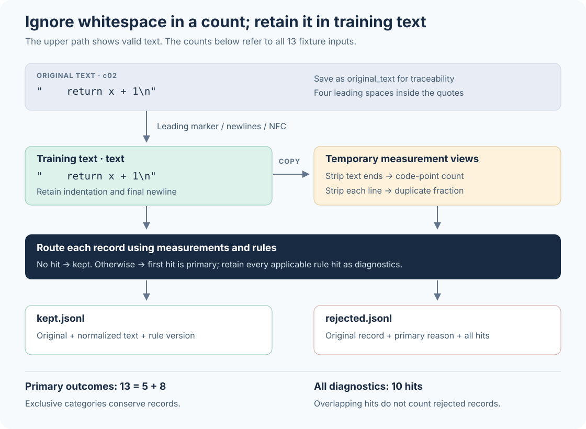

# 6. Cleaning text: what to retain, what to change, and how to check

## Turn “remove dirty data” into a learning objective

The previous chapter stored text together with its provenance. Suppose those records now contain three kinds of material: repeated website navigation, an indented Python fragment, and a sentence containing mathematical symbols. All three fit in a text file, but the same rule need not be appropriate for all of them.

~~~text
首页
首页
首页

    return x + 1

Ａ＋①＝２，这些字形先保留。
~~~

The repeated Chinese word means “home page.” It probably adds little article content. Spaces in the code may determine its structure. The circled number and fullwidth characters in the final sentence may be precisely what its author wants to discuss. A combination of “remove short lines,” “remove non-English letters,” and “strip all indentation” might produce a tidy file while removing the material we wanted to teach the model.

A language model learns by repeatedly predicting the next token in training text. Retaining more of a kind of text usually gives the model more opportunities to encounter its patterns. Filtering almost all of it leaves little opportunity to learn those expressions from this corpus. Cleaning therefore has two responsibilities: reduce useless or damaged material, and control the rejection of useful material. **The retention rate is a processing statistic, not a quality score.**

We begin with three distinct questions: was the file decoded correctly, should its text be normalized, and should this record be retained? We then work through 13 original records included in the repository and run a standard-library-only program that produces retained records, rejected records, and an auditable report. The thresholds are deliberately small so that every decision is inspectable. They are not recommendations for a large pretraining corpus.

## Bytes in a file, text on a screen

A computer stores a file as bytes. A byte has 256 possible values, often written using two hexadecimal digits, such as `41`. Unicode assigns code points to text elements: `A`, for example, has code point `U+0041`. UTF-8 specifies a representation of those code points as bytes. **Decoding** turns bytes into a Python `str`; **encoding** turns a `str` into bytes. One code point can occupy several UTF-8 bytes. [Python Unicode HOWTO](https://docs.python.org/3.12/howto/unicode.html)

Consider `Café`. Its final accented letter can be represented by a single `é` or by an `e` followed by a combining accent. The table shows representations of the same small word, not token IDs from a tokenizer vocabulary.

| Representation | Unicode code points | UTF-8 bytes in hexadecimal | Python `len` |
|---|---|---|---:|
| `Cafe\u0301`: `e` plus combining accent | `0043 0061 0066 0065 0301` | `43 61 66 65 cc 81` | 5 |
| `Café`: precomposed `é` | `0043 0061 0066 00E9` | `43 61 66 c3 a9` | 4 |

Here `\u0301` is the Python/JSON escape for a code point, not six visible characters in the actual text. Both strings normally display as the same word, but their code points and bytes differ. Python's `len` counts string code points. It does not count UTF-8 bytes, does not necessarily count the characters a reader perceives, and does not count model tokens. This distinction will matter for our length threshold.

If a UTF-8 file is read using an incorrect encoding, the resulting garbled text is a decoding problem. Unicode normalization neither infers the original encoding nor reliably recovers unknown content already replaced with `�`. Our program decodes the entire input strictly as UTF-8. Invalid bytes stop the run before cleaning outputs are created, keeping a decoding failure from silently becoming ordinary training text.

File format and content format also differ. JSONL stores one JSON value per line; our input requires each line to be an object with a `text` field. That text might have come from a web article or a code repository. **Successfully parsing JSON does not establish that HTML article extraction succeeded.** Consider:

~~~html
<nav>首页　登录</nav><article>
雨水进入河流。
</article>
~~~

Removing the tags alone retains both the navigation, “home page / login,” and the article, “rainwater enters the river.” Article extraction must also decide which nodes belong to the article. It should preserve paragraph boundaries so that separate paragraphs do not become joined words or sentences. Our program accepts already extracted plain text. It does not parse HTML or implement an article extractor. A source containing HTML needs extraction and an assessment of its output before these text rules are applied; passing HTML to this program does not automatically perform that step.

## What NFC and NFKC actually change

Normalization operates on Unicode text that has already been decoded. NFC unifies canonically equivalent representations in composed form, for example replacing `e` plus a combining accent with `é`. NFKC additionally uses compatibility equivalence and therefore removes more distinctions. Python provides these operations through `unicodedata.normalize("NFC", text)` and `unicodedata.normalize("NFKC", text)`. [Python `unicodedata`](https://docs.python.org/3.12/library/unicodedata.html#unicodedata.normalize)

| Original | NFC result | NFKC result | Distinction to inspect |
|---|---|---|---|
| `Cafe\u0301` | `Café` | `Café` | The accented letter changes from two code points to one |
| `Ａ` (`U+FF21`) | `Ａ` | `A` (`U+0041`) | The fullwidth distinction disappears |
| `①` (`U+2460`) | `①` | `1` (`U+0031`) | The circle disappears |

NFKC is not a universally better NFC. A sentence explaining “the difference between ① and 1” can become one explaining “the difference between 1 and 1.” Compatibility distinctions can carry meaning in mathematical and technical material, so merging them indiscriminately is inappropriate. [Unicode normalization standard, UAX #15](https://www.unicode.org/reports/tr15/tr15-58.html)

NFC does not preserve the original bytes either: the first row changes both the code-point count and the UTF-8 bytes. Calling our policy conservative describes its narrower range of equivalences; it is not a promise of losslessness for every application. We retain `original_text` and separately produce the training `text`. This records what the model will receive and allows another policy to be applied to the original later.

Our training text undergoes exactly three transformations: remove one leading `U+FEFF` marker, convert `CRLF` and `CR` newlines to `LF`, and apply NFC. Removing the leading marker is itself a deliberate policy choice. A corpus studying file encodings might need to preserve it. The report records these choices instead of hiding them behind a vague label such as “standard cleaning.”

~~~python
def normalize_text(text: str) -> str:
    text = text.removeprefix("\ufeff")
    text = text.replace("\r\n", "\n").replace("\r", "\n")
    return unicodedata.normalize("NFC", text)
~~~

### Ignore whitespace for a count without deleting it from training text

`str.strip()` returns a string with leading and trailing whitespace removed, including spaces and tabs as well as newlines. [Python `str.strip`](https://docs.python.org/3.12/library/stdtypes.html#str.strip)

~~~python
text = "    return x + 1\n"
count_view = text.strip()    # "return x + 1"，只用于计数
training_text = text        # 仍包含四个行首空格和末尾换行
~~~

Writing `text.strip()` back to the training record loses the first code line's indentation. Stripping every line and joining the results loses the indentation hierarchy throughout the block. Even when a fragment cannot run independently, cleaning should not silently change its structure in the original context.

The program therefore creates views for separate purposes. Training text retains its whitespace. Length measurement temporarily ignores whitespace at the two ends of the whole text. Repeated-line measurement additionally ignores whitespace at both ends of each line and omits empty lines. Neither measurement view replaces `text`. Two differently indented lines may therefore compare as equal in the diagnostic view while retaining their original indentation in saved code.

Figure 6.1: Read from top to bottom. Normalization produces training text, which is copied into measurement views. Decisions determine the output file for a record. The two counts at the right answer different questions: each input has exactly one primary outcome, while diagnostic hits can overlap. No arrow writes a measurement view back into training text.

## Make the rules concrete with 13 records

The input is `examples/book/fixtures/cleaning_records.jsonl`; open it in an editor to inspect every line. The first record has the following structure. Subsequent records use the same fields and deliberately include some invalid cases.

~~~json
{"id":"c01","source":"web","language":"en","kind":"prose","text":"Cafe\u0301 by the sea."}
~~~

`id` locates a sample; `source` names its source group; `language` is a label supplied by the input; `kind` distinguishes ordinary text, `prose`, from `code`; and `text` holds the content. No language-identification model runs here, so the language label is not a prediction made by this program. The first four fields must be nonempty strings, `text` must be a string, and `kind` must be one of the two supported values. These constraints on fields and types form a **schema**.

Structure is checked before text. `text: 42` is a type error: silently converting it to `"42"` before judging its length would conceal the problem. Invalid JSON may not even define a complete object; we do not guess its ID from a partial line. These cases receive `invalid_schema` and `invalid_json`, respectively. The reader also rejects `NaN`, `Infinity`, and numbers outside its supported finite floating-point range, such as `1e999`, recording them as `invalid_json`. The last case is a limit of this reader, not a claim that `1e999` violates JSON syntax; the rejection log preserves the original line. After schema validation, the program checks that the normalized text can be encoded as UTF-8. JSON escapes can represent lone surrogate code points that are not valid UTF-8 text; these receive `invalid_unicode`. The default fixture does not trigger this case, but the report retains its zero count.

Valid text is evaluated with the following settings. Length means the number of **code points** in the normalized text after temporarily excluding leading and trailing whitespace.

| Rule | Decision in this run | Reason for the choice |
|---|---|---|
| Empty text | Reject an empty measurement view | Spaces, tabs, and newlines alone provide no content for this example |
| Minimum length | At least 12 for `prose`, at least 1 for `code` | Demonstrate different domain policies; 12 is not a universal quality boundary |
| Maximum length | Reject above 120 | Demonstrate a processing limit with a small fixture; this does not declare long documents poor quality |
| Repeated lines | For `prose` only: at least 3 nonempty lines and duplicate fraction at least 0.6 | Demonstrate repeated navigation; repeated code statements may be legitimate |

We also need an unambiguous duplicate fraction. Let \(n_{\mathrm{line}}\) be the number of nonempty comparison lines and \(u_{\mathrm{line}}\) the number of distinct line contents. Define:

$$
\rho_{\mathrm{line}}=
\begin{cases}
1-\dfrac{u_{\mathrm{line}}}{n_{\mathrm{line}}}, & n_{\mathrm{line}}>0,\\
0, & n_{\mathrm{line}}=0.
\end{cases}
$$

Keeping one copy of every distinct line would leave \(u_{\mathrm{line}}\) lines. The excess copies therefore number \(n_{\mathrm{line}}-u_{\mathrm{line}}\). For three copies of “首页,” the counts are 3 and 1, so \(\rho_{\mathrm{line}}=2/3\), above 0.6. Three different lines give zero. This measure compares complete lines within one document; it is not a measure of similarity between documents, which we introduce in the next chapter.

The table gives **hand-derived expectations** for the default rules. `\n` denotes a newline. “121 a's” abbreviates the display; the fixture contains all 121 letters.

| Line / ID | Text or problem | Primary outcome | All diagnostic hits |
|---|---|---|---|
| 1 / `c01` | `Cafe\u0301 by the sea.`; 16 code points after NFC | `kept` | None |
| 2 / `c02` | `    return x + 1\n`; code | `kept` | None |
| 3 / `c03` | `Ａ＋①＝２，这些字形先保留。`; 14 code points | `kept` | None |
| 4 / `c04` | `\r\n \t`; whitespace only | `empty` | `empty`, `too_short` |
| 5 / `c05` | `短定义。`; 4 code points | `too_short` | `too_short` |
| 6 / `c06` | `首页\n首页\n首页`; 8 code points | `too_short` | `too_short`, `repeated_line` |
| 7 / `c07` | 121 copies of `a` | `too_long` | `too_long` |
| 8 / `c08` | Three lines of `重复的导航行`; 20 code points | `repeated_line` | `repeated_line` |
| 9 / `c09` | `text` is the number `42` | `invalid_schema` | `invalid_schema` |
| 10 / no parseable ID | JSON truncated after `"text":` | `invalid_json` | `invalid_json` |
| 11 / `c11` | Unsupported `kind` value `table` | `invalid_schema` | `invalid_schema` |
| 12 / `c12` | `A short note about rain.` | `kept` | None |
| 13 / `c13` | Three indented `pass` lines; code | `kept` | None |

Two details deserve a close look. The length of `c06` is \(2+1+2+1+2=8\): surrounding whitespace is excluded, but each of the two internal newlines still contributes one code point. The duplicate fraction of `c13` is also \(2/3\), but its kind is code, so the repeated-line rule does not apply. A high measured value can therefore coexist with an empty diagnostics list. A measurement and a rejection decision are different objects.

`c05`, whose text means “short definition,” exposes a limitation of the rule. A short definition does not become worthless merely because it has four code points. We intentionally retain this counterexample. Understanding a cleaning policy means being able to explain why `c06` is rejected and to identify why rejecting `c05` might conflict with the intended corpus.

## Why keep both a primary reason and every hit?

A whitespace-only text is both empty and shorter than 12. `c06` is both short and repetitive. Incrementing “documents removed” for every rule hit would count both records twice, producing numbers that no longer correspond to the files.

The program stores one `primary_reason` per input and a potentially multi-valued `diagnostics` list. The order is fixed: invalid JSON, invalid schema, invalid text Unicode, empty text, too short, too long, repeated lines. The first hit supplies the primary reason; no hit means `kept`. When parsing or schema validation fails, later text measurements are undefined, so the program does not invent them. For valid text, it evaluates every applicable text rule and retains all its hits.

Let \(n_{\mathrm{input}}\) be the number of nonblank input lines, \(n_{\mathrm{kept}}\) the number retained, and \(n_{\mathrm{rejected},r}\) the number whose primary rejection reason is rule \(r\). Every input belongs to exactly one category. Partitioning the inputs into those categories and adding their sizes gives:

$$
n_{\mathrm{input}}
=n_{\mathrm{kept}}+\sum_r n_{\mathrm{rejected},r}.
$$

For the default fixture:

$$
13=5+\underbrace{(1+2+0+1+2+1+1)}_{8\text{ rejected records}}.
$$

The terms inside the parentheses follow the rule order above. This equation conserves **input records**. It does not conserve bytes, code points, or tokens. If documents are divided into smaller segments, record the parent-to-segment relationship separately; input documents and output segments cannot be substituted into the same count equation.

All-hit counts answer a different question: how many inputs triggered rule \(r\)? Here `too_short` has three hits and `repeated_line` has two, while their primary counts are two and one. All rule hits total 10, exceeding the eight rejected records because of overlap. The report therefore separates `primary_counts` from `diagnostic_counts`.

It also gives a stage table obtained by subtracting primary rejections in rule order. This is an accounting view; it does not mean diagnostics stop being evaluated after the first rejection.

| Completed check | Primary rejections at this stage | Remaining records |
|---|---:|---:|
| Nonblank input lines | 0 | 13 |
| `invalid_json` | 1 | 12 |
| `invalid_schema` | 2 | 10 |
| `invalid_unicode` | 0 | 10 |
| `empty` | 1 | 9 |
| `too_short` | 2 | 7 |
| `too_long` | 1 | 6 |
| `repeated_line` | 1 | 5 |

The minimum-length stage removes two records: \(2/9\approx22.2\%\) of the nine entering that stage, or \(2/13\approx15.4\%\) of all inputs. Either fraction can be useful, but its denominator must be stated. Reordering rules can also change the primary-reason distribution even when it leaves the retained set unchanged.

## Run the program and inspect its files

The program is `examples/book/cleaning_walkthrough.py` and uses only the Python standard library. Run the following from the repository root. If `.venv` was created following the environment chapter, use that same interpreter. For this project's verification work, CPU execution takes place on the designated remote host; editing the chapter does not require running it locally.

~~~bash
.venv/bin/python examples/book/cleaning_walkthrough.py \
  --output outputs/book-cleaning-v1
~~~

`--input` defaults to the bundled fixture, so no download or missing input path is required. Existing output directories are rejected; give a new directory name for another run. The default terminal summary should contain `input_records: 13`, `kept_records: 5`, and `rejected_records: 8`. These numbers first come from the reasoning above. After execution, use the files from that run as evidence rather than presenting the hand-derived table as an execution log.

The output directory contains three files, each answering a separate question:

| File | Actual contents | What to inspect |
|---|---|---|
| `kept.jsonl` | Five retained records; `original_text` stores input text, `text` stores normalized text, and `cleaning` stores the rule version and input line | Accent composition in `c01`, indentation in `c02`, fullwidth characters and the circled number in `c03` |
| `rejected.jsonl` | Primary reason, diagnostics, original object, and input line for each rejection; text metrics when defined | Overlapping hits for `c04` and `c06`, and the parse error on line 10 |
| `report.json` | Parameters, counts, grouped statistics, per-record decisions, Unicode examples, and version identifiers | Compare each result with the tables above |

Output JSON represents non-ASCII characters using `\uXXXX` escapes, so an editor may show escapes instead of visible Chinese text. Parsing the JSON restores the same Unicode strings; this does not delete Chinese content. The representation also lets the rejection log preserve lone surrogate code points that cannot themselves be encoded as UTF-8 text.

The next command reads the actual outputs and prints the details we want to inspect. It does not rerun cleaning or modify files.

~~~bash
.venv/bin/python - <<'PY'
import json
from pathlib import Path

root = Path("outputs/book-cleaning-v1")
report = json.loads((root / "report.json").read_text(encoding="utf-8"))
rows = [json.loads(line) for line in (root / "kept.jsonl").read_text(encoding="utf-8").splitlines()]
print("Primary outcomes:", report["primary_counts"])
print("All hits:", report["diagnostic_counts"])
print("Retained IDs:", [row["id"] for row in rows])
for row in rows:
    if row["id"] in {"c01", "c02", "c03"}:
        print(row["id"], repr(row["original_text"]), "->", repr(row["text"]))
PY
~~~

`repr` displays newlines as `\n` and surrounds a string with quotes, making leading spaces easier to inspect. Retained IDs should be `c01, c02, c03, c12, c13` in input order. The text of `c02` should still start with four spaces.

Several report fields need precise interpretations:

| Report field | Exact meaning |
|---|---|
| `input_sha256`, `script_sha256` | SHA-256 digests of the input bytes and current script bytes, identifying the input and implementation |
| `python_version`, `unicode_version` | The running interpreter version and the Unicode database version used by `unicodedata` |
| `parameters`, `rule_order` | Thresholds, normalization choices, rule applicability, and primary-reason priority |
| `input_records`, `ignored_blank_lines` | Nonblank input lines and skipped blank lines; an ordinary final newline does not create an extra line |
| `primary_counts`, `diagnostic_counts`, `stages` | Exclusive outcomes, potentially overlapping rule hits, and stage counts after primary rejections |
| `groups`, `group_scope` | Counts grouped by supplied `source/language/kind` for schema-valid records only; invalid JSON and invalid schema are excluded |
| `decisions` | Input line, ID when available, primary outcome, and diagnostics; valid text additionally has lengths, line counts, duplicate fraction, and related metrics |
| `unicode_examples` | Original, NFC, and NFKC strings, code points, and UTF-8 bytes for the three examples |
| `count_conservation` | The program checked conservation of primary counts; it does not certify corpus quality |

Ten fixture records pass the schema, so the input counts in `groups` sum to 10 while global `input_records` is 13. The difference follows from the stated scope. The other three records should not be forced into a guessed language group. Counting records with invalid provenance separately is usually more interpretable than inventing labels for them.

A UTF-8 decoding failure aborts the whole input. A single JSON or schema failure instead enters the rejection log while other records continue. The program finishes its analysis before creating the output directory and writes the report last. An interrupted disk write can still leave a partial directory. Without all three complete files and a readable report, the run is not a successful result.

## Change one threshold and see what comes back

Keep the input fixed and lower only the `prose` minimum length from 12 to 4:

~~~bash
.venv/bin/python examples/book/cleaning_walkthrough.py \
  --output outputs/book-cleaning-min4 \
  --min-prose-chars 4
~~~

Predict before inspecting the output. `c05` is exactly four code points long and now passes. `c06` is no longer too short but still has repeated lines, so it remains rejected with `repeated_line` as its primary reason. The expected retained count rises from five to six, while rejections fall from eight to seven. The primary `too_short` count becomes zero and the primary `repeated_line` count becomes two. Whitespace-only `c04` still triggers both `empty` and `too_short`. A rule change can therefore alter either the retained set or only the attribution for an already rejected record.

This does not prove that the new rule is better. It only shows that one short text returned. Whether it belongs in the corpus depends on the intended material and on further samples. If most short records are navigation, buttons, or extraction fragments, lowering the threshold may also bring back substantial noise.

Language and domain affect this tradeoff. Equal Chinese and English code-point counts do not guarantee equal information content. Short code lines, mathematical symbols, and repeated lines of poetry can all be legitimate. Real policies may use separate thresholds by source, language, and content type, but such choices should follow stratified inspection rather than unexamined exceptions. This program implements only separate `prose/code` minimum lengths and grouped reporting. **It does not automatically choose language-specific thresholds or classify the quality of poetry and mathematics.**

Stratified inspection means dividing samples into meaningful groups and examining each group. Our code group retains 2/2 records, while the Chinese short-definition source retains 0/1. A global 5/13 cannot describe both differences. Groups containing one or two examples do not estimate production false-rejection rates, however; they show whether the report can locate a problem.

Estimating false rejection requires additional labels saying “should retain for this training objective” or “should reject.” Within the same labeled sample, define:

$$
\text{false rejection rate}
=\frac{\text{records that should be retained but were rejected}}
{\text{all records that should be retained}}.
$$

This fraction requires at least one record that should be retained. With a zero denominator, report it as undefined rather than zero. The denominator includes correctly retained useful records, so sampling only rejected records cannot estimate this fraction. If two of ten human-confirmed useful records are rejected, the false-rejection rate is 20%. That is a different question from what fraction of all rejected records were rejected incorrectly. Oversampling threshold-adjacent examples is useful for finding problems, but the resulting fraction describes that boundary sample and cannot be directly extrapolated to the corpus. The program does not automatically supply human quality labels, and its `keep_rate` is not the false-rejection rate above.

## From this example to a larger corpus

The program holds its small input and decisions in memory so that records, outputs, and report entries can be followed one by one. Production corpora need chunked input processing, recovery after interruption, stable record identities, and a stronger provenance schema. Web sources additionally need article extraction, and quality decisions may need evaluated classifiers. A successful run of this example does not establish those capabilities.

The retained `text` is now a specified version of the text view. The next chapter compares documents on a fixed view and explains why “the same meaning,” “the same string,” and “the same training example” are different notions. Tokenization and training-window construction follow afterward. Each stage then answers its own question: here we checked how text changed and why records were retained or rejected, instead of treating a successful token-encoding command as evidence that cleaning worked.
