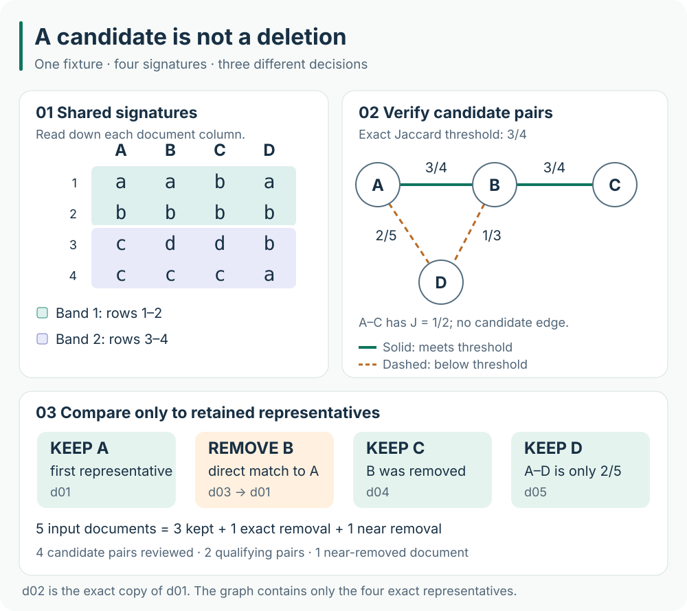

# 7　Deduplication: controlling how often the same information appears

## Why cleaning is not enough

The previous chapter asked whether a record is worth keeping. A good article republished a hundred times may pass every cleaning rule a hundred times. Training on those copies does not provide a hundred independent pieces of knowledge: it repeatedly emphasizes the same content. Photocopying a page a hundred times makes a book thicker without adding a hundred pages of new knowledge.

Duplication first changes the training distribution. Consider an equal-length document collection containing just two kinds of content: nine copies of one article and one copy of another. Uniform document sampling selects the first content with probability \(9/10\) and the second with probability \(1/10\). Keeping one copy of each changes both probabilities to \(1/2\). The sampler did not change, but copy counts acted as implicit sampling weights. If lengths differ, or sampling operates on tokens or training windows, probabilities must be calculated under that protocol instead.

Copies can also cross an evaluation boundary. If training contains an article and validation contains its mirror, validation may test predictions of previously encountered passages. The [original study by Lee et al.](https://arxiv.org/abs/2107.06499) examines training duplication, memorization, and training–evaluation overlap. It motivates checking these issues; its reported benefits are not measurements of this project.

Deduplication involves three questions: what counts as the same content, how to find potentially matching documents in a large collection, and which document to retain. These correspond to the **comparison representation, candidate retrieval, and retention policy**. We will connect them using five short original documents. The small tables are constructed teaching examples; the accompanying script turns their calculations into inspectable artifacts.

## Define what is compared before computing a digest

These are all five texts in `examples/book/dedup_documents.jsonl`. The JSON escape `\n` represents an LF newline, while `\r\n` represents CRLF. Decoding them produces one or two control characters respectively. The color words are convenient labels for calculation, without additional semantic significance.

| Document ID | Source | JSON representation of `text` | Name after exact deduplication |
|---|---|---|---|
| `d01` | notes | `"red blue green amber\n"` | Document A |
| `d02` | mirror | `"red blue green amber\r\n"` | A's copy |
| `d03` | notes | `"red blue green amber gold\n"` | Document B |
| `d04` | notes | `"blue green amber gold\n"` | Document C |
| `d05` | notes | `"red blue green violet silver\n"` | Document D |

Their original bytes make `d01` and `d02` different. We first define this experiment's rule: normalize Unicode to NFC and replace CRLF with LF, preserving case, punctuation, indentation, trailing spaces, and other characters. NFC handles canonically equivalent character representations, such as a precomposed “é” and an “e followed by a combining accent.” It does not translate text or equate words with different meanings. This rule does not replace every standalone CR either.

Call the resulting string the **comparison text**. It is used for matching, while the selected representative keeps its original `text`. This distinction matters: a similarity representation may be coarser than the training text, but it should not silently rewrite that text. Removing all spaces might simplify some webpage comparisons while destroying code indentation.

~~~python
import hashlib
import unicodedata

def comparison_text(text):
    return unicodedata.normalize("NFC", text).replace("\r\n", "\n")

def exact_key(text):
    compared = comparison_text(text)
    return hashlib.sha256(compared.encode("utf-8")).hexdigest()
~~~

SHA-256 maps a byte string of arbitrary length to a fixed-length digest, commonly displayed as 64 hexadecimal characters. Think of the digest as an index label: group documents with the same label, then compare their complete comparison texts. Identical inputs have identical digests. The converse is not a logical guarantee, because different inputs can have a **hash collision**. Our script compares full comparison texts after matching digests. Even a test that deliberately gives every document the same digest therefore does not merge all five records.

Representative selection also needs a rule. This experiment processes document IDs in lexicographic order and keeps the first ID for identical comparison texts. Thus `d02 → d01`, while `d01`, `d03`, `d04`, and `d05` represent themselves. ID order determines the result, so reversing input lines does not change it. A production project might prefer a source with more complete permission metadata or a more complete article, but must record priorities and tie-breaking.

This is **exact deduplication**. “Exact” refers to equality of the explicitly defined comparison texts, not byte-for-byte equality of the original files. A copy's provenance should not disappear with its text: representative mappings provide a way to trace copies, while the actual corpus catalog must also retain their source and permission records.

## Turn text into a comparable set

Exact deduplication leaves A, B, C, and D. B differs from A by just one word, but their full-text digests already differ. Recognizing this overlap requires a different comparison representation.

We split on whitespace and take adjacent pairs of words, called **word bigram shingles**. Splitting A gives:

~~~text
red | blue | green | amber
~~~

A window of width 2 moves one word at a time, producing three fragments:

~~~text
(red, blue)    (blue, green)    (green, amber)
~~~

This splitting rule is for deduplication; it is **not the language model's tokenizer**. The model tokenizer's vocabulary and token IDs are introduced later. Whitespace splitting should not be assumed appropriate for Chinese, other languages without word spaces, or code. Character fragments or domain-specific segmentation may be preferable, with the chosen rule version recorded.

To make the tables readable, label the six distinct fragments as follows. These letters name set elements in this example; they are not model parameters or tokenizer IDs.

| Label | Word bigram |
|---|---|
| `a` | `(red, blue)` |
| `b` | `(blue, green)` |
| `c` | `(green, amber)` |
| `d` | `(amber, gold)` |
| `e` | `(green, violet)` |
| `f` | `(violet, silver)` |

Let \(\mathcal A,\mathcal B,\mathcal C,\mathcal D\) denote the shingle sets of documents A, B, C, and D:

$$
\mathcal A=\{a,b,c\},\qquad
\mathcal B=\{a,b,c,d\},\qquad
\mathcal C=\{b,c,d\},\qquad
\mathcal D=\{a,b,e,f\}.
$$

A **set** records each distinct fragment once, without order or frequency. The text `red blue red blue` has fragments at three positions, but its set contains only `(red, blue)` and `(blue, red)`. This representation preserves some local word order while losing document structure and fragment counts. It helps find overlap, but does not understand meaning or independently measure repetition within a document.

**Jaccard similarity** measures set overlap. For finite sets \(\mathcal S,\mathcal T\) whose union is nonempty, define:

$$
J(\mathcal S,\mathcal T)
=\frac{|\mathcal S\cap\mathcal T|}{|\mathcal S\cup\mathcal T|}.
$$

The intersection symbol \(\cap\) means elements present in both sets; the union symbol \(\cup\) means elements present in either set. Vertical bars count distinct elements. The numerator counts shared kinds of fragment, and the denominator counts all kinds involved, giving a value between 0 and 1.

A and B share \(a,b,c\), and together contain \(a,b,c,d\). Therefore:

$$
\mathcal A\cap\mathcal B=\{a,b,c\},\qquad
\mathcal A\cup\mathcal B=\{a,b,c,d\},\qquad
J(\mathcal A,\mathcal B)=\frac34.
$$

A and D both contain \(a,b\), but their union is \(a,b,c,e,f\). Thus \(J(\mathcal A,\mathcal D)=2/5\); having two shared fragments alone does not establish duplication. The complete hand calculation is:

| Document pair | Intersection size | Union size | Jaccard |
|---|---:|---:|---:|
| A, B | 3 | 4 | \(3/4\) |
| A, C | 2 | 4 | \(1/2\) |
| A, D | 2 | 5 | \(2/5\) |
| B, C | 3 | 4 | \(3/4\) |
| B, D | 2 | 6 | \(1/3\) |
| C, D | 1 | 6 | \(1/6\) |

A one-word document has no word bigrams. Comparing two empty sets gives \(0/0\), and MinHash also has no minimum element to select. The teaching script rejects such input. A real pipeline must route short documents separately or define an appropriate alternative; assigning all empty sets a shared signature and merging them is not a sound default.

## MinHash: compress a large set into a short signature

Four documents have only six pairs, so calculating every Jaccard value is easy. But \(N\) documents have \(N(N-1)/2\) unordered pairs: each document has \(N-1\) partners, and that counts each pair twice. Even fast set comparisons become expensive as document counts grow.

MinHash first computes a short **signature** for each document. Think of it as several representative elements selected by a common rule. The goal is to make similar sets more likely to agree at the same signature position. These short signatures can then organize candidate retrieval.

Start with one signature position. Order the complete universe \(\{a,b,c,d,e,f\}\), and let every document search **the same order** for its first element. For example:

$$
d\prec c\prec b\prec a\prec e\prec f.
$$

The symbol \(\prec\) means “earlier in this order.” A lacks \(d\), so its first available element is \(c\). B and C contain \(d\), so both choose \(d\). D lacks \(d,c\), so it chooses \(b\). This round gives signature values \(c,d,d,b\).

Let \(\pi\) denote a permutation and \(\operatorname{rank}_\pi(u)\) the position of element \(u\) in it. The selection can be written as:

$$
h_\pi(\mathcal S)
=\underset{u\in\mathcal S}{\operatorname{argmin}}\,
  \operatorname{rank}_\pi(u).
$$

Here \(\operatorname{argmin}\) returns the element with the smallest position, rather than that position's numerical value. Textbooks and libraries may instead store its permutation rank or hash value. With a collision-free permutation, checking equality within the same round is equivalent. We store element labels to make the example inspectable. Documents must not use unrelated permutations independently: that would break the comparison intended here.

For hand calculation, explicitly choose four orders. These are **fixed illustrative permutations**, not a claimed independent uniform random sample.

| Signature row | Order from first to last | A | B | C | D |
|---|---|---|---|---|---|
| 1 | `a b c d e f` | `a` | `a` | `b` | `a` |
| 2 | `b c d a e f` | `b` | `b` | `b` | `b` |
| 3 | `d c b a e f` | `c` | `d` | `d` | `b` |
| 4 | `c d a b e f` | `c` | `c` | `c` | `a` |

A's signature is \((a,b,c,c)\), B's is \((a,b,d,c)\), C's is \((b,b,d,c)\), and D's is \((a,b,b,a)\). An element can occur repeatedly within a column because rows use different permutations. A column is not a sample of four distinct document elements drawn without replacement.

### Why collision probability equals Jaccard similarity

The following property concerns a randomized construction, not a probability claim about the four fixed orders above. Let \(\mathcal S,\mathcal T\) be nonempty finite sets. Choose one permutation **uniformly from all permutations** of a shared finite universe. Write \(\mathcal U=\mathcal S\cup\mathcal T\), and examine its earliest element, \(u_\star\).

First, each element of \(\mathcal U\) has the same chance to be earliest. A uniform random permutation favors no element: exchanging two element names pairs every ordering in which one is earliest with an ordering in which the other is earliest. The possible earliest elements are mutually exclusive and cover all cases, so each has probability \(1/|\mathcal U|\).

Next, consider two cases:

1. If \(u_\star\in\mathcal S\cap\mathcal T\), both sets contain it, and no element of their union is earlier. Both therefore select it, giving equal signatures.
2. If \(u_\star\) belongs to only one set, that set selects it and the other cannot. Their signatures differ.

Thus signatures agree **if and only if** the union's earliest element belongs to the intersection. Add the probabilities for each intersection element being earliest:

$$
\begin{aligned}
\Pr\!\left[h_\pi(\mathcal S)=h_\pi(\mathcal T)\right]
&=\Pr\!\left[u_\star\in\mathcal S\cap\mathcal T\right]\\
&=\sum_{u\in\mathcal S\cap\mathcal T}\frac1{|\mathcal S\cup\mathcal T|}\\
&=\frac{|\mathcal S\cap\mathcal T|}{|\mathcal S\cup\mathcal T|}\\
&=J(\mathcal S,\mathcal T).
\end{aligned}
$$

For A and B, the union has four elements. An earliest element of \(a,b,c\) gives a collision, while \(d\) does not. The collision probability is therefore \(3/4\). This describes repeated random choices of permutations. It does not mean that after observing one matching signature, the documents have a \(3/4\) probability of being duplicates. That different claim requires a definition of true duplication and a model of the document population.

Real text has a huge shingle universe, so implementations do not explicitly generate a full random permutation of every possible element. They commonly use seeded hash families to assign an order and retain a minimum value. How well the family approximates equal chances of being minimal, and how it handles collisions, depend on the implementation. Different integer seeds alone do not prove independent uniform permutations. Charikar's [original research account](https://ftp.zx.net.nz/pub/archive/gatekeeper.dec.com/pub/DEC/SRC/technical-notes/SRC-1997-028-html/charikar.html) distinguishes exact min-wise independence from approximate properties. Engineering reports should record the hash algorithm, seeds, and version.

If we independently sample \(m_{\mathrm{hash}}\) ideal permutations, let \(I_j\) be 1 when row \(j\) agrees and 0 otherwise. The proportion of matching rows is:

$$
\widehat q=\frac1{m_{\mathrm{hash}}}\sum_{j=1}^{m_{\mathrm{hash}}}I_j.
$$

Write the true Jaccard value as \(q=J(\mathcal S,\mathcal T)\). Each \(I_j\) equals 1 with probability \(q\) and 0 with probability \(1-q\). Its average, or expectation, is therefore \(1\cdot q+0\cdot(1-q)=q\). Expectation is linear over sums, so \(\mathbb E[\widehat q]=(m_{\mathrm{hash}}q)/m_{\mathrm{hash}}=q\). This is **unbiasedness**: the long-run average over repeated random constructions equals the target, not every individual estimate.

Variance is the expected squared deviation from the mean. For a variable with only two possible values, calculate it directly from those cases:

$$
\operatorname{Var}(I_j)
=q(1-q)^2+(1-q)(0-q)^2
=q(1-q).
$$

The first term is for value 1 and the second for value 0, each weighted by its probability. Under independent rows, variances add; dividing the sum by \(m_{\mathrm{hash}}^2\) yields:

$$
\operatorname{Var}(\widehat q)=
\frac{q(1-q)}{m_{\mathrm{hash}}}.
$$

More rows can therefore reduce estimation variability while requiring more storage. In our four fixed rows, A and B happen to agree in \(3/4\) of positions, as do B and C. But A and D agree in \(2/4\), differing from their true \(2/5\). This fixed small table is not a measurement of a randomized estimator's accuracy.

## LSH: match a whole band to enter the candidate list

Short signatures reduce individual comparison cost, but comparing every document pair still takes quadratically many comparisons. **Locality-sensitive hashing**, or LSH, groups signatures into buckets so that similar documents are more likely to share a bucket. A bucket is simply a labeled collection of documents; sharing one makes documents eligible for pairwise verification.

Split our four signature rows into two **bands**, each containing two consecutive rows. Compare only within the same band. Two documents become candidates if all their rows in that band match; a match in any one band is enough. Thus matching all rows within a band is an AND condition, while matching at least one band is an OR condition.

| Document | Band 1: rows 1 and 2 | Band 2: rows 3 and 4 |
|---|---|---|
| A | `(a,b)` | `(c,c)` |
| B | `(a,b)` | `(d,c)` |
| C | `(b,b)` | `(d,c)` |
| D | `(a,b)` | `(b,a)` |

Band 1 places A, B, and D in one bucket, generating pairs A—B, A—D, and B—D. Band 2 groups B and C, adding B—C. Deduplicating the pair list gives four candidates. A pair found in both bands still needs verification only once. Bucket keys must include the band index: a value from band 1 must not match a value from band 2 merely because their tuples happen to be equal.

Read the two colored signature bands first, then follow the candidate edges. Solid edges A—B and B—C meet the threshold; dashed edges A—D and B—D do not. Finally inspect C: its similarity to B does not cause its deletion, because B is no longer a retained representative. [Download the editable SVG](../../assets/figures/dedup-candidates.svg) to inspect each signature value and similarity at full scale.

### Deriving the candidate probability

Let the true Jaccard similarity be \(q\). Each band contains \(r_{\mathrm{LSH}}\) rows, there are \(b_{\mathrm{LSH}}\) bands, and the total row count is \(m_{\mathrm{hash}}=b_{\mathrm{LSH}}r_{\mathrm{LSH}}\). Assume that rows come from independent uniform random permutations.

- One row matches with probability \(q\).
- Every row of a specified band matches with probability \(q^{r_{\mathrm{LSH}}}\), because probabilities multiply for independent events occurring together.
- That band fails to match completely with probability \(1-q^{r_{\mathrm{LSH}}}\).
- Every band fails to match completely with probability \((1-q^{r_{\mathrm{LSH}}})^{b_{\mathrm{LSH}}}\), since bands use disjoint groups of independent rows.
- Matching at least one band is the complement of the last event, giving:

$$
P_{\mathrm{candidate}}(q)
=1-\left(1-q^{r_{\mathrm{LSH}}}\right)^{b_{\mathrm{LSH}}}.
$$

This is the banding formula often written \(1-(1-s^r)^b\). We use subscripted band parameters and \(q\) for similarity to distinguish them from the book's batch and token-stream notation. The AND–OR construction and formula can also be checked against the [Stanford CS336 deduplication lecture source](https://github.com/stanford-cs336/lectures/blob/main/lecture_14.py).

In the ideal randomized setting with two rows per band and two bands, a pair with similarity \(q=3/4\) becomes a candidate with probability:

$$
1-\left(1-\left(\frac34\right)^2\right)^2
=1-\left(\frac7{16}\right)^2
=\frac{207}{256}
\approx 0.8086.
$$

It still has probability \(49/256\) of being missed. A pair with similarity only \(q=2/5\) has a nonzero candidate probability too:

$$
1-\left(1-\left(\frac25\right)^2\right)^2
=1-\left(\frac{21}{25}\right)^2
=\frac{184}{625}
=0.2944.
$$

These are theoretical probabilities under the randomized model. Our four fixed orders produce one deterministic candidate list; they do not establish a measured recall of 80.86%. LSH can miss similar documents and retrieve dissimilar ones. It does not implement a perfect hard threshold.

Holding rows per band fixed, more bands increase the chance of at least one match and can increase verification cost. Holding the number of bands fixed, more rows per band make a full band match harder. With a fixed total signature length, the two parameters are also constrained by their product. Choose them using candidate volume, misses, and false matches on actual data, rather than treating a single “deduplication threshold” as the whole specification.

## Candidates, similar pairs, and deletion decisions differ

Choose a final similarity threshold of \(q_\star=3/4\) for this teaching experiment. This value exposes the decision process; it is not a production default for every corpus. Read the complete shingle sets again and compute exact Jaccard values for the four candidates:

| Candidate pair | Exact Jaccard | Meets \(q_\star\)? |
|---|---:|---|
| A—B | \(3/4\) | Yes |
| A—D | \(2/5\) | No |
| B—C | \(3/4\) | Yes |
| B—D | \(1/3\) | No |

Deleting immediately after a bucket match could wrongly remove D because it shares band 1 with A. Verification rejects that candidate, but verification still does not establish factual equivalence. It precisely applies the current set-similarity rule. A changed date, negation, or program operator may be an important difference worth preserving.

A subtler problem concerns A, B, and C:

$$
J(\mathcal A,\mathcal B)=\frac34,\qquad
J(\mathcal B,\mathcal C)=\frac34,\qquad
J(\mathcal A,\mathcal C)=\frac12.
$$

A meeting the threshold with B, and B meeting it with C, does not imply that A meets it with C. In mathematical language, thresholded similarity is **not transitive**. Exact string equality is different: if A equals B and B equals C, A must equal C.

Draw each document as a point and each above-threshold pair as an edge. A—B—C forms a path. A **connected component** is a group of points reachable from each other through paths of edges, so all three belong to the same component. Keeping only the smallest-ID document A in that component would remove B and C, even though A and C do not meet the threshold. This chain merge follows from the clustering policy, rather than an error in Jaccard calculation.

Our script uses a stricter deletion rule. Process IDs in ascending order; remove the current document only if it is a direct candidate of an **already-retained representative** and its exact Jaccard meets the threshold. If several retained representatives qualify, choose the one with the smallest ID. The resulting steps are:

1. A comes first and has no earlier representative, so keep A.
2. B is a direct candidate of retained A with similarity \(3/4\). Remove B and record `d03 → d01`.
3. C is similar to B, but B was removed. C has no qualifying candidate edge to retained A, so keep C.
4. D is a candidate of retained A but has similarity only \(2/5\). D and C are not candidates, so keep D.

This avoids the example's chain merge. It does not guarantee that the retained collection has no genuinely similar pairs, since candidate retrieval can still miss them. It is not a globally optimal representative selection either: the outcome depends on the explicit ID priority. Production decisions must consider permissions, quality, completeness, and language coverage rather than treating smallest ID as a universal quality measure.

Deletion and splitting policies can also differ. To prevent evaluation overlap, the connected component A, B, C can be required to stay in one dataset partition while retaining both A and C within it. The first policy conservatively protects the evaluation boundary; the second limits deletion. Record these groups separately so that “assign together” does not silently become “keep only one.”

## Run these documents instead of only describing the algorithm

The executable entry point is `examples/book/dedup_walkthrough.py`. It uses the Python 3.10+ standard library, without JAX, a GPU, downloads, or extra dependencies. `collections`, `fractions`, `hashlib`, and `itertools` are standard-library modules. The script handles the supplied six-shingle teaching fixture; it is not a production deduplicator accepting arbitrary webpage corpora.

On a CPU machine with the repository cloned, run from the repository root. Project maintenance runs these commands on the designated remote CPU node:

~~~bash
python3 examples/book/dedup_checks.py
python3 examples/book/dedup_walkthrough.py --output outputs/book-dedup-v1
~~~

The output directory must not already exist. Use a new name, such as `outputs/book-dedup-v2`, for another comparison so previous evidence remains intact. The script reads the adjacent `dedup_documents.jsonl` automatically and produces:

| Artifact or report field | What to inspect |
|---|---|
| `report.json`: `exact_keys` and `exact_representatives` | Check that `d01` and `d02` share a key, and that `d02` maps to `d01` |
| `shingle_sets`, `illustrative_permutations`, `signatures` | Match actual arrays to the set and permutation tables |
| `band_buckets`, `candidate_pair_reviews` | Inspect band members, the four distinct candidate pairs, their intersections, unions, and exact similarities |
| `representative_decisions`, `final_representatives` | Distinguish a qualifying pair from the representative ultimately selected for a document |
| `exhaustive_permutation_checks` | Enumerate all \(6!=720\) orders for each of six document pairs and compare collision fractions with exact Jaccard |
| `counts` | Separate document outcomes from pair-review activity |
| `deduped.jsonl` | Retained original records, including their original `text` and `source` |

Here \(6!=6\times5\times4\times3\times2\times1=720\): six choices for the first position, five for the second, and so on. For A and B, hand calculation predicts 540 collisions out of 720 permutations because three of the four union elements belong to the intersection. Exhaustive enumeration checks this tiny example. It is neither a production algorithm for large corpora nor a replacement for the general proof.

The rules above imply these **expected values**:

~~~json
{
  "input_documents": 5,
  "kept_documents": 3,
  "exact_removed_documents": 1,
  "near_removed_documents": 1,
  "candidate_pairs_reviewed": 4,
  "pairs_at_or_above_threshold": 2
}
~~~

This JSON is derived from the example; it is not presented as an execution log. Read your own generated `report.json` after running the script. Retained IDs should be `d01,d04,d05`; exact deduplication removes `d02`, and near-duplicate selection removes `d03`. The report also records the rule version, Python version, input-file SHA-256, and script SHA-256 so the materials used can be identified.

Document outcomes obey a conservation relationship:

$$
N_{\mathrm{input}}
=N_{\mathrm{kept}}
+N_{\mathrm{exact\ removed}}
+N_{\mathrm{near\ removed}},
\qquad
5=3+1+1.
$$

The three outcomes are disjoint and cover every input document. By contrast, `candidate_pairs_reviewed=4` counts **document pairs reviewed**, and `pairs_at_or_above_threshold=2` counts **qualifying document pairs**. Neither counts removed documents, and neither belongs on the right side of that equation. B participates in both qualifying edges A—B and B—C but remains just one document. Only B is removed: the number of edges and the number of removed points are different quantities.

The checks deliberately force digest collisions, reverse input order, and verify that empty sets and invalid band lengths are rejected. They target behaviors that can actually go wrong. If a result differs, find the first disagreeing intermediate table: for exact representatives, inspect normalization and IDs; for sets, inspect splitting and shingle width; for candidates, inspect permutations and bands; for retention, inspect representative selection. Do not merely adjust final counts to make them match.

## Put the teaching algorithm back into a data pipeline

The example exposes each decision but does not solve all large-corpus engineering problems. Reading JSONL through the current training-data entry point does not automatically run this chapter's MinHash/LSH process. The chapter script independently writes `deduped.jsonl`. Production deduplication should be an explicit, versioned upstream stage producing text, original-to-representative mappings, and candidate and decision reports, which can then be associated with tokenizer outputs and token manifests.

First define the scope. A source with no internal duplicates can still overlap other sources after a merge. Inspect within-source, cross-source, and training–validation overlap separately. Keeping shared copies under a single source can change language, domain, or licensed-source coverage. Reports should compare these distributions before and after deduplication rather than reporting only a removal percentage.

Next define the unit. This chapter compares whole documents. Long documents may share one paragraph while having low overall Jaccard similarity. Paragraph deduplication or repeated-substring detection can address that case, but removing an internal paragraph can break references, derivations, or code context. These operations need their own segmentation and retention rules; changing a document threshold does not implement them.

Then calibrate errors. Removing content that should have been retained is a false removal; missing documents that the intended policy considers duplicates is a miss. Inspect both retrieved candidates and nonretrieved pairs, or use a stronger independent retrieval method to search for omissions. Inspecting only candidates cannot estimate how much retrieval missed. Human judgments also need written criteria for factual updates, code changes, and permission variants.

Finally account for resources and reproducibility. The script stores texts and sets in memory and enumerates permutations to explain probability. Real systems commonly need sharding, external sorting, or distributed indexes. A huge bucket full of webpage templates can still create many candidate pairs; LSH does not guarantee linear work on every dataset. Bucket limits, candidate truncation, or changed hash implementations can affect misses and must enter the rule version and report. A credible deduplicated corpus should explain not only how much was removed, but which documents were removed, why, and which representatives replaced them.

The next chapter addresses another boundary: once relationships between documents are known, how should training and validation sets be constructed so that validation better reflects prediction on unseen content?
