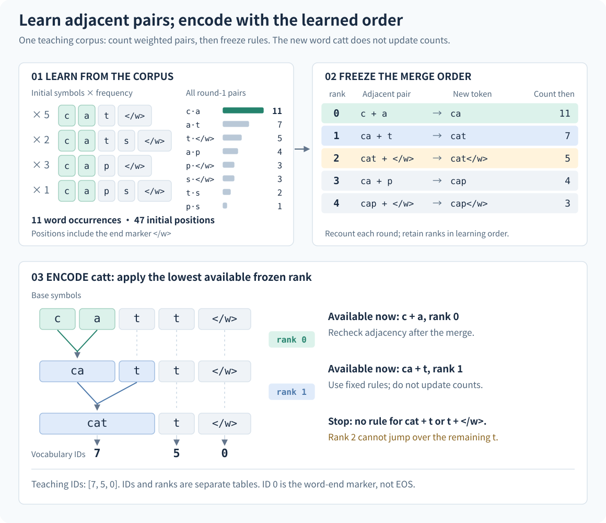

# 9 Tokenizer: from text to a fixed vocabulary

## Why the same sentence can have different input lengths

When we read a sentence, we naturally recognize characters, words, and punctuation. A model receives integers. Before giving it “猫坐下” (“the cat sits down”), we must decide whether each Chinese character occupies one position or whether “坐下” is one unit. Does the English word `cats` occupy one position, or two positions for `cat` and `s`? A **tokenizer** makes these decisions before the neural network begins its computation.

Tokenization is broader than identifying complete words. A **token** can be a word, part of a word, a Chinese character, or a byte in a UTF-8 representation. Different tokenizers can produce different sequence lengths for the same text. A model that accepts 4096 tokens therefore does not necessarily accept 4096 Chinese characters or 4096 English words. Earlier chapters established which text belongs in the training distribution. We now decide how to represent that text as a discrete sequence.

For raw text \(u\), write the output of tokenizer \(\tau\) as

$$
\tau(u)=s=(s_1,\ldots,s_{n_u}),\qquad s_t\in\{0,\ldots,V-1\}.
$$

Here \(n_u\) counts tokens produced from this text and \(V\) is the vocabulary size. Later, \(L\) retains its book-wide meaning as the number of model input positions in a window; one document can contribute several windows. A **vocabulary** maps tokens to integer IDs. Assigning 17 to “猫” and 42 to “坐下” is one possible teaching convention. The fact that 17 is smaller than 42 says nothing about their meanings: these integers are addresses for a lookup. Model training will learn the vectors stored at those addresses.

A tokenizer affects the number of training positions, context coverage, and parameter count. It is part of the training design. We will first work through a complete BPE example, then distinguish other common methods, and finally connect tokenization to the training script, model dimensions, and data shards.

## A vocabulary does not specify a complete tokenizer

Suppose a vocabulary contains `c`, `a`, `t`, `ca`, and `cat`. The string `cat` has at least three valid segmentations: `c | a | t`, `ca | t`, and `cat`. The vocabulary tells us which pieces are available, but not which segmentation to choose. The selection rules must also be saved.

A **normalizer** determines whether full-width letters become ordinary letters and whether certain Unicode representations are combined. A **pre-tokenizer** establishes initial boundaries within which further segmentation can occur. The **encoder** applies fixed segmentation rules and maps pieces to IDs. The **decoder** reconstructs text from IDs. Special tokens represent control information such as document boundaries and padding.

~~~text
raw text → normalization → pre-tokenization → learned segmentation → vocabulary lookup → IDs
IDs → token lookup → decoding → recoverable text
~~~

The final result is “recoverable text” because an earlier operation may have discarded information. If normalization changes full-width `Ａ` to `A`, decoding cannot determine which form appeared originally. Saving a vocabulary while omitting the normalizer, merge order, or decoder does not save a complete tokenizer.

We must also distinguish two meanings of training. **Tokenizer training** learns a vocabulary and segmentation rules from text statistics. **Language-model training** learns embeddings, attention, MLPs, and other neural parameters from the encoded sequences. The small BPE experiment below needs neither a GPU nor a Transformer. Normally, we train and freeze the tokenizer before producing language-model training data.

## Training BPE from four word types

BPE stands for byte-pair encoding. For text tokenization, it repeatedly replaces frequent adjacent symbol pairs with new symbols. The word “byte” reflects the algorithm's history; we will start with characters to keep the arithmetic visible and discuss bytes later. A primary reference for this application to subword segmentation is [Sennrich et al.'s original paper](https://aclanthology.org/P16-1162/).

### Decide what is being counted

The following corpus is constructed for this chapter. Each row represents a word type; its frequency is the number of occurrences in the full corpus. The four rows do not have equal weight.

| Word type | Frequency | Initial symbol sequence |
|---|---:|---|
| `cat` | 5 | `c · a · t · </w>` |
| `cats` | 2 | `c · a · t · s · </w>` |
| `cap` | 3 | `c · a · p · </w>` |
| `caps` | 1 | `c · a · p · s · </w>` |

The dots only display boundaries between symbols; they are not corpus content. The **end-of-word marker** `</w>` is one indivisible symbol. It distinguishes “this word ends here” from “more characters follow.” It is a boundary symbol in this teaching algorithm, not the language model's EOS. We process words independently, never merge across words, and do not reconstruct sentence whitespace in this experiment.

There are six initial vocabulary symbols: `c`, `a`, `t`, `p`, `s`, and `</w>`. The corpus contains \(5+2+3+1=11\) word occurrences. Multiplying each word's symbol count by its frequency gives

$$
5\times4+2\times5+3\times4+1\times5=47
$$

initial symbol positions. This includes eleven end markers, so it is not the raw character count. We need this counting unit before “reducing sequence length” becomes a precise statement.

Let \(f(w)\) be the frequency of word type \(w\), whose current symbols are
\((q_1^{(w)},\ldots,q_{m_w}^{(w)})\). The weighted count of adjacent pair \((a,b)\) is

$$
C(a,b)=
\sum_w f(w)
\sum_{i=1}^{m_w-1}
\mathbf{1}\!\left[q_i^{(w)}=a,\ q_{i+1}^{(w)}=b\right].
$$

The indicator \(\mathbf{1}[\cdot]\) equals 1 when its condition holds and 0 otherwise. The inner sum counts occurrences within one word type; the outer sum weights them by word frequency. Pair \((c,a)\) appears once in every word type, giving \(5+2+3+1=11\). Pair \((a,t)\) appears only in `cat` and `cats`, giving \(5+2=7\).

Here is the complete initial table, including low-frequency pairs:

| Adjacent pair | Contributing word types | Weighted count |
|---|---|---:|
| `(c, a)` | All four | 11 |
| `(a, t)` | `cat`, `cats` | 7 |
| `(t, </w>)` | `cat` | 5 |
| `(a, p)` | `cap`, `caps` | 4 |
| `(p, </w>)` | `cap` | 3 |
| `(s, </w>)` | `cats`, `caps` | 3 |
| `(t, s)` | `cats` | 2 |
| `(p, s)` | `caps` | 1 |

We are counting adjacent positions, not whether two characters occur anywhere in the same word. Pair `(c,t)` is not adjacent yet and is absent from the table.

### Recompute adjacency after every merge

The first round selects `(c,a)`, the most frequent pair, and replaces it with `ca`. Each word type loses one position. Weighted by frequency, the corpus loses eleven positions, leaving \(47-11=36\).

~~~text
cat   ×5: ca · t · </w>
cats  ×2: ca · t · s · </w>
cap   ×3: ca · p · </w>
caps  ×1: ca · p · s · </w>
~~~

Neither `(c,a)` nor `(a,t)` exists now. New adjacent pairs include `(ca,t)` and `(ca,p)`. Selecting a second pair from the original table would try to merge symbols that are no longer there. Each round must update counts using the **current sequences**.

The table below lists every remaining candidate before each subsequent merge. The number after the colon is its weighted count; the first entry is the selected pair.

| Round | All current pairs and weighted counts |
|---:|---|
| 2 | `(ca,t):7`; `(t,</w>):5`; `(ca,p):4`; `(p,</w>):3`; `(s,</w>):3`; `(t,s):2`; `(p,s):1` |
| 3 | `(cat,</w>):5`; `(ca,p):4`; `(p,</w>):3`; `(s,</w>):3`; `(cat,s):2`; `(p,s):1` |
| 4 | `(ca,p):4`; `(p,</w>):3`; `(s,</w>):3`; `(cat,s):2`; `(p,s):1` |
| 5 | `(cap,</w>):3`; `(s,</w>):3`; `(cat,s):2`; `(cap,s):1` |

Round 2 merges `ca · t` into `cat`. Round 3 merges `cat · </w>` into `cat</w>`. That third merge changes the word type `cat` but leaves `cats` unchanged: in the latter, `cat` is followed by `s`. Round 4 merges `ca · p` into `cap`.

Round 5 has a tie: `(cap,</w>)` and `(s,</w>)` both have count 3. Our implementation first compares counts and then breaks ties by the ascending Unicode lexicographic order of the pair tuple. It compares the first strings, then the second strings if necessary. Since `cap` precedes `s`, it selects `(cap,</w>)`. This is a rule of our teaching implementation, not a claim about every BPE library. Without an explicit tie rule, iteration order can affect the vocabulary.

The complete state after every round is shown below. Each transition replaces only the pair selected for that round.

| State | Added token | `cat` × 5 | `cats` × 2 | `cap` × 3 | `caps` × 1 | Weighted positions |
|---|---|---|---|---|---|---:|
| Initial | — | `c a t </w>` | `c a t s </w>` | `c a p </w>` | `c a p s </w>` | 47 |
| Round 1 | `ca` | `ca t </w>` | `ca t s </w>` | `ca p </w>` | `ca p s </w>` | 36 |
| Round 2 | `cat` | `cat </w>` | `cat s </w>` | `ca p </w>` | `ca p s </w>` | 29 |
| Round 3 | `cat</w>` | `cat</w>` | `cat s </w>` | `ca p </w>` | `ca p s </w>` | 24 |
| Round 4 | `cap` | `cat</w>` | `cat s </w>` | `cap </w>` | `cap s </w>` | 20 |
| Round 5 | `cap</w>` | `cat</w>` | `cat s </w>` | `cap</w>` | `cap s </w>` | 17 |

Five added symbols plus six initial symbols give eleven vocabulary entries. We retain the original characters even if some no longer appear individually in this corpus: new words may still require them.

No selected occurrences overlap in this example, so the reduction in positions equals the chosen pair's count at every round. This is not a universal identity. Sequence `a a a` has two adjacent occurrences of `(a,a)`, but replacing non-overlapping occurrences from left to right gives `aa a` and removes only one position. The script implements that rule explicitly. Pair frequency and the number of actual replacements must not be treated as interchangeable in every corpus.

### Encoding applies merge ranks without learning new frequencies

Now consider `catt`, which was absent from training. Relearning a vocabulary from this input would make its representation depend on the current text and undermine the stable meaning of the IDs used to train the model. Ordinary BPE encoding applies the learned rules.

Assign each rule a **merge rank** in learning order. The script uses ranks starting at zero:

| Rank | Fixed rule |
|---:|---|
| 0 | `c + a → ca` |
| 1 | `ca + t → cat` |
| 2 | `cat + </w> → cat</w>` |
| 3 | `ca + p → cap` |
| 4 | `cap + </w> → cap</w>` |

Encoding starts from base symbols. Among current adjacent pairs that have a learned rule, it selects the smallest rank, applies the merge, and checks adjacency again. It stops when no rule applies.

~~~text
c · a · t · t · </w>
    rank 0
ca · t · t · </w>
    rank 1
cat · t · </w>
    no applicable rule; stop
~~~

Even though `cat</w>` is in the vocabulary, it cannot be used here: another `t` follows `cat`. Another unseen word, `catcap`, uses ranks 0, 1, 3, and 4 to produce `cat | cap</w>`. Neither encoding adds a token or re-estimates corpus frequencies.

Token-to-ID lookup happens after segmentation. The teaching script sorts the initial symbols by Unicode order, then appends learned symbols in order. Thus `catt` becomes `cat | t | </w>` with teaching IDs `[7, 5, 0]`. These IDs belong only to this experiment and must not be copied into a model configuration. This example has no BOS, EOS, or PAD; ID 0 is the end-of-word marker.

<figure class="book-figure book-figure--diagram" markdown="1">

{target="_blank" rel="noopener"}

<figcaption markdown="span">
**Figure 9.1**　Identify the four word types contributing to the count of eleven for `(c,a)`, then trace the new word using frozen ranks. Merged ribbons retain their original spans: the second `t` prevents `cat` from being adjacent to the end marker, so rank 2 cannot apply. Vocabulary IDs are looked up only at the end; IDs and ranks serve different roles. Numbers are hand-derived from the corpus above.
</figcaption>

[Open SVG](../../assets/figures/bpe-learning-vs-encoding.svg){target="_blank" rel="noopener"}
[PNG · 2×](../../assets/figures/exports/bpe-learning-vs-encoding.png){download="bpe-learning-vs-encoding.png"}
[Vector PDF](../../assets/figures/exports/bpe-learning-vs-encoding.pdf){download="bpe-learning-vs-encoding.pdf"}
[TikZ](../../assets/figures/bpe-learning-vs-encoding.tex){download="bpe-learning-vs-encoding.tex"}
Scroll on narrow screens; open the image for full size.

</figure>

### Produce an artifact that can be checked against the arithmetic

The repository's [`examples/book/bpe_walkthrough.py`](https://github.com/WenbinWang12/Modern-Sequence-Models-from-Scratch/blob/main/examples/book/bpe_walkthrough.py) uses only the Python standard library. Counting, merging, training, and encoding are separate functions. The two key decisions are visible directly:

~~~python
# 训练：频次优先，同频时按 pair 字典序决定。
chosen = min(counts, key=lambda pair: (-counts[pair], pair))

# 编码：只在已有规则中选 rank 最小的一项。
pair = min(candidates, key=lambda candidate: ranks[candidate])
~~~

From the repository root in the prepared Linux experiment environment, run:

~~~bash
.venv/bin/python examples/book/bpe_walkthrough.py \
  --output outputs/book/bpe-walkthrough.json
~~~

The output contains the before-and-after sequences for every round, all pair counts, the final vocabulary, encoding traces for new words, the Python version, and the script's SHA-256. **The theoretical calculation above** predicts selected counts `[11, 7, 5, 4, 3]` and positions changing from 47 to `[36, 29, 24, 20, 17]`. Those are hand-computed expectations; the generated JSON is the evidence from your particular run.

The script refuses to overwrite an existing report; choose a new output filename for another run. It deliberately handles individual words over its known base alphabet and rejects “猫” because that character is absent. Being able to form unseen words does not imply being able to represent every writing system. Coverage needs a separate solution in a production tokenizer.

## WordPiece and Unigram make different segmentation decisions

For each method, ask what training saves and how encoding selects a segmentation. Sharing the appearance of a subword vocabulary does not imply sharing an algorithm.

### One concrete meaning of WordPiece: BERT's encoder

Consider BERT's WordPiece encoder specifically. It starts at the left of a word and chooses the longest matching vocabulary piece. Pieces inside the word carry the prefix `##`. If a teaching vocabulary contains `cat` and `##s` but not `cats`, the word `cats` becomes `cat | ##s`. The prefix marks a continuation; it does not represent two literal hash characters.

If the remaining suffix cannot be segmented, BERT's implementation replaces that word with the unknown token rather than learning a new rule. This behavior can be checked in [WordpieceTokenizer in BERT's original tokenization.py](https://github.com/google-research/bert/blob/master/tokenization.py). We have specified that implementation's **longest-match encoding**. WordPiece vocabulary training should not be equated with the maximum-pair-count BPE procedure above, and this chapter does not implement a complete WordPiece trainer. The repository's production entry point supports BPE and Unigram.

### Unigram assigns probabilities to alternative segmentations

Unigram assigns a probability to each vocabulary piece. For candidate segmentation \(\sigma=(v_1,\ldots,v_K)\), the independent-piece assumption gives the score

$$
P(\sigma)=\prod_{j=1}^{K}p(v_j),
\qquad \sum_{v\in\mathcal V}p(v)=1.
$$

Here \(\mathcal V\) is the set of pieces. Independence is an assumption used by this segmentation model, not a claim that natural-language words are unrelated. These probabilities are also separate from the conditional probabilities learned by the later neural language model.

Use `cat` again with the following stipulated five-piece vocabulary:

| Piece | `c` | `a` | `t` | `ca` | `cat` |
|---|---:|---:|---:|---:|---:|
| \(p(v)\) | 0.10 | 0.10 | 0.20 | 0.25 | 0.35 |

The probabilities sum to one. The three legal segmentations receive scores

$$
\begin{aligned}
P([\texttt{cat}])&=0.35,\\
P([\texttt{ca},\texttt{t}])&=0.25\times0.20=0.05,\\
P([\texttt{c},\texttt{a},\texttt{t}])&=0.10\times0.10\times0.20=0.002.
\end{aligned}
$$

The maximum-score segmentation is `cat`. To sample among these segmentations, first normalize for the same observed string. The total score is \(0.402\), so the conditional probability of the single-piece segmentation is \(0.35/0.402\approx0.871\), not 0.35. Changing the piece probabilities can change the best segmentation. There are no merge ranks in this decision.

Long strings have too many segmentations to enumerate explicitly. Since logarithms are increasing, maximizing a product is equivalent to maximizing the sum of its logarithms. Let \(D(j)\) be the best log score for the first \(j\) characters, with \(D(0)=0\) for the empty prefix. Then

$$
D(j)=
\max_{\substack{0\le i<j\\u_{i+1:j}\in\mathcal V}}
\left[D(i)+\log p(u_{i+1:j})\right].
$$

The recurrence tries each possible starting point for the last piece and attaches it to the best preceding prefix. Recording the selected starting points lets us trace backward from the end and recover the segmentation. In the example, the best two-character score is \(\log0.25\). At the third character, comparing \(\log0.35\) with \(\log0.25+\log0.20\) selects the whole `cat`. Uncoverable prefixes receive a score of negative infinity.

The probabilities above were chosen for illustration. Training must estimate them and shrink the candidate vocabulary. If \(\mathcal S(u)\) contains every segmentation that concatenates to \(u\), training seeks to **maximize** the following log likelihood. A loss to minimize would require a minus sign in front of the entire expression:

$$
\mathcal J_{\mathrm{tok}}
=\sum_u f(u)\log
\left[
\sum_{\sigma\in\mathcal S(u)}
\prod_{v\in\sigma}p(v)
\right].
$$

First sum the scores of alternative segmentations of the same string, then accumulate log likelihood weighted by text frequency. Training alternates between estimating segmentation statistics and updating probabilities, while progressively removing less useful candidates and protecting required base characters. See [Kudo's original Unigram subword-model paper](https://aclanthology.org/P18-1007/). This section explains scores, best segmentation, and the training objective. It does not derive every EM update, candidate-generation step, or pruning operation; experiments use a pinned library implementation for those.

SentencePiece is a toolkit supporting methods including BPE and Unigram. Listing “BPE, Unigram, SentencePiece” as three algorithms at the same level mixes methods with their implementation tools.

## From character coverage to byte coverage

Character BPE can encode only characters in its initial alphabet. Enumerating every possible character is inconvenient for multilingual text. An alternative is to represent text as UTF-8 bytes. A byte has one of 256 values, from 0 to 255. If every base byte is representable, valid UTF-8 text can be decomposed into known units. Frequent byte sequences can then become BPE merges or pieces in a Unigram model.

Three operations must be distinguished. The **ByteLevel pre-tokenizer** maps bytes to character representations used by the segmentation algorithm. A **complete initial alphabet** requires the trainer to retain all 256 base representations, including those absent from the training sample. The **ByteLevel decoder** converts those representations back into bytes and text. Configuring the pre-tokenizer does not replace the other two steps. The [BpeTrainer and UnigramTrainer APIs in Tokenizers 0.22.2](https://raw.githubusercontent.com/huggingface/tokenizers/v0.22.2/bindings/python/py_src/tokenizers/trainers/__init__.pyi) both accept `initial_alphabet`; the [Unigram training source](https://github.com/huggingface/tokenizers/blob/v0.22.2/tokenizers/src/models/unigram/trainer.rs) includes it among required characters.

The repository script now passes `ByteLevel.alphabet()` to both trainers and installs the decoder. Their segmentation algorithms remain different: BPE learns merge rules, while Unigram learns piece scores. A complete byte representation is also distinct from the `<0xXX>` unknown-character fallback protocol used by some other tokenizers.

With four additional special tokens, the requested vocabulary must contain at least \(256+4=260\) entries. This is a lower bound for fitting the base units, not a guarantee that training produces exactly the requested size. Small corpora, insufficient BPE pairs, or library training constraints can make the actual size differ. Model configuration must use the produced artifact.

### Complete bytes do not imply lossless recovery of the original text

The script applies NFKC normalization. Original text `Ａ① 猫🙂` becomes `A1 猫🙂`. Recovering the latter demonstrates preservation of the **normalized text**; it does not recover the original full-width letter or circled digit. Compatibility distinctions preserved by NFC in the cleaning chapter can still disappear at this tokenizer stage, so the upstream cleaning rule alone does not establish an end-to-end lossless pipeline.

For ordinary text that is not interpreted as control tokens, with additional whitespace cleanup disabled, our check is therefore

$$
\operatorname{decode}\!\left(\operatorname{encode}(u)\right)
=\operatorname{NFKC}(u),
$$

not unconditional equality with \(u\). Disable automatic special-token insertion for this check, and include unseen Chinese characters, emoji, newlines, tabs, and compatibility characters. The `--no-byte-level` option uses Whitespace pre-tokenization instead. That experimental path does not preserve arbitrary original whitespace or guarantee complete byte coverage, so it cannot inherit this round-trip expectation. If an experiment must retain compatibility distinctions, choose a different normalization policy **before** training its tokenizer.

The repository also provides a training-free `ByteTokenizer`. Bytes 0–255 map to IDs 3–258; PAD, BOS, and EOS have IDs 0, 1, and 2. Its vocabulary size is 259, and it does not apply the NFKC normalization above. It is useful for checking data/model interfaces, but produces longer sequences: a common Chinese character typically occupies three UTF-8 bytes. Complete coverage and compact representation are separate properties.

## How vocabulary size fixes model input and output dimensions

An ID is not a vector. The model first uses an embedding matrix to look it up. For hidden width \(d\),

$$
E\in\mathbb R^{V\times d},\qquad
s_t\longmapsto E_{s_t,:}\in\mathbb R^d.
$$

Each token occupies a row, so a larger vocabulary means more rows. After several layers of computation, the model produces a hidden vector \(h\) of width \(d\). Predicting the next token requires a score for every vocabulary candidate:

$$
z=hW_{\mathrm{out}},\qquad
W_{\mathrm{out}}\in\mathbb R^{d\times V},\qquad
z\in\mathbb R^V.
$$

Here \(h\) is written as a row vector. The components of \(z\) are logits; softmax converts them to probabilities that sum to one. **Once the vocabulary is fixed, the final classification head must output \(V\) scores.** The MLP intermediate width can be chosen separately, but in this architecture its output returns to the residual width \(d\); the final vocabulary projection maps \(d\) to \(V\).

Input embeddings and the output projection may share parameters, called **tied embeddings**, by setting \(W_{\mathrm{out}}=E^{\mathsf T}\). Without tying, each matrix contains \(Vd\) parameters. With tying, only one copy is stored. Ignoring biases:

| \(V\) | \(d\) | Parameters in one embedding, \(Vd\) |
|---:|---:|---:|
| 259 | 16 | 4,144 |
| 32,000 | 16 | 512,000 |
| 128,000 | 16 | 2,048,000 |
| 32,000 | 768 | 24,576,000 |
| 128,000 | 768 | 98,304,000 |

A larger vocabulary may encode common text in fewer positions, but requires larger embeddings and output projections. Rare tokens may also receive too few training examples. Vocabulary selection must consider compression, language and domain coverage, model size, and training budget together.

## Train and preserve a reusable tokenizer

The production entry point is [`scripts/train_tokenizer.py`](https://github.com/WenbinWang12/Modern-Sequence-Models-from-Scratch/blob/main/scripts/train_tokenizer.py). The following assumes `.tools/uv` and `.venv` have already been prepared as described in the environment chapter. Add tokenizer dependencies while retaining other installed extras:

~~~bash
.tools/uv sync --frozen --inexact --python .venv/bin/python --extra tokenizer
~~~

Use only the training portion after cleaning, deduplication, and splitting. Do not include validation or test text when selecting the vocabulary. Even without training a neural network, seeing evaluation text can change the vocabulary and encoded lengths. Record the language and domain proportions of tokenizer training data as well: merges learned from a small English-only sample may be unsuitable for a bilingual model.

Prepare `data/tokenizer/train.jsonl` with one JSON object per line and a string field named `text`. This is a training-entry example; the repository does not supply that production corpus automatically:

~~~bash
.venv/bin/python scripts/train_tokenizer.py \
  --input data/tokenizer/train.jsonl \
  --output outputs/tokenizer-32k \
  --algorithm bpe --vocab-size 32000 --text-key text
~~~

The script writes JSONL text fields to temporary text files, converts CRLF/CR to LF, appends a newline after each record, and preserves embedded newlines. The tokenizer trainer therefore reads text-file lines; one temporary line need not correspond to one original JSONL document. Document-boundary protocols are handled later when preparing language-model data.

Byte-level processing is enabled by default. `--algorithm unigram` changes both model and trainer. `--min-frequency` affects only BPE; `--max-piece-length` affects only Unigram. The important coverage setting is:

~~~python
initial_alphabet = sorted(pre_tokenizers.ByteLevel.alphabet())

# 两种 trainer 都传入同一套基础字节表示。
trainer = trainers.BpeTrainer(
    vocab_size=32_000,
    initial_alphabet=initial_alphabet,
    special_tokens=["<pad>", "<bos>", "<eos>", "<unk>"],
)
~~~

This fragment explains the configuration relationship; the script above remains the complete executable entry point. It also installs NFKC, the ByteLevel pre-tokenizer, and decoder, then saves a Hugging Face tokenizer directory. Its `tokenizer_metadata.json` records requested and actual vocabulary sizes, special IDs, normalizer, decoder, alphabet size, library versions, input digests, and the SHA-256 of `tokenizer.json`.

A digest identifies file contents. It does not guarantee that retraining under another library version, parallel schedule, or tie implementation reproduces identical bytes. The teaching BPE defines its tie rule explicitly; production experiments should preserve the pinned library environment and final artifact. The script rejects existing output directories and checks both source and actual training-text digests before and after training, refusing to save a tokenizer if either changes. Metadata records source and converted training-text digests separately. Use a fresh path and archive the complete directory with metadata for each experiment.

## Checks before connecting the tokenizer to data preparation

First check **representation correctness**: IDs are in \([0,V)\), special IDs do not conflict, unknown inputs have the intended behavior, and encode/decode agrees with the normalization policy. The repository's `tests/test_tokenizer_training.py` trains BPE and Unigram on ASCII-only text, then checks unseen Chinese characters, emoji, whitespace, and NFKC changes. This verifies coverage and interfaces, not language quality.

Second check **encoding cost**. For fixed raw text, let \(N_{\mathrm{bytes}}\) be its UTF-8 byte count and \(T\) its ordinary-token count. Report

$$
r_{\mathrm{tok/byte}}=\frac{T}{N_{\mathrm{bytes}}}.
$$

Use the same raw text and byte-counting convention for both tokenizers, and state whether BOS/EOS are included. For the same 1000 bytes, 500 tokens give a ratio of 0.5 and 800 tokens give 0.8. The former uses fewer training positions; this does not establish better model quality.

Break the ratio down by language and domain, then inspect document-length distributions, truncation rates, UNK rates, and special-token frequencies. A global average can hide longer Chinese sequences, damaged code indentation, or frequent unknown tokens in a smaller language. Per-token cross-entropy is not directly comparable across tokenizers either: the events being predicted have changed.

Third check the **special-token protocol**. BOS marks a sequence start, EOS a sequence or document end, PAD padding, and UNK an unknown item. Their strings, IDs, insertion points, and loss treatment must agree. Declaring a BOS ID does not imply that every `encode` call inserts it automatically. Adding it again in data preparation can also create duplicates.

[`ttt.data`](https://github.com/WenbinWang12/Modern-Sequence-Models-from-Scratch/blob/main/ttt/data.py) provides `ByteTokenizer` and `HuggingFaceTokenizer`. The latter calls `encode(add_special_tokens=False)`, then manually adds BOS according to configuration. Data preparation appends EOS. Current behavior is summarized below; the next chapter explains loss masks position by position.

| Data path | BOS | EOS | Loss mask |
|---|---|---|---|
| Ordinary NPY | Added by `encode` if a BOS ID exists | Appended per document if an EOS ID exists | No separate mask file; targets are valid by default |
| Sharded ordinary LM | Same | Same | BOS is 0; other tokens are 1 |
| Sharded supervised data | Added to prompt, not repeated for response | Appended after response | Prompt is 0; response and EOS are 1 |

Pass the fixed local tokenizer directory when producing shards. These are alternative experiments: replace `corpus.jsonl` with prepared data, and train the tokenizer before running the second command.

~~~bash
.venv/bin/python -m ttt.data --input corpus.jsonl \
  --output data/pretrain-byte --sharded --tokenizer byte

.venv/bin/python -m ttt.data --input corpus.jsonl \
  --output data/pretrain-bpe --sharded --tokenizer outputs/tokenizer-32k
~~~

The commands use separate output directories. The data manifest records the tokenizer name, vocabulary size, and input/shard digests. Archive special IDs, normalization, library versions, and tokenizer digests alongside the training script's metadata; do not assume the data manifest automatically includes them all. Loading a remote tokenizer also requires fixing its revision and local files. The current CLI does not expose a separate revision argument.

A tokenizer's identity includes its vocabulary, segmentation rules, and surrounding processing, not just vocabulary size. Replacing it requires rebuilding token shards and checking actual \(V\) against model configuration. Old IDs may remain in range while referring to different tokens. An existing checkpoint cannot be made compatible merely by changing `vocab_size`.

We now have a token stream with defined meaning. The next chapter turns that stream into fixed model windows: which positions become inputs, which become prediction targets, and how document boundaries affect supervision and visible context.
