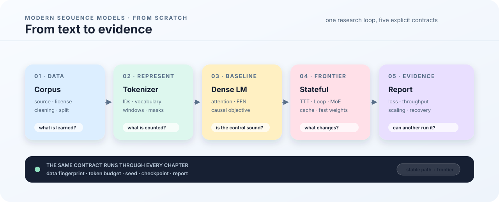

# From Scratch: Modern Sequence Models

This is the English edition of a book under active development. It follows the same concepts, code, configurations, and experimental protocols as the Chinese edition, distinguishing implemented paths, standalone teaching examples, and planned experiments.

The manuscript remains under revision and has not passed publication review. See the [editorial records](https://github.com/WenbinWang12/Modern-Sequence-Models-from-Scratch/tree/main/editorial) for paragraph-level findings, revisions, and pending checks.

The data section now includes five inspectable experiments: [source records](11_data_acquisition.md), Unicode cleaning, MinHash deduplication, grouped splits, and the [complete BPE learning and encoding process](15_tokenizer.md). Inputs, scripts, and a shared validation entry point are in the [chapter examples directory](https://github.com/WenbinWang12/Modern-Sequence-Models-from-Scratch/tree/main/examples/book). Hand-derived expectations are distinguished from runtime evidence.

<figure class="book-figure">
  
  <figcaption><strong>Figure 1. The book spine.</strong> Every model claim passes through data, budget, implementation, and evidence; Frontier Lab reuses the same experiment contract.</figcaption>
</figure>

The intended learning sequence connects the following functions; section headings vary with the chapter's question:

```text
Question → Theory → Code → Remote experiment → Evidence → Next question
```

The stable path starts with the training system and data, establishes a dense causal-language-model baseline, and then moves to TTT-E2E, streaming state, sparse models, scaling, and GPU validation. The Frontier Lab tracks fast-moving topics such as TTT and linear attention, recurrent-depth Transformers, and long-context learning. A chapter is complete when its code path, command, and evidence are clear, including the limits of what has been verified.

## Book map

| Part | Question | Main artifacts |
|---|---|---|
| Prologue | Why train a base model from scratch? | system map and research boundary |
| Part I | How do we make a run start, resume, and explain itself? | experiment contract, environment, config, checkpoints, provenance |
| Part II | What data distribution does the model learn? | source records, cleaning, tokenizer, manifests, preflight |
| Part III | Is the dense causal baseline trustworthy? | fixed-budget baseline |
| Part IV | Where do TTT fast weights update? | forward path and inner/outer loops |
| Part V | How do caches, streaming, and experts change the system? | runtime, MoE, mesh, restore reports |
| Part VI | How do we separate architecture gains from cost? | ablation matrix, profiling, GPU validation |

The stable path establishes the protocol first. [Frontier Lab](../../frontier/en/index.md) can move faster, but its claims should reuse the mainline data, training, and evaluation contract before they are compared with the baseline.

Start with [Notation and conventions](notation.md) and the [mathematics and deep-learning toolkit](00_prerequisites.md), then read [Why train a base model](00_why_pretrain.md) and [The experiment contract](01_experiment_contract.md).
