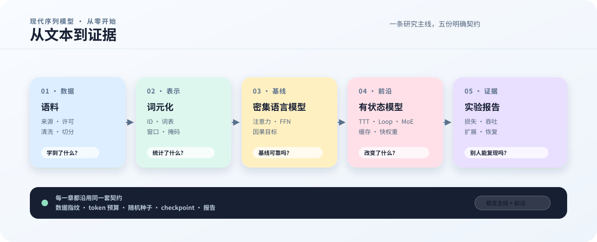

# Modern Sequence Models — From Scratch

这是一本正在撰写和实验的现代序列模型训练书。主线从数据、tokenizer 和 dense baseline 开始，逐步进入 TTT、线性注意力、Loop、MoE、长上下文和多卡训练。章节连接概念、推导、实现和实验；已实现路径、独立教学示例和待完成实验分别标注。

当前为修订稿，尚未达到出版标准。逐章逐段意见、修复记录及未验收项目见[编辑与审稿记录](https://github.com/WenbinWang12/Modern-Sequence-Models-from-Scratch/tree/main/editorial)。

数据部分已补充五个可以逐步核对的小实验：从[来源记录](book/11_data_acquisition.md)开始，经过 Unicode 清洗、MinHash 去重和按组切分，走到[BPE 的完整学习与编码过程](book/15_tokenizer.md)。配套输入、脚本和统一运行说明见[章节实验目录](https://github.com/WenbinWang12/Modern-Sequence-Models-from-Scratch/tree/main/examples/book)。正文中的手算预期与实际运行证据分开标注。

<figure class="book-figure">
  
  <figcaption><strong>图 1　全书主线。</strong> 每个模型结论都要经过数据、预算、实现和证据四层约束；Frontier Lab 复用同一条实验协议。</figcaption>
</figure>

## 阅读方式

阅读一章时，可以沿着下面的关系理解内容；各章按问题组织，不机械套用相同标题：

1. **问题**：这一章要解决什么训练或系统问题；
2. **原理**：哪些概念和约束决定了实现；
3. **代码**：对应的模型、训练或基础设施文件；
4. **实验**：在远端 CPU/GPU 机器上执行的命令；
5. **证据**：日志、检查点、环境摘要和验证报告；
6. **下一步**：下一章会改变什么，哪些结论还没有得到证明。

## 当前路线

我们先用 tiny 配置确认数据、内循环、外循环、检查点和恢复都能工作，再逐步进入 125M、760M、MoE、多卡 mesh 和 GPU 规模验证。官方权重、完整 RULER 和 128K 长上下文属于后续实验，需要额外数据和硬件条件。

前沿问题单独放在 [Frontier Lab](frontier/index.md)：TTT 与线性注意力的关系、TTT-E2E 长上下文和 Looped Transformer 会按论文版本和复现实验更新。它们是研究雷达，不会覆盖主线教材已经验证的结论。

## 全书地图

| 部分 | 要回答的问题 | 主要产物 |
|---|---|---|
| 序章 | 为什么要从零训练基模 | 系统全景、变量关系和研究边界 |
| Part I 实验契约 | 怎样让一次运行可启动、可恢复、可审计 | 研究主张、环境快照、配置、checkpoint 和运行记录 |
| Part II 数据 | 模型究竟从哪一批数据中学习 | 来源记录、清洗报告、tokenizer、manifest 和 preflight |
| Part III 基线 | dense Causal LM 是否已经可靠 | 固定数据和预算的 baseline |
| Part IV TTT-E2E | 快权重在哪里更新，梯度怎样传播 | 前向、内循环、外循环和状态边界 |
| Part V 扩展 | 缓存、流式推理和专家并行怎样改变系统 | runtime、MoE、mesh 和恢复报告 |
| Part VI 实验 | 如何把结构收益与成本分开 | 消融矩阵、profiler 数据和 GPU 验证 |

主线章节优先建立稳定的实验协议；Frontier Lab 允许更快地加入新论文和新假设。只有当一个前沿想法能够复用主线的数据、训练和评估协议时，才把它写成可比较的结果。

开始阅读：[为什么训练基模](book/00_why_pretrain.md)，然后阅读[实验契约](book/01_experiment_contract.md)。
