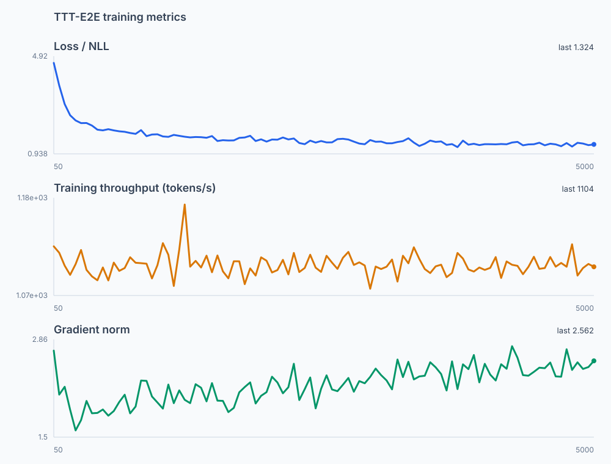

# CPU Pilot 1M：训练曲线

这张图读取远端 `cpu-pilot-1m-formal/metrics.jsonl` 的已记录点，展示训练 loss/NLL、吞吐、梯度范数和快权重范数。图中的最后一步会随着训练推进而更新；缺少的指标不会被补成零。

这次 pilot 使用约 1.02M 参数、byte tokenizer、WikiText-2 train split 和 5,000 步配置。它用于验证训练稳定性、checkpoint、恢复和数据记录，不代表与大模型进行公平能力比较。独立评估取 256 个窗口：无适应时 validation NLL/PPL 为 `1.2814 / 3.6016`，test NLL/PPL 为 `1.2912 / 3.6370`；允许会话内适应时分别为 `1.2715 / 3.5661` 和 `1.2779 / 3.5892`。这些 PPL 使用 byte tokenizer，不能直接和 BPE/SentencePiece 模型横向比较。
