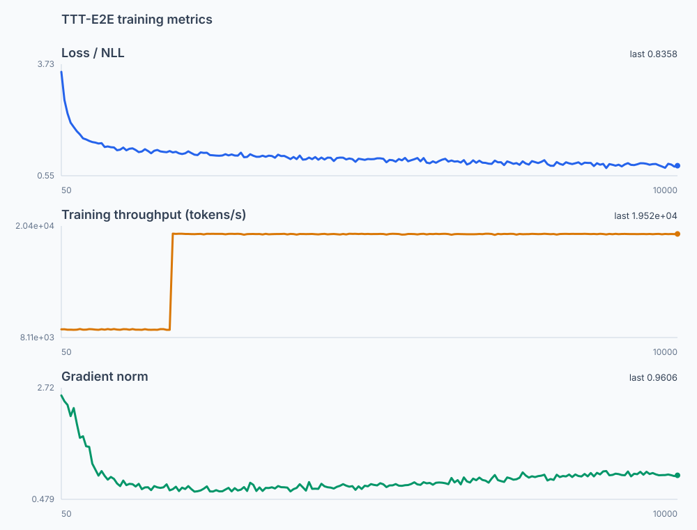

# H200 15M Scaling：TTT 与 plain baseline

本实验在 H200 GPU 5 和 GPU 7 上分别运行两个独立进程，没有使用多卡分布式。两组使用相同的 WikiText-2 train split、byte tokenizer、seed、sequence length、batch size、训练步数和 token budget。

| 组别 | GPU | 实际参数 | steps | tokens | train tokens/s | 峰值显存 |
|---|---:|---:|---:|---:|---:|---:|
| TTT | 5 | 15,449,856 | 10,000 | 40,960,000 | 约 19.5k | 约 1.87 GiB |
| Plain baseline | 7 | 15,449,856 | 10,000 | 40,960,000 | 约 57.2k | 约 0.84 GiB |

## 训练曲线

## Held-out 结果

评测使用独立 validation/test manifest、sequence length 512、256 个窗口和约 130k 有效 token：

| 模型 | validation PPL | test PPL |
|---|---:|---:|
| Plain baseline | 2.7279 | 2.6865 |
| TTT no-adapt | 2.7522 | 2.7082 |
| TTT adapt | 2.6642 | 2.6109 |

TTT 在 no-adapt 状态下略差于 plain baseline；启用会话内适应后，test PPL 改善约 0.0755。这个收益伴随约 2.9 倍训练吞吐成本和更高状态/显存开销，因此只能报告为当前配对实验结果，不能外推成普适优势。

完整 checkpoint、metrics、评测 JSON 和环境报告保存在 H200 机器的独立输出目录；仓库中的图由远端原始 JSONL 指标生成。
