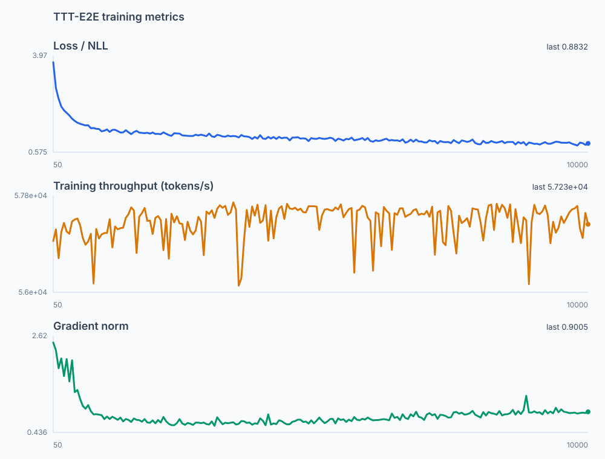

# H200 15M Scaling：TTT 与 plain baseline

!!! note "历史记录"
    本页是 2026-11-17 流程验证阶段的记录（小模型、字节级 tokenizer、WikiText-2），用于确认训练和评测链路可用，不代表模型能力。正式实验和结论见 [TTT-E2E 技术报告](../technical_report.md)。

本实验在 H200 GPU 5 和 GPU 7 上分别运行两个独立进程，没有使用多卡分布式。两组使用相同的 WikiText-2 train split、byte tokenizer、seed、sequence length、batch size、训练步数和 token budget。

| 组别 | GPU | 实际参数 | steps | tokens | train tokens/s | 峰值显存 |
|---|---:|---:|---:|---:|---:|---:|
| TTT | 5 | 15,449,856 | 10,000 | 40,960,000 | 约 19.5k | 约 1.87 GiB |
| Plain baseline | 7 | 15,449,856 | 10,000 | 40,960,000 | 约 57.2k | 约 0.84 GiB |

## 训练曲线

## Held-out 结果

评测使用独立 validation/test manifest、sequence length 512、256 个窗口和约 130k 有效 token：

| 模型 | validation PPL | test PPL |
|---|---:|---:|
| Plain baseline | 2.7279 | 2.6865 |
| TTT no-adapt | 2.7522 | 2.7082 |
| TTT adapt | 2.6642 | 2.6109 |

TTT 在 no-adapt 状态下略差于 plain baseline；启用会话内适应后，test PPL 改善约 0.0755。这个收益伴随约 2.9 倍训练吞吐成本和更高状态/显存开销，因此只能报告为当前配对实验结果，不能外推成普适优势。

完整 checkpoint、metrics、评测 JSON 和环境报告保存在 H200 机器的独立输出目录；仓库中的图由远端原始 JSONL 指标生成。

## 85/15 混合数据配对实验

随后使用同一个 15M 配置和 40,960,000 token 预算，把训练来源改成版本化 recipe：WikiText-2 train 窗口占 85%，Tiny Shakespeare 窗口占 15%，`with_replacement`，seed 仍为 0。采样器审计了 80,000 个窗口，实际来源比例为 68,075/11,925，即 85.09375%/14.90625%。TTT 在 GPU5、plain baseline 在 GPU7 独立运行，仍没有跨卡通信。

| 模型 | validation PPL | test PPL | MMLU 诊断准确率 |
|---|---:|---:|---:|
| Plain baseline | 2.7555 | 2.6966 | 29.59% (392 有效样本) |
| TTT no-adapt | 2.7664 | 2.7105 | 26.53% (392 有效样本) |
| TTT adapt | 2.6765 | 2.6223 | — |

PPL 使用 WikiText-2 validation/test，各 128 个随机窗口、约 65k 有效 token；MMLU 使用五个科目、每科最多 100 题、byte tokenizer、512 token 上限和 no-adapt。由于这是 15M 非 instruction-tuned byte 模型，MMLU 只作诊断，不能与厂商榜单直接比较；professional_law 中有 95/100 题因固定上下文上限被跳过，已经计入总审计而没有静默截断。

混合 recipe SHA256 为 `f033e8e281813f7652e1d489193e3e7ce9dc5846419807165d83c5a8dc4aa610`；MMLU 压缩包 SHA256 为 `91d1fe0e3a0dde2e8d8af25f537ee0ec6c6378a499845c80f78f67cbe2d38e9e`。原始 JSON 结果保存在 H200 的 `outputs/benchmarks/` 目录，后续应在多 seed、固定 tokenizer 和更大模型上重复后再进入论文主表。

HellaSwag validation 前 100 题的 continuation 诊断中，baseline 与 TTT no-adapt 都是 32/100（32%）；它们使用完全相同的 byte tokenizer、512 token 上限和题目子集，因此这里只能说本次小样本没有观察到差异。仓库也保存了 [baseline HellaSwag JSON](../assets/reports/hellaswag_baseline_100.json) 和 [TTT HellaSwag JSON](../assets/reports/hellaswag_ttt_100.json)。

仓库也保存了本次远端运行导出的 [来源比例审计](../assets/reports/h200_mixture_source_probe.json)、[baseline MMLU](../assets/reports/mmlu_baseline_mixture_5x100.json)、[TTT MMLU](../assets/reports/mmlu_ttt_mixture_5x100.json)、[baseline valid PPL](../assets/reports/ppl_baseline_mixture_valid.json)、[baseline test PPL](../assets/reports/ppl_baseline_mixture_test.json)、[TTT no-adapt valid PPL](../assets/reports/ppl_ttt_mixture_noadapt_valid.json)、[TTT no-adapt test PPL](../assets/reports/ppl_ttt_mixture_noadapt_test.json)、[TTT adapt valid PPL](../assets/reports/ppl_ttt_mixture_adapt_valid.json) 和 [TTT adapt test PPL](../assets/reports/ppl_ttt_mixture_adapt_test.json)。

## 其他 benchmark 诊断

| 任务 | Plain baseline | TTT no-adapt | 协议 |
|---|---:|---:|---|
| ARC-Challenge | 12/100 | 11/100 | test 前 100 题，答案文本 continuation |
| PIQA | 57/100 | 57/100 | validation 前 100 题，答案文本 continuation |
| GSM8K | 0/100 | 0/100 | greedy numeric exact match |
| HumanEval | 0/50 | 0/50 | 官方测试执行，pass@1 |
| GPQA | 9/32 有效 | 5/32 有效 | test 前 50 题，18/50 因 512-token 上限跳过 |
| BBH sports_understanding | 0/50 | 0/50 | 零样本 greedy normalized exact match |

合成长上下文 key-value 诊断在 256、512、1024 请求长度各取 16 题；baseline、TTT no-adapt 和 TTT adapt 的 exact match 全部为 0。这一项是 RULER/LongBench 的前置工程诊断，不能当作公开套件分数。

对应的 [ARC 结果](../assets/reports/arc_challenge_baseline_100.json)、[TTT ARC 结果](../assets/reports/arc_challenge_ttt_100.json)、[PIQA 结果](../assets/reports/piqa_baseline_100.json)、[TTT PIQA 结果](../assets/reports/piqa_ttt_100.json)、[GPQA baseline](../assets/reports/gpqa_baseline_50.json)、[GPQA TTT](../assets/reports/gpqa_ttt_50.json)、[BBH baseline](../assets/reports/bbh_sports_baseline_50.json)、[BBH TTT](../assets/reports/bbh_sports_ttt_50.json)、[GSM8K baseline](../assets/reports/gsm8k_baseline_100.json)、[GSM8K TTT](../assets/reports/gsm8k_ttt_100.json)、[HumanEval baseline](../assets/reports/humaneval_baseline_50.json)、[HumanEval TTT](../assets/reports/humaneval_ttt_50.json) 和 [长上下文 JSON](../assets/reports/long_ttt_noadapt_16.json) 已随仓库保存。
